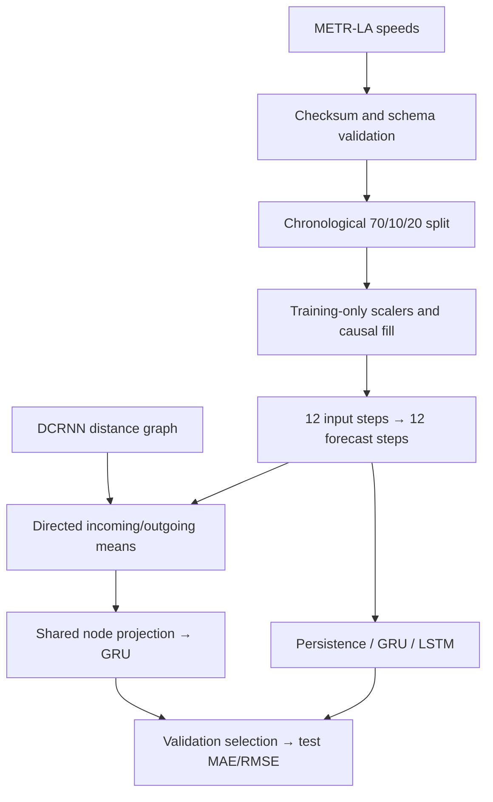

# TraCast

Traffic-speed forecasting on METR-LA. PyTorch recurrent models, directed road-distance features, and Flower federated learning, sized for a CPU laptop.

[Research brief](reports/research-brief.pdf) · [Technical report](reports/research-report.md) · [Run guide](docs/reproducibility.md) · [Data sources](DATA.md) · [Tests](https://github.com/ivanimmanuel-dev/TraCast/actions/workflows/tests.yml)

## Results

Sixteen topology-selected sensors, March–June 2012, five training epochs. Errors are mph, reported as mean (sample SD) over seeds 7, 42, and 2026. Persistence is evaluated once.

| Model | MAE (SD) | RMSE (SD) | Parameters |
|---|---:|---:|---:|
| Persistence | 4.100 | 8.549 | 0 |
| GRU | 3.409 (0.032) | 7.179 (0.033) | 11,136 |
| LSTM | 3.363 (0.007) | 7.091 (0.031) | 12,736 |
| Graph-GRU | 3.364 (0.036) | 7.107 (0.106) | 15,760 |
| Graph-GRU (self only) | 3.368 (0.023) | 7.073 (0.047) | 15,760 |

LSTM nearly matches Graph-GRU's mean MAE with fewer parameters. Removing graph neighbors changes mean MAE by 0.0043 mph, with mixed effects across seeds. The self-only projection retains most of the improvement over GRU.

Five epochs averaged 11.1 s for GRU, 10.9 s for LSTM, and 12.7 s for Graph-GRU on a Ryzen 7 5825U. Whole-process peak memory was about 320 MiB.


[Per-seed metrics and timings](reports/benchmark/results.json) · [Benchmark protocol](reports/benchmark/report.md)

## Federated learning

Three simulated clients hold disjoint sensor subsets and share a univariate GRU. Flower's `ClientApp`, `ServerApp`, and `FedAvg` run through a local SuperLink and Ray. Each sensor uses its own training-only normalization; evaluation pools error sums and valid target counts across clients.

The twelve-sensor, fourteen-day study uses three seeds and one local epoch per round:

| Partition | Rounds | FedAvg MAE | Pooled GRU MAE | Parameter payload |
|---|---:|---:|---:|---:|
| Balanced | 1 | 4.047 | 3.792 | 180,288 B |
| Balanced | 3 | 3.809 | 3.765 | 450,720 B |
| Balanced | 5 | 3.774 | 3.750 | 721,152 B |
| Congestion-grouped | 5 | 3.836 | 3.750 | 721,152 B |

One to five rounds reduces balanced-partition MAE by 0.273 mph at four times the parameter payload. The pooled reference shares initial weights, examples, scalers, masks, and total exposure. Partial batches yield different optimizer-step counts. Payload estimates count model tensors; client ownership is simulated on one host.

[Round convergence, RMSE, client counts, and partition controls](reports/federated-study/findings.md)

## Run

Python 3.11, Windows x64, CPU PyTorch. From the repository directory:

```powershell
py -3.11 -m venv .venv
.\.venv\Scripts\python.exe -m pip install -r requirements-lock.txt
.\.venv\Scripts\python.exe -m pip install -e . --no-deps
.\.venv\Scripts\python.exe -m tracast.cli fetch
.\.venv\Scripts\python.exe -m pytest -q -W error

# Seven-day GRU smoke run
.\.venv\Scripts\python.exe -m tracast.cli run --config configs/smoke.json --out runs/gru-smoke

# Three-client Flower simulation: three rounds, one local epoch
.\.venv\Scripts\python.exe -m tracast.federated --config configs/federated-smoke.json --out runs/flower-smoke
```

For the full comparisons:

```powershell
.\.venv\Scripts\python.exe -m tracast.benchmark --config configs/benchmark.json --out runs/benchmark
.\.venv\Scripts\python.exe -m tracast.federated_study --config configs/federated-study.json --out runs/federated-study
```

The benchmark fetches topology files automatically. Use a fresh output directory for each run. [Configuration, inspection, repeats, and measurement definitions](docs/reproducibility.md).

## Pipeline



Windows stay within their chronological split. Zero/NaN targets are masked. The graph's 16 sensors and 85 directed relationships are selected from topology alone. The self-only ablation keeps the same architecture and parameter count while removing neighbor inputs.

## Reports

| Experiment | Results |
|---|---|
| Recurrent encoders and graph ablation | [Methods](reports/benchmark/report.md), [summary](reports/benchmark/summary.json), [exact repeats](reports/benchmark/repeatability.json) |
| Federated budgets and client distributions | [Findings](reports/federated-study/findings.md), [summary](reports/federated-study/summary.json) |
| Centralized GRU baseline | [Results](reports/centralized-baseline.md) |
| Three-client Flower baseline | [Results](reports/federated-smoke/report.md), [exact repeats](reports/federated-smoke/determinism.json) |

The studies use sensor subsets and one fixed test period. Seed SD measures training variation on those dates. Raw data and checkpoints remain local; committed records include configurations, source/data hashes, scalers, histories, and horizon counts.
