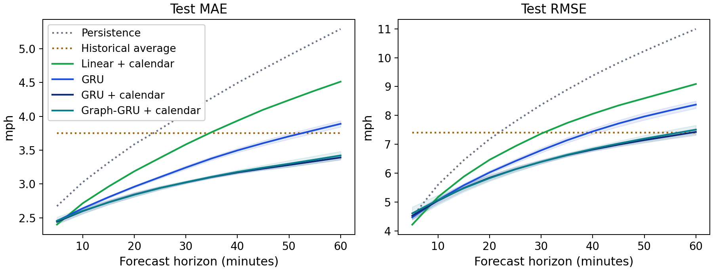
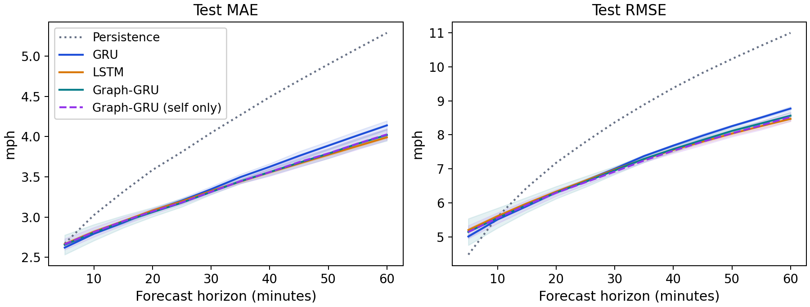
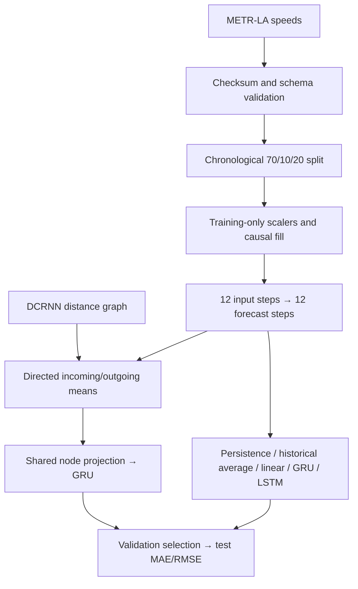

# TraCast

TraCast predicts traffic speed 5 to 60 minutes ahead from the last hour of sensor readings. The data is METR-LA: 207 road sensors in Los Angeles, March to June 2012. Everything runs on a CPU laptop.

I use it to compare a few things: GRU vs LSTM vs a plain linear model, whether the road graph helps, whether knowing the time of day helps, and federated training vs centralized vs training each client alone.

[Research brief](reports/research-brief.pdf) · [Technical report](reports/research-report.md) · [Run guide](docs/reproducibility.md) · [Data sources](DATA.md) · [Tests](https://github.com/ivanimmanuel-dev/TraCast/actions/workflows/tests.yml)

## Results

Every model here forecasts 12 steps (60 minutes) from the previous 12, using 16 sensors picked from the DCRNN road-distance graph and the full March to June timeline. The first 70% is train, the next 10% validation, the last 20% test. MAE is mean absolute error and RMSE punishes big misses more; both are in mph.

### Longer training, calendar inputs, baselines

The five-epoch run below stops while the models are still improving, so here each one trains for up to 60 epochs, stops after 8 epochs with no validation gain, and halves the learning rate after 2. I also added calendar inputs (time of day as sine and cosine plus a weekend flag, marked "+ calendar"), a historical-average baseline (the training mean for each sensor, weekday, and 5-minute slot), and a linear model. 5 seeds: 7, 42, 2026, 123, 999.

| Model | MAE (SD) | MAE range over test days | 15 min | 30 min | 60 min | RMSE (SD) | Parameters | Epochs run |
|---|---:|---:|---:|---:|---:|---:|---:|---:|
| Persistence | 4.100 | 3.681–4.469 | 3.316 | 4.048 | 5.290 | 8.549 | 0 | – |
| Historical average | 3.751 | 3.300–4.185 | 3.751 | 3.751 | 3.752 | 7.405 | 0 | – |
| Linear | 3.622 (0.001) | 3.218–3.988 | 2.967 | 3.602 | 4.572 | 7.386 (0.005) | 37,056 | 43 |
| Linear + calendar | 3.597 (0.003) | 3.196–3.962 | 2.961 | 3.584 | 4.512 | 7.373 (0.007) | 43,968 | 39 |
| GRU | 3.255 (0.026) | 2.892–3.602 | 2.805 | 3.243 | 3.889 | 6.873 (0.085) | 11,136 | 37 |
| GRU + calendar | 3.007 (0.025) | 2.687–3.313 | 2.730 | 3.023 | 3.391 | 6.373 (0.078) | 11,424 | 42 |
| LSTM | 3.271 (0.013) | 2.906–3.617 | 2.845 | 3.259 | 3.885 | 6.913 (0.046) | 12,736 | 32 |
| Graph-GRU | 3.193 (0.038) | 2.844–3.527 | 2.779 | 3.195 | 3.765 | 6.743 (0.134) | 15,760 | 37 |
| Graph-GRU + calendar | 3.016 (0.031) | 2.695–3.324 | 2.727 | 3.026 | 3.422 | 6.403 (0.095) | 16,048 | 35 |
| Graph-GRU (self only) | 3.231 (0.037) | 2.872–3.574 | 2.829 | 3.229 | 3.793 | 6.854 (0.109) | 15,760 | 33 |
| Graph-GRU (self only) + calendar | 2.985 (0.039) | 2.666–3.292 | 2.732 | 3.002 | 3.327 | 6.363 (0.162) | 16,048 | 45 |

MAE and RMSE are test means in mph, and the 15/30/60 min columns are MAE at those horizons. The range column resamples the 24 test days, so it shows how much a score depends on which days ended up in the test set. Persistence and the historical average aren't trained, so they run once.

Graph-GRU (self only) + calendar is lowest at 2.985 mph (persistence 4.100, historical average 3.751), but GRU + calendar and Graph-GRU + calendar are within 0.031 mph of it, so I can't rank them. Training longer helped: the GRU went from 3.409 at five epochs to 3.255. Calendar inputs gave the biggest jump: the GRU changes by -0.249 mph (95% CI -0.324 to -0.181). Graph-GRU minus its self-only version (the same model with the neighbor averages zeroed) is -0.038 mph (95% CI -0.062 to -0.018) without calendar inputs and +0.031 mph (95% CI +0.008 to +0.055) with calendar inputs. The sign flips, so the graph doesn't give a reliable gain.

| Difference in MAE (first - second) | Estimate (mph) | 95% CI over test days |
|---|---:|---:|
| GRU + calendar - GRU | -0.249 | -0.324 to -0.181 |
| Linear + calendar - linear | -0.025 | -0.035 to -0.015 |
| Graph-GRU + calendar - Graph-GRU | -0.177 | -0.229 to -0.130 |
| LSTM - GRU | +0.016 | -0.021 to +0.057 |
| Graph-GRU - self only | -0.038 | -0.062 to -0.018 |
| Graph-GRU - self only, both with calendar | +0.031 | +0.008 to +0.055 |
| Graph-GRU - GRU, both with calendar | +0.010 | -0.007 to +0.025 |
| GRU - historical average | -0.496 | -0.672 to -0.320 |
| GRU + calendar - historical average | -0.744 | -0.926 to -0.573 |
| Historical average - persistence | -0.349 | -0.551 to -0.135 |

Negative means the first model is better. Both models in a row are scored on the same windows and the same resampled days. These intervals are about which days were held out; the seed SDs in the table above cover random initialization.



[Per-seed metrics and timings](reports/benchmark-extended/results.json) · [Protocol and comparisons](reports/benchmark-extended/report.md)

### First pass: five epochs

My first run trained each model for five epochs with three seeds (7, 42, 2026). Persistence repeats the last reading, so it runs once. Numbers in parentheses are the standard deviation across seeds.

| Model | MAE (SD) | RMSE (SD) | Parameters |
|---|---:|---:|---:|
| Persistence | 4.100 | 8.549 | 0 |
| GRU | 3.409 (0.032) | 7.179 (0.033) | 11,136 |
| LSTM | 3.363 (0.007) | 7.091 (0.031) | 12,736 |
| Graph-GRU | 3.364 (0.036) | 7.107 (0.106) | 15,760 |
| Graph-GRU (self only) | 3.368 (0.023) | 7.073 (0.047) | 15,760 |

LSTM and Graph-GRU end up with about the same MAE, but the LSTM has fewer parameters. "Self only" is Graph-GRU with the neighbor averages set to zero (same architecture, same parameter count). Taking the averages out changes MAE by only 0.0043 mph (it helped in one seed and hurt in two), and most of Graph-GRU's lead over the GRU stays. One catch: every model, the plain GRU too, already gets all 16 sensors through its input layer, so this tests the graph averages and not whether neighboring sensors matter.

Five epochs turned out to be too short. In 12 of 12 runs the best validation epoch was the last one, so the models were still improving when training stopped. The longer-training study above fixes that.

Training took 11.1 s for the GRU, 10.9 s for the LSTM and 12.7 s for Graph-GRU on a Ryzen 7 5825U, with about 320 MiB peak memory.



[Per-seed metrics and timings](reports/benchmark/results.json) · [Benchmark protocol](reports/benchmark/report.md)

## Federated learning

The Flower simulation gives each of three clients its own set of sensors. Every round, each client trains its copy of the same GRU on its own readings, and the server averages the weights, weighted by how many training examples each client has (one example is one sensor's readings).

I compare it with two other setups. Centralized trains the same model on all the clients' data together, from the same starting weights, with the same normalization, masks and number of examples. Local-only trains each client by itself with the same amount of local work and no communication. All three clients run on one machine.

Twelve sensors, fourteen days, three seeds, one local epoch per round. Sensors are ranked by how often their training speeds fall below 40 mph. Balanced groups spread those ranks across the clients, and congestion-grouped clients get consecutive blocks.

| Sensor grouping | Rounds | Federated MAE | Centralized MAE | Local-only MAE | Model weights transferred |
|---|---:|---:|---:|---:|---:|
| Balanced | 1 | 4.047 | 3.792 | 4.003 | 180,288 B |
| Balanced | 3 | 3.809 | 3.765 | 3.826 | 450,720 B |
| Balanced | 5 | 3.774 | 3.750 | 3.796 | 721,152 B |
| Congestion-grouped | 5 | 3.836 | 3.750 | 3.769 | 721,152 B |

At 5 rounds with balanced groups, federated averaging gets 3.774 mph, local-only 3.796, and centralized 3.750. With congestion-grouped clients it is 3.836 against 3.769. The gaps are about as big as the seed spread, so here training alone is roughly as good as federating.

Going from 1 to 5 rounds cuts balanced MAE by 0.273 mph and sends 4 times as many model-weight bytes. The byte counts cover weights sent for training, validation and the final test; message overhead isn't counted.

[Round convergence, RMSE, client counts, and partition controls](reports/federated-study/findings.md)

## Run

The recorded experiments ran on Python 3.11 and CPU PyTorch on Windows x64. CI runs the tests on Windows and Ubuntu. From the repo folder:

```powershell
py -3.11 -m venv .venv
.\.venv\Scripts\python.exe -m pip install -r requirements-lock.txt
.\.venv\Scripts\python.exe -m pip install -e . --no-deps
.\.venv\Scripts\python.exe -m tracast.cli fetch
.\.venv\Scripts\python.exe -m pytest -q -W error

# Seven-day GRU smoke run
.\.venv\Scripts\python.exe -m tracast.cli run --config configs/smoke.json --out runs/gru-smoke

# Three-client Flower simulation: three rounds, one local epoch
.\.venv\Scripts\python.exe -m tracast.federated --config configs/federated-smoke.json --out runs/flower-smoke
```

The full model comparison, the longer-training study and the federated study:

```powershell
.\.venv\Scripts\python.exe -m tracast.benchmark --config configs/benchmark.json --out runs/benchmark
.\.venv\Scripts\python.exe -m tracast.benchmark --config configs/benchmark-extended.json --out runs/benchmark-extended
.\.venv\Scripts\python.exe -m tracast.federated_study --config configs/federated-study.json --out runs/federated-study
```

On Linux or WSL use `python3.11` and `.venv/bin/python`. The installed `tracast` command runs everything too, e.g. `tracast benchmark --config configs/benchmark-extended.json --out runs/benchmark-extended`, and `tracast --help` lists the subcommands.

The benchmark downloads the topology files itself. Use a fresh output folder for each run. More in the [run guide](docs/reproducibility.md).

## Pipeline



Windows never cross a split boundary. Normalization uses training data only, and zero or missing targets are left out of the loss and the metrics. The graph has 16 sensors and 85 directed edges from the published distance data; the sensors and edge weights come from distances, not from speeds. The saved model is the one with the best validation MAE, and test scores come after that.

## Reports

The [report index](reports/README.md) explains the folders, result files and provenance records.

| Experiment | Results |
|---|---|
| Recurrent encoders and graph ablation | [Methods](reports/benchmark/report.md), [summary](reports/benchmark/summary.json), [exact repeats](reports/benchmark/repeatability.json) |
| Longer training, calendar inputs, baselines | [Protocol](reports/benchmark-extended/report.md), [summary](reports/benchmark-extended/summary.json) |
| Federated budgets and client distributions | [Findings](reports/federated-study/findings.md), [summary](reports/federated-study/summary.json) |
| Centralized GRU baseline | [Results](reports/centralized-baseline.md) |
| Three-client Flower baseline | [Results](reports/federated-smoke/report.md), [exact repeats](reports/federated-smoke/determinism.json) |

Everything uses one sensor subset and one fixed test period, so the seed SDs only show how much training varies on those dates. Each result has its config, file hashes, normalization stats, training histories and metrics in the repo. Raw data and model checkpoints stay local.
