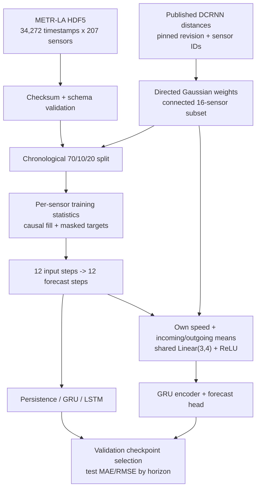

# TraCast

Traffic-speed forecasting on METR-LA with PyTorch and Flower. Recurrent encoders, directed road-distance features, and federated model averaging under chronological evaluation.

[Research brief (PDF)](reports/research-brief.pdf) · [Technical report](reports/research-report.md) · [Reproduce the experiments](docs/reproducibility.md)

[71 tests passing on a clean Windows runner](https://github.com/ivanimmanuel-dev/TraCast/actions/runs/40427570956).

## Findings

The centralized benchmark uses 16 sensors, the full available March-June 2012 timeline, and five epochs per learned model. Values are mean (sample SD) over seeds 7, 42, and 2026; errors are mph. Persistence is deterministic and evaluated once.

| Model | MAE (SD) | RMSE (SD) | Parameters |
|---|---:|---:|---:|
| Persistence | 4.100 | 8.549 | 0 |
| GRU | 3.409 (0.032) | 7.179 (0.033) | 11,136 |
| LSTM | 3.363 (0.007) | 7.091 (0.031) | 12,736 |
| Graph-GRU | 3.364 (0.036) | 7.107 (0.106) | 15,760 |
| Graph-GRU (self only) | 3.368 (0.023) | 7.073 (0.047) | 15,760 |

- Graph-GRU minus GRU mean MAE: -0.0453 mph, with 42% more parameters.
- Removing graph neighbors changed mean MAE by 0.0043 mph, with mixed seed-level effects. Most of the gain remained in the self-only projection.
- LSTM reached nearly the same mean error as Graph-GRU with fewer parameters and lower seed dispersion in this configuration.
- Five training epochs averaged 11.1 s for GRU, 10.9 s for LSTM, and 12.7 s for Graph-GRU on a Ryzen 7 5825U. Fresh-process peak memory was about 320 MiB, including data loading.

- In the separate 12-sensor Flower study, mean MAE fell from 4.047 to 3.774 mph over 1 to 5 rounds, at four times the estimated parameter payload.


[Per-seed results, timings, and counts](reports/benchmark/results.json) · [Graph ablation and protocol](reports/benchmark/report.md)

## Architecture



The graph contains 85 directed non-self distance relationships. Its weights and subset selection use topology only. The Graph-GRU spatial layer is trained jointly with the recurrent encoder. The self-only ablation removes neighbor inputs and retains the same architecture and parameter count. [Graph source and hashes](DATA.md#sensor-distance-graph).

## Federated learning

The expanded Flower study used 12 sensors, 14 days, 3 clients, and 3 seeds. At five rounds, balanced partitions scored MAE 3.774 mph versus 3.750 for the matched pooled reference. Congestion-grouped clients scored 3.836 mph. Training histogram divergence was 0.0169 versus 0.0307 bits. The five-round parameter payload was 721,152 bytes. Round budgets of 1/3/5 and all per-seed results are recorded.

The Flower `ClientApp`, `ServerApp`, and official `FedAvg` strategy run through the local CLI/SuperLink and Ray runtime. Clients hold disjoint sensor subsets. A shared univariate GRU keeps parameter meanings consistent across clients. Per-sensor normalization uses local training values; global scores pool error sums and valid target counts.

The centralized reference uses the same initial weights, normalized examples, masks, and exposure. Client partitions represent simulated data ownership. They do not represent cities or independent organizations, and the simulation applies neither differential privacy nor secure aggregation.

[Round-budget and heterogeneity study](reports/federated-study/findings.md) · [Original Flower baseline](reports/federated-smoke/report.md)

## Run

Python 3.11, Windows x64, CPU PyTorch. From the repository directory:

```powershell
py -3.11 -m venv .venv
.\.venv\Scripts\python.exe -m pip install -r requirements-lock.txt
.\.venv\Scripts\python.exe -m pip install -e . --no-deps
.\.venv\Scripts\python.exe -m tracast.cli fetch
.\.venv\Scripts\python.exe -m pytest -q -W error

# Three-seed GRU/LSTM/Graph-GRU benchmark and graph ablation
.\.venv\Scripts\python.exe -m tracast.benchmark --config configs/benchmark.json --out runs/benchmark-new

# Flower round budgets and client-distribution study
.\.venv\Scripts\python.exe -m tracast.federated_study --config configs/federated-study.json --out runs/study-new
```

The benchmark downloads and validates topology files automatically. Use unused output paths. The measured budget for the model benchmark is a few minutes; the sequential Flower study takes roughly ten minutes on this machine. [Environment, timing definitions, smoke commands, and report regeneration](docs/reproducibility.md).

## Evaluation contract

- Split rows before making windows. Inputs and targets remain within one chronological partition.
- Fit means/scales only on observed training readings; forward-fill within a split and use the training mean for leading gaps.
- Treat zero/NaN targets as missing. Compute MAE/RMSE from valid forecast/sensor pairs, with counts at every horizon.
- Select checkpoints by validation MAE. Report test results after selection.
- Preserve configurations, source/data hashes, sensor IDs, scalers, graph weights, convergence, timing definitions, and model hashes.

[Dataset provenance and citation](DATA.md) · [Tests](https://github.com/ivanimmanuel-dev/TraCast/actions/workflows/tests.yml)

## Reports

| Study | Records |
|---|---|
| Recurrent encoders and graph ablation | [Report](reports/benchmark/report.md), [summary](reports/benchmark/summary.json), [repeatability](reports/benchmark/repeatability.json) |
| Federated budgets and heterogeneity | [Findings](reports/federated-study/findings.md), [summary](reports/federated-study/summary.json) |
| Original centralized baseline | [Phase 1 report](reports/verification.md) |
| Original Flower baseline | [Report](reports/federated-smoke/report.md), [exact repeats](reports/federated-smoke/determinism.json) |

The original implementations and results remain under `phase1-verified` and `flower-verified`. Current reports keep those historical results separate from the topology-selected benchmark. Raw data, topology CSVs, checkpoints, client partitions, and local Flower state stay out of Git. Sensor-failure experiments have not been added.
