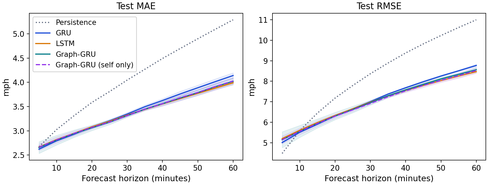
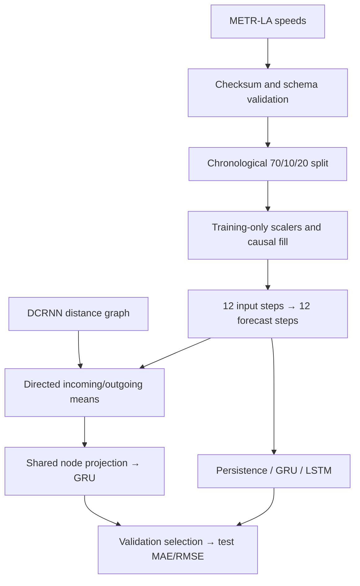

# TraCast

TraCast predicts traffic speeds for the next 5–60 minutes using the previous hour of sensor readings. It uses METR-LA, which contains speed measurements from 207 road sensors in Los Angeles.

The experiments compare GRU and LSTM recurrent neural networks, test whether readings from neighboring sensors improve forecasts, and compare federated training with centralized training. The code runs on a CPU laptop.

[Research brief](reports/research-brief.pdf) · [Technical report](reports/research-report.md) · [Run guide](docs/reproducibility.md) · [Data sources](DATA.md) · [Tests](https://github.com/ivanimmanuel-dev/TraCast/actions/workflows/tests.yml)

## Results

The model comparison uses 16 sensors selected from the published road-distance graph and all available readings from March through June 2012. Each learned model trains for five epochs with three random seeds: 7, 42, and 2026.

MAE is the mean absolute forecast error. RMSE is the root mean squared error, which gives larger errors more weight. Both are reported in mph. Parentheses show the sample standard deviation across the three training runs. The persistence baseline repeats the latest available speed at every forecast horizon and is evaluated once.

| Model | MAE (SD) | RMSE (SD) | Parameters |
|---|---:|---:|---:|
| Persistence | 4.100 | 8.549 | 0 |
| GRU | 3.409 (0.032) | 7.179 (0.033) | 11,136 |
| LSTM | 3.363 (0.007) | 7.091 (0.031) | 12,736 |
| Graph-GRU | 3.364 (0.036) | 7.107 (0.106) | 15,760 |
| Graph-GRU (self only) | 3.368 (0.023) | 7.073 (0.047) | 15,760 |

LSTM and Graph-GRU reach nearly the same mean MAE, while LSTM uses fewer parameters. The self-only version of Graph-GRU keeps the same architecture but excludes readings from neighboring sensors. Removing those readings changes mean MAE by only 0.0043 mph; it helps in one seed and hurts in two. Most of Graph-GRU's improvement over the smaller GRU remains without the neighbor readings.

Five epochs averaged 11.1 s for GRU, 10.9 s for LSTM, and 12.7 s for Graph-GRU on a Ryzen 7 5825U. Whole-process peak memory was about 320 MiB.



[Per-seed metrics and timings](reports/benchmark/results.json) · [Benchmark protocol](reports/benchmark/report.md)

## Federated learning

The Flower simulation assigns a different set of sensors to each of three clients. During each round, every client trains a copy of the same GRU on its own readings. The server then averages their model weights, weighted by each client's number of training examples. Each example contains readings from one sensor.

The centralized comparison trains the same model on the combined client datasets. Both methods start from the same weights, use the same sensor normalization and missing-value masks, and process the same total number of training examples. All three simulated clients run on one machine.

This study uses twelve sensors, fourteen days of readings, and three random seeds. Each client trains for one local epoch per round. Sensors are ranked by the share of training readings below 40 mph. Balanced groups spread these ranks across clients; congestion-grouped clients receive consecutive blocks of ranks.

| Sensor grouping | Rounds | Federated MAE | Centralized MAE | Model weights transferred |
|---|---:|---:|---:|---:|
| Balanced | 1 | 4.047 | 3.792 | 180,288 B |
| Balanced | 3 | 3.809 | 3.765 | 450,720 B |
| Balanced | 5 | 3.774 | 3.750 | 721,152 B |
| Congestion-grouped | 5 | 3.836 | 3.750 | 721,152 B |

Increasing training from one to five rounds reduces mean MAE by 0.273 mph for the balanced groups and transfers four times as many model-weight bytes. The byte estimates include weights sent for training, validation, and final test evaluation; they exclude message and transport overhead.

[Round convergence, RMSE, client counts, and partition controls](reports/federated-study/findings.md)

## Run

The tested environment uses Python 3.11 and CPU PyTorch on Windows x64. Run these commands from the repository directory:

```powershell
py -3.11 -m venv .venv
.\.venv\Scripts\python.exe -m pip install -r requirements-lock.txt
.\.venv\Scripts\python.exe -m pip install -e . --no-deps
.\.venv\Scripts\python.exe -m tracast.cli fetch
.\.venv\Scripts\python.exe -m pytest -q -W error

# Seven-day GRU smoke run
.\.venv\Scripts\python.exe -m tracast.cli run --config configs/smoke.json --out runs/gru-smoke

# Three-client Flower simulation: three rounds, one local epoch
.\.venv\Scripts\python.exe -m tracast.federated --config configs/federated-smoke.json --out runs/flower-smoke
```

Run the complete model comparison and federated study with:

```powershell
.\.venv\Scripts\python.exe -m tracast.benchmark --config configs/benchmark.json --out runs/benchmark
.\.venv\Scripts\python.exe -m tracast.federated_study --config configs/federated-study.json --out runs/federated-study
```

The benchmark fetches topology files automatically. Use a fresh output directory for each run. [Configuration, inspection, repeats, and measurement definitions](docs/reproducibility.md).

## Pipeline



The pipeline assigns the earliest 70% of readings to training, the next 10% to validation, and the final 20% to testing. Every input and forecast sequence stays within one split. Normalization uses observed training readings only, and zero or missing target readings are excluded from the loss and error metrics.

The graph contains 16 sensors and 85 directed relationships derived from published distance data. Sensor selection and graph weights use those distances independently of the traffic-speed measurements. Validation MAE selects the saved model before it is evaluated on the test period.

## Reports

The [report index](reports/README.md) explains the study directories, result files, and provenance records.

| Experiment | Results |
|---|---|
| Recurrent encoders and graph ablation | [Methods](reports/benchmark/report.md), [summary](reports/benchmark/summary.json), [exact repeats](reports/benchmark/repeatability.json) |
| Federated budgets and client distributions | [Findings](reports/federated-study/findings.md), [summary](reports/federated-study/summary.json) |
| Centralized GRU baseline | [Results](reports/centralized-baseline.md) |
| Three-client Flower baseline | [Results](reports/federated-smoke/report.md), [exact repeats](reports/federated-smoke/determinism.json) |

The studies cover sensor subsets and a fixed test period. Variation across seeds measures how training changes on those dates. The repository includes the configurations, file hashes, normalization statistics, training histories, and forecast metrics needed to inspect each result. Raw datasets and model checkpoints remain local.
