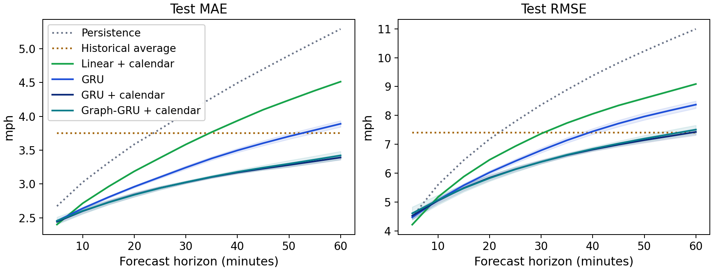
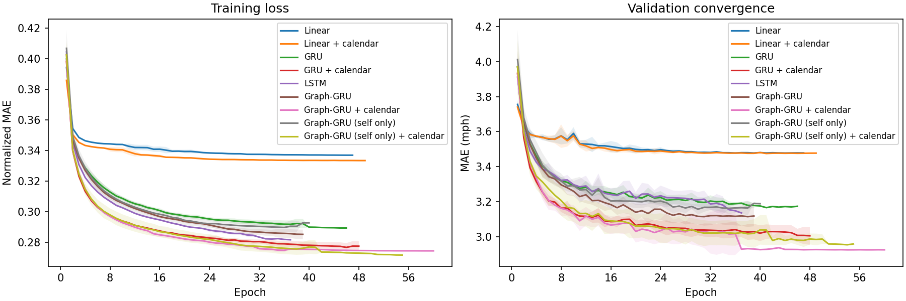

# Longer training, calendar inputs, baselines

The [first benchmark](../benchmark/report.md) trained every model for five epochs and stopped while they were still improving. This one fixes that and adds a few things. Same 16 sensors, same split, same masked loss.

Each model trains for up to 60 epochs, stops after 8 epochs with no validation gain, and halves the learning rate after 2. Models marked "+ calendar" also get the time of day (sine and cosine) and a weekend flag as inputs. I added two simple baselines: a historical average (the training mean for each sensor, weekday and 5-minute slot) and a linear model over the whole input window. 5 seeds: 7, 42, 2026, 123, 999.

| Model | MAE (SD) | MAE range over test days | 15 min | 30 min | 60 min | RMSE (SD) | Parameters | Epochs run |
|---|---:|---:|---:|---:|---:|---:|---:|---:|
| Persistence | 4.100 | 3.681-4.469 | 3.316 | 4.048 | 5.290 | 8.549 | 0 | - |
| Historical average | 3.751 | 3.300-4.185 | 3.751 | 3.751 | 3.752 | 7.405 | 0 | - |
| Linear | 3.622 (0.001) | 3.218-3.988 | 2.967 | 3.602 | 4.572 | 7.386 (0.005) | 37,056 | 43 |
| Linear + calendar | 3.597 (0.003) | 3.196-3.962 | 2.961 | 3.584 | 4.512 | 7.373 (0.007) | 43,968 | 39 |
| GRU | 3.255 (0.026) | 2.892-3.602 | 2.805 | 3.243 | 3.889 | 6.873 (0.085) | 11,136 | 37 |
| GRU + calendar | 3.007 (0.025) | 2.687-3.313 | 2.730 | 3.023 | 3.391 | 6.373 (0.078) | 11,424 | 42 |
| LSTM | 3.271 (0.013) | 2.906-3.617 | 2.845 | 3.259 | 3.885 | 6.913 (0.046) | 12,736 | 32 |
| Graph-GRU | 3.193 (0.038) | 2.844-3.527 | 2.779 | 3.195 | 3.765 | 6.743 (0.134) | 15,760 | 37 |
| Graph-GRU + calendar | 3.016 (0.031) | 2.695-3.324 | 2.727 | 3.026 | 3.422 | 6.403 (0.095) | 16,048 | 35 |
| Graph-GRU (self only) | 3.231 (0.037) | 2.872-3.574 | 2.829 | 3.229 | 3.793 | 6.854 (0.109) | 15,760 | 33 |
| Graph-GRU (self only) + calendar | 2.985 (0.039) | 2.666-3.292 | 2.732 | 3.002 | 3.327 | 6.363 (0.162) | 16,048 | 45 |

MAE and RMSE are test means in mph; 15/30/60 min are MAE at those horizons. The range column resamples the 24 test days to show how much a score depends on which days ended up in the test set. Persistence and the historical average aren't trained, so they run once.

Graph-GRU (self only) + calendar is lowest at 2.985 mph (persistence 4.100, historical average 3.751), but GRU + calendar and Graph-GRU + calendar are within 0.031 mph of it, so I can't rank them. Training longer helped: the GRU went from 3.409 at five epochs to 3.255. Calendar inputs gave the biggest jump: the GRU changes by -0.249 mph (95% CI -0.324 to -0.181). Graph-GRU minus its self-only version (the same model with the neighbor averages zeroed) is -0.038 mph (95% CI -0.062 to -0.018) without calendar inputs and +0.031 mph (95% CI +0.008 to +0.055) with calendar inputs. The sign flips, so the graph doesn't give a reliable gain.

| Difference in MAE (first - second) | Estimate (mph) | 95% CI over test days |
|---|---:|---:|
| GRU + calendar - GRU | -0.249 | -0.324 to -0.181 |
| Linear + calendar - linear | -0.025 | -0.035 to -0.015 |
| Graph-GRU + calendar - Graph-GRU | -0.177 | -0.229 to -0.130 |
| LSTM - GRU | +0.016 | -0.021 to +0.057 |
| Graph-GRU - self only | -0.038 | -0.062 to -0.018 |
| Graph-GRU - self only, both with calendar | +0.031 | +0.008 to +0.055 |
| Graph-GRU - GRU, both with calendar | +0.010 | -0.007 to +0.025 |
| GRU - historical average | -0.496 | -0.672 to -0.320 |
| GRU + calendar - historical average | -0.744 | -0.926 to -0.573 |
| Historical average - persistence | -0.349 | -0.551 to -0.135 |

Negative means the first model is better. Both models in a row are scored on the same windows and the same resampled days. The intervals are about which days were held out; the seed SDs in the table above cover random initialization.





## Running it

```powershell
.\.venv\Scripts\python.exe -m tracast.benchmark --config configs/benchmark-extended.json --out runs/benchmark-extended
```

This writes one folder per model and seed, then `results.json`, `summary.json` and the plots. `summary.json` has the seed stats plus a `day_bootstrap` section with the intervals above (every trial saves per-day error sums, which is all the bootstrap needs).

Timings are rough: the machine was doing other things during part of the run, so don't compare them with the first benchmark. The errors aren't affected. Repeating the GRU seed-7 trial under a different load gave exactly the same validation errors.

The manifest says `git_dirty` because the run used code that wasn't committed yet. After the 47 trials finished, the convergence plot crashed on early-stopped runs of different lengths, so I fixed `benchmark.plots` and redrew the plots from `results.json`. No trial or metric changed.

Model names ending in `_time` get the calendar inputs. `ha` is fit on the training split only, and `linear` is one linear layer over the flattened window.

Files: [summary](summary.json), [per-seed results](results.json), [protocol](protocol.json), [manifest](manifest.json), [config](config.json).
