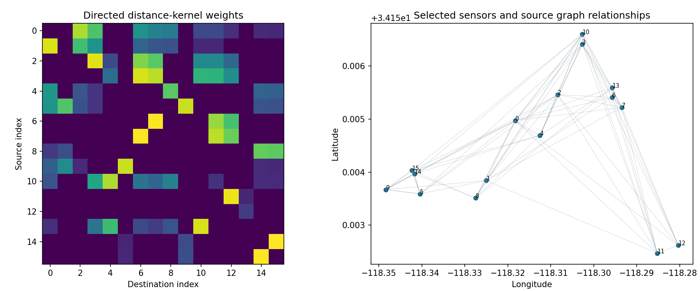
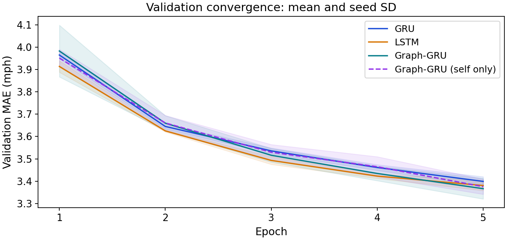

# Five-epoch benchmark

My first benchmark: 16 sensors picked from the METR-LA distance graph, the full March to June timeline, seeds 7, 42 and 2026, and five epochs per learned model. Each trial runs in a fresh CPU process. It turned out five epochs is too short, which is why there is a [longer-training study](../benchmark-extended/report.md).

The [technical report](../research-report.md) covers the data, models and results.

| File | What's in it |
|---|---|
| [summary.json](summary.json) | Mean and SD per model, horizon metrics, paired differences |
| [results.json](results.json) | Per-seed scores, convergence, timings, model hashes |
| [protocol.json](protocol.json) | Sensor IDs, splits, scalers, graph weights, missing counts |
| [manifest.json](manifest.json) | Source, dependency and input hashes |
| [config.json](config.json) | Resolved model and training settings |
| [repeatability.json](repeatability.json) | Exact repeats of the seed-42 Graph-GRU and LSTM runs |

To run it, see the [run guide](../../docs/reproducibility.md#five-epoch-benchmark).
