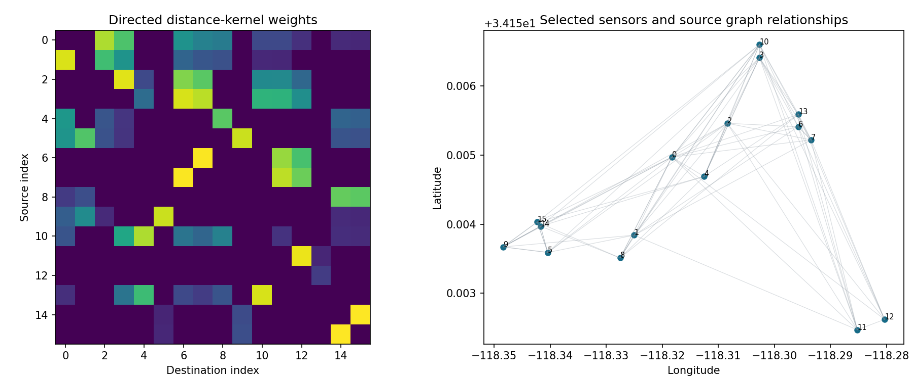
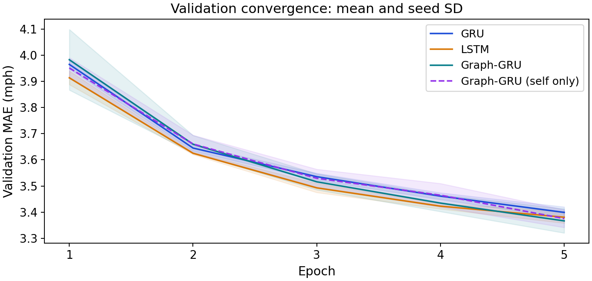

# Centralized model benchmark

Sixteen topology-selected METR-LA sensors, the full March–June 2012 timeline, seeds 7/42/2026, and five epochs per learned model. Each trial runs in a fresh CPU process.

The [technical report](../research-report.md#3-data-and-preprocessing) describes preprocessing, graph construction, architecture, training, and interpretation.

| Record | Contents |
|---|---|
| [Summary](summary.json) | Mean and sample SD, horizon metrics, paired differences |
| [Trials](results.json) | Per-seed scores, convergence, timings, model hashes |
| [Protocol](protocol.json) | Sensor IDs, splits, scalers, graph weights, missing counts |
| [Manifest](manifest.json) | Executed source, dependencies, and input hashes |
| [Configuration](config.json) | Resolved model and training settings |
| [Repeatability](repeatability.json) | Exact seed-42 Graph-GRU and LSTM repeats |

[Run commands](../../docs/reproducibility.md#centralized-models)
