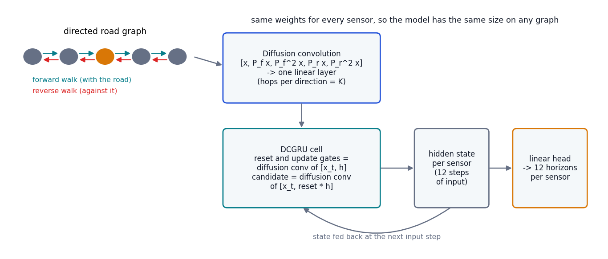
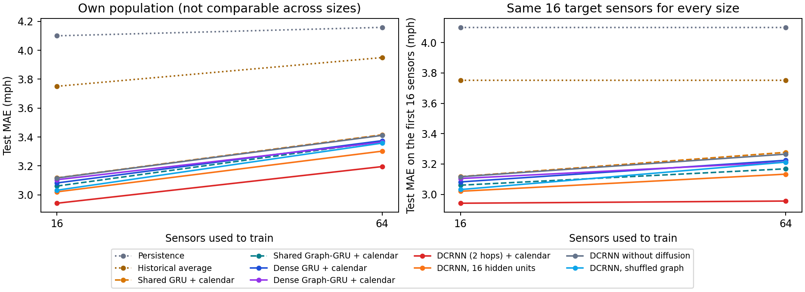
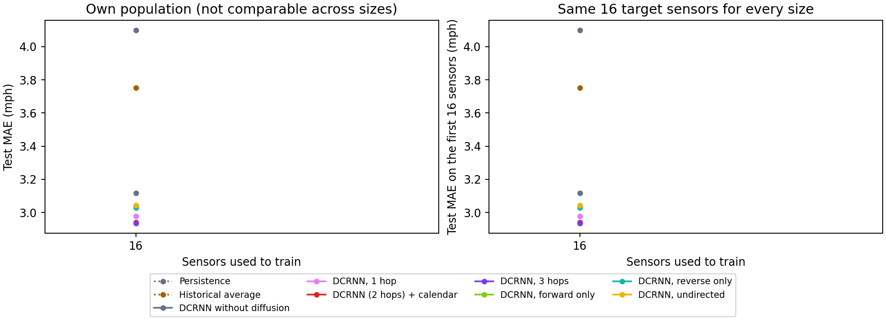
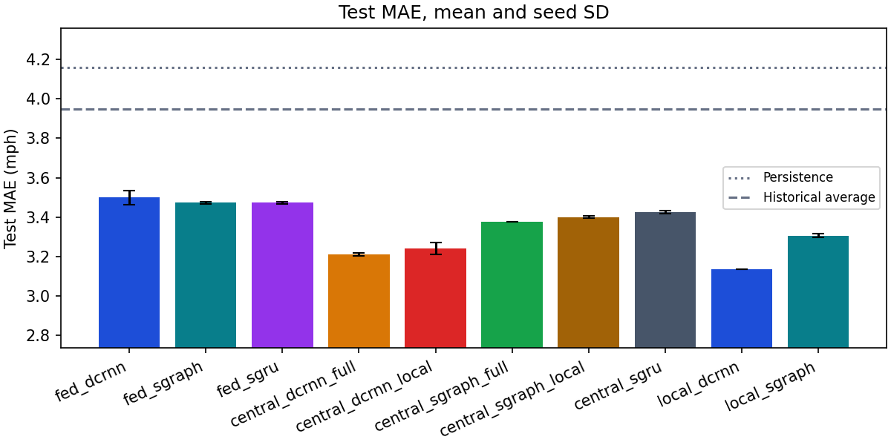
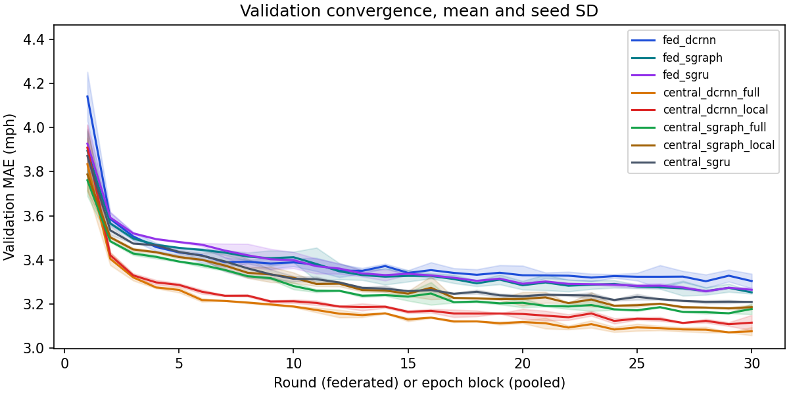

# A DCRNN-style diffusion GRU

The shared Graph-GRU in the earlier studies gives each sensor the average speed of its direct upstream and downstream neighbors. That is a one-hop picture, and traffic doesn't stop at the next sensor: a slowdown spreads back along the road over many sensors, and it matters which way the road runs. DCRNN (Li, Yu, Shahabi and Liu, ICLR 2018) models this with **diffusion convolution**: random walks along the road (forward) and against it (reverse), over several hops, inside the gates of a GRU. I wanted to know whether that extra machinery helps on METR-LA or whether the simple one-hop average was already enough.



## The model

For a graph with weights W, the forward transition matrix is `P_f = D_out^-1 W` (each sensor's weights to its downstream neighbors, normalized to sum to one) and the reverse one is `P_r = D_in^-1 W^T`. One diffusion convolution mixes a sensor's features with what random walks of 1, 2, ... K steps along each direction reach, `[x, P_f x, P_f^2 x, ..., P_r x, P_r^2 x, ...]`, and applies one linear layer to the result. The DCGRU cell is an ordinary GRU cell whose reset gate, update gate and candidate state each use that convolution on `[input, state]` instead of a plain linear layer, so the hidden state itself is diffused along the road.

How it compares with the paper:

- **Same:** directed forward and reverse random walks, K hops per direction, diffusion convolution inside the gates, one set of weights for every sensor.
- **Different:** the paper's full model is an encoder-decoder with scheduled sampling that predicts the horizons one after another. Mine encodes the input hour and predicts all twelve horizons at once from the last hidden state, the same direct head every other model here uses, so the comparison is like for like. It has one layer, and the adjacency has no self-loops (hop 0 already is the sensor itself).
- **Written from the equations,** not adapted from existing code. The tests check it against hand-computed random walks on small graphs, check that relabelling the sensors relabels the forecast, and check that an isolated sensor (no edges at all) gets a zero walk and still trains.

A sensor with no outgoing (or no incoming) edge has a zero row in that direction's matrix, so it just receives nothing through it. The learned weights depend on the number of features and hops, never on the number of sensors: with 32 hidden units, calendar inputs and two hops, DCRNN has 17,772 parameters on any graph, against 4,236 for the shared Graph-GRU and 4,044 for the shared GRU with no graph. A 16-unit version (5,052 parameters) is about the same size as the Graph-GRU, so the comparison can be made with size held roughly equal too.

## Centralized comparison

The same data, forecast horizons, splits, normalization, missing-value masking, optimizer and update budget as the [scaling study](../scaling/report.md): 30 epochs that each use a random third of the training windows, the best epoch on validation kept. Sizes 16 and 64; seeds: 7, 42 and 2026 at 16 sensors; 7 at 64 sensors.

Test MAE in mph on all the sensors each model was trained on, mean (SD over seeds):

| Model | 16 | 64 |
|---|---:|---:|
| Persistence | 4.100 | 4.159 |
| Historical average | 3.751 | 3.950 |
| Dense GRU | 3.082 (0.021) | 3.375 |
| Dense Graph-GRU | 3.104 (0.021) | 3.365 |
| Shared GRU (no graph) | 3.117 (0.016) | 3.416 |
| Shared Graph-GRU | 3.061 (0.015) | 3.369 |
| DCRNN with no diffusion (0 hops) | 3.116 (0.012) | 3.411 |
| DCRNN, 2 hops, shuffled graph | 3.032 (0.016) | 3.358 |
| DCRNN, 2 hops, 16 hidden units | 3.020 (0.009) | 3.302 |
| DCRNN, 2 hops | 2.942 (0.019) | 3.195 |

On the same first 16 sensors for every size (so the targets are identical across columns):

| Model | 16 | 64 |
|---|---:|---:|
| Dense GRU | 3.082 (0.021) | 3.225 |
| Dense Graph-GRU | 3.104 (0.021) | 3.213 |
| Shared GRU (no graph) | 3.117 (0.016) | 3.277 |
| Shared Graph-GRU | 3.061 (0.015) | 3.168 |
| DCRNN with no diffusion (0 hops) | 3.116 (0.012) | 3.265 |
| DCRNN, 2 hops, shuffled graph | 3.032 (0.016) | 3.212 |
| DCRNN, 2 hops, 16 hidden units | 3.020 (0.009) | 3.133 |
| DCRNN, 2 hops | 2.942 (0.019) | 2.956 |

Paired gaps on identical windows (first minus second, negative favors the first; 95% interval from resampling test days, seeds averaged first):

| Gap in MAE (first minus second) | 16 sensors | 64 sensors |
|---|---:|---:|
| DCRNN, 2 hops - Shared Graph-GRU | -0.119 (-0.153 to -0.083) | -0.174 (-0.215 to -0.129) |
| DCRNN, 2 hops - Shared GRU (no graph) | -0.176 (-0.218 to -0.130) | -0.220 (-0.263 to -0.171) |
| DCRNN, 2 hops - Dense GRU | -0.140 (-0.204 to -0.087) | -0.179 (-0.260 to -0.112) |
| DCRNN, 2 hops - DCRNN with no diffusion (0 hops) | -0.174 (-0.216 to -0.130) | -0.216 (-0.257 to -0.169) |
| DCRNN, 2 hops - DCRNN, 2 hops, shuffled graph | -0.090 (-0.116 to -0.063) | -0.162 (-0.194 to -0.127) |
| DCRNN, 2 hops, 16 hidden units - Shared Graph-GRU | -0.040 (-0.072 to -0.008) | -0.067 (-0.091 to -0.042) |
| DCRNN, 2 hops - Historical average | -0.809 (-1.014 to -0.617) | -0.754 (-0.899 to -0.625) |

DCRNN beat the shared Graph-GRU (0.119 mph at 16 sensors and 0.174 at 64), the shared GRU with no graph (0.176 and 0.220) and the dense GRU (0.140 and 0.179); every interval excludes zero.

Two hops of diffusion beat no diffusion in the same architecture (0.174 mph at 16 sensors and 0.216 at 64), the real graph beat a shuffled one (0.090 and 0.162) and a 16-unit DCRNN, about the size of the Graph-GRU, beat the shared Graph-GRU (0.040 and 0.067); every interval excludes zero.



## Ablations: depth, direction, and does the graph matter

Sixteen sensors, same protocol, seeds 7, 42 and 2026.

| Model | 16 |
|---|---:|
| Historical average | 3.751 |
| DCRNN with no diffusion (0 hops) | 3.116 (0.012) |
| DCRNN, 1 hop | 2.977 (0.011) |
| DCRNN, 2 hops | 2.942 (0.019) |
| DCRNN, 3 hops | 2.934 (0.009) |
| DCRNN, forward walks only | 3.033 (0.024) |
| DCRNN, reverse walks only | 3.029 (0.015) |
| DCRNN, undirected walks | 3.044 (0.007) |

Gaps on identical windows (first minus second, negative favors the first; 95% interval from resampling test days, seeds averaged first):

| Comparison | Gap in MAE (mph) |
|---|---:|
| 1 hop - 0 hops | -0.139 (-0.174 to -0.105) |
| 1 hop - 2 hops | +0.035 (+0.012 to +0.055) |
| 3 hops - 2 hops | -0.008 (-0.023 to +0.007) |
| Forward walks only - both directions | +0.092 (+0.062 to +0.120) |
| Reverse walks only - both directions | +0.088 (+0.057 to +0.117) |
| Undirected walks - both directions | +0.102 (+0.068 to +0.132) |

One hop was 0.139 mph better than no diffusion. One hop was 0.035 mph worse than two hops. Three hops were not clearly different from two hops (0.008 mph). Using only forward walks, only reverse walks or undirected walks was 0.088 to 0.102 mph worse than using both directions (every interval is above zero), so the direction of the road matters.



## Federated and pooled

The same model through Flower: 6 geographic clients on 64 sensors, each with only its own sensors and the edges among them, FedAvg weighted by examples, 30 rounds of one local epoch of a random third of the windows, seeds 7 and 42. The learned weights have the same shape for every client, so clients with different numbers of sensors can still be averaged. The arms are the ones from the [federated study](../fedgraph/report.md), run for DCRNN as well as for the shared Graph-GRU.

| Arm | MAE (SD) | Parameters | Best round | Train min | Comm MiB |
|---|---:|---:|---:|---:|---:|
| Federated DCRNN | 3.499 (0.036) | 17,772 | 29 | 64.8 | 37.0 |
| Federated shared Graph-GRU | 3.473 (0.005) | 4,236 | 29 | 25.7 | 8.8 |
| Federated shared GRU (no graph) | 3.472 (0.006) | 4,044 | 29 | 25.5 | 8.4 |
| Pooled DCRNN, local graphs only | 3.240 (0.031) | 17,772 | 28 | 43.7 | 0.0 |
| Pooled DCRNN, full graph | 3.212 (0.008) | 17,772 | 30 | 57.3 | 0.0 |
| Pooled shared Graph-GRU, local graphs only | 3.401 (0.005) | 4,236 | 28 | 18.9 | 0.0 |
| Pooled shared Graph-GRU, full graph | 3.376 (0.001) | 4,236 | 29 | 19.7 | 0.0 |
| Pooled shared GRU | 3.424 (0.007) | 4,044 | 29 | 18.1 | 0.0 |
| Local-only DCRNN | 3.135 (0.000) | 17,772 | own | 54.7 | 0.0 |
| Local-only shared Graph-GRU | 3.306 (0.008) | 4,236 | own | 14.9 | 0.0 |

Gaps on identical windows (same convention as above):

| Comparison | Gap in MAE (mph) |
|---|---:|
| Federated DCRNN - Federated shared Graph-GRU | +0.026 (+0.005 to +0.051) |
| Pooled DCRNN, full graph - Pooled shared Graph-GRU, full graph | -0.164 (-0.201 to -0.123) |
| Federated DCRNN - Pooled DCRNN, local graphs only | +0.259 (+0.206 to +0.306) |
| Federated shared Graph-GRU - Pooled shared Graph-GRU, local graphs only | +0.072 (+0.053 to +0.091) |
| Pooled DCRNN, local graphs only - Pooled DCRNN, full graph | +0.029 (+0.016 to +0.043) |
| Pooled shared Graph-GRU, local graphs only - Pooled shared Graph-GRU, full graph | +0.025 (+0.016 to +0.035) |
| Federated DCRNN - Local-only DCRNN | +0.364 (+0.296 to +0.424) |

The diffusion model's advantage does not survive federation. Pooled, DCRNN beats the shared Graph-GRU by 0.164 mph; federated, it is 0.026 mph worse. Federating costs DCRNN 0.259 mph (against a pooled model with the same cut graph) and the shared Graph-GRU 0.072, so the larger model (17,772 parameters against 4,236) loses much more to averaging the clients' updates in this short budget. The cut graph costs about the same for both models, so lost edges aren't what separates them. As in the [headline study](../fedgraph/report.md), training alone is the best arm (3.135 (0.000) mph for local-only DCRNN, against 3.212 (0.008) pooled and 3.499 (0.036) federated): with clients this different, a model that specializes in its own area beats one model for everyone, and averaging the clients is worse again. I haven't tested that explanation on its own.





## Cost

Parameters, time per epoch, peak memory and inference time from a short separate run with nothing else on the machine (3 epochs, one seed, 8 threads) are in the table. The accuracy runs above shared the machine with other jobs, so their timings are rough and I don't use them.

| Model | Parameters | Seconds per epoch, 16/64/207 | Peak memory (MiB), 16/64/207 | Inference ms per window, 16/64/207 |
|---|---:|---:|---:|---:|
| Dense GRU | 105,396 | 0.7 / 0.7 / 1.1 | 320 / 320 / 381 | 0.010 / 0.011 / 0.018 |
| Dense Graph-GRU | 165,028 | 0.8 / 1.1 / 2.0 | 319 / 320 / 381 | 0.016 / 0.024 / 0.054 |
| Shared GRU (no graph) | 4,044 | 2.2 / 5.4 / 22.9 | 320 / 408 / 627 | 0.065 / 0.199 / 0.698 |
| Shared Graph-GRU | 4,236 | 2.1 / 5.7 / 23.0 | 320 / 408 / 639 | 0.061 / 0.217 / 0.723 |
| DCRNN, 2 hops | 17,772 | 4.0 / 13.3 / 94.2 | 329 / 630 / 1855 | 0.188 / 0.755 / 7.656 |
| DCRNN, 2 hops, 16 hidden units | 5,052 | 3.2 / 9.0 / 71.5 | 320 / 577 / 1675 | 0.181 / 0.334 / 6.132 |
| DCRNN, 1 hop | 10,860 | 3.1 / 8.1 / 53.4 | 320 / 485 / 1192 | 0.140 / 0.289 / 3.706 |

## Limits

- Equal update budgets, not equal convergence. DCRNN has about 4.2 times the parameters of the shared Graph-GRU and may need longer, or a different learning rate, to show what it can do. The 16-unit version is closer in size but isn't a full control.
- Few seeds (centralized: 7, 42 and 2026 at 16 sensors; 7 at 64 sensors; federated: 2 seeds). The intervals over test days reflect which days were held out, not the randomness of training.
- The direct multi-horizon head replaces the paper's autoregressive decoder, so this is DCRNN-style rather than a reproduction. I don't compare with the published METR-LA numbers because the splits, horizons and budgets differ.
- Accuracy is measured up to 64 sensors centralized and 64 federated. At all 207 sensors DCRNN is only timed.
- One city, one four-month period, and a test period with more missing readings than training.

## Reproduce

```powershell
.\.venv\Scripts\python.exe -m tracast.cli scaling --config configs/diffusion.json --out runs/diffusion
.\.venv\Scripts\python.exe -m tracast.cli scaling --config configs/diffusion-ablation.json --out runs/diffusion-ablation
.\.venv\Scripts\python.exe -m tracast.cli fedgraph --config configs/fedgraph-diffusion.json --out runs/fedgraph-diffusion
.\.venv\Scripts\python.exe -m tracast.cli scaling --config configs/diffusion-cost.json --out runs/diffusion-cost
```

Files: [central-summary.json](central-summary.json), [ablation-summary.json](ablation-summary.json), [cost-summary.json](cost-summary.json) and the federated study in [federated/](federated/).
