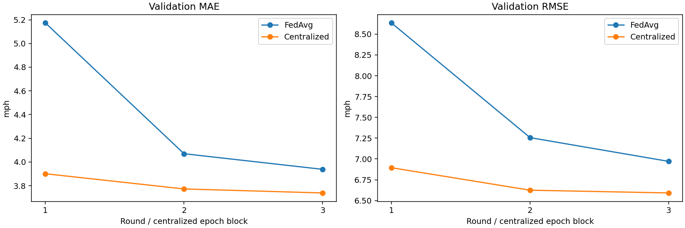
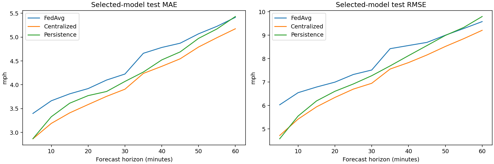

# TraCast federated smoke report

Executed October 26, 2026 on Windows x64, Python 3.11.9, PyTorch 2.5.1+cpu, Flower 1.42.0, and Ray 2.55.1. Data: checksum-verified real METR-LA. This report contains measured results from completed local Flower simulations.

## Phase 1 review

The row split occurs before sequence construction. Training, validation, and test occupy disjoint timestamp ranges; windows remain within their own split. Forward fill uses earlier observations within a split, with training means for leading gaps. Per-sensor means and population standard deviations use observed training values only. Zero and NaN targets are excluded from loss and scores.

The horizon evaluator accumulates absolute-error sums, squared-error sums, and valid target counts. It computes RMSE after pooling squared errors, rather than averaging batch RMSEs. The same principle is used across clients. Validation MAE selects checkpoints; test scores do not participate in training or selection.

Phase 1 seeded Python/NumPy/PyTorch, used deterministic PyTorch algorithms, disabled MKLDNN, seeded shuffling, and logged input/source hashes. The original real-data smoke experiment was rerun through the current package: its complete metrics JSON matches the saved report exactly. The original result JSONs and plots are unchanged. The `phase1-verified` Git tag preserves the complete original implementation and reports.

## Architecture and ownership

There are three simulated clients on one machine. They hold disjoint sensor columns from the first six sensors in original file order. These partitions do not represent cities, agencies, geographic regions, or independent organizations. No sensor is held by two clients.

| Client | Sensor IDs | Candidate train examples | Usable train examples | Validation examples | Test examples |
| --- | --- | ---: | ---: | ---: | ---: |
| 0 | 773869, 767541 | 2,776 | 2,764 | 356 | 762 |
| 1 | 767542, 717447 | 2,776 | 2,764 | 356 | 762 |
| 2 | 717446, 717445 | 2,776 | 2,764 | 356 | 762 |

Each example is one sensor's 12-step history and next 12 speeds. The existing PyTorch `GRU` class is reused with `sensors=1`, hidden size 32, one recurrent layer, and a 12-output linear head: **3,756 float32 parameters**. Sharing a univariate forecasting function keeps every parameter's meaning consistent across sensor partitions. Averaging multivariate local models with different sensors in matching channel positions would mix different sensor identities. This choice omits cross-sensor dependencies; it does not reproduce the Phase 1 multivariate model.

Each client has a separate local partition file. ClientApp handlers read that partition, fit that client's per-sensor scalers from its training rows, and use the same task functions as the centralized reference. The simulation driver holds the source data to prepare partitions, and the reference run pools all partitions. Filesystem access is shared on this machine: partition ownership is a simulation convention, not an operating-system isolation boundary or a privacy guarantee.

## Time boundaries and normalization

The smoke run uses the first 2,016 timestamps (March 1–7, 2012). All clients use identical row boundaries:

| Split | First timestamp | Last timestamp | Rows per sensor |
| --- | --- | --- | ---: |
| Train | 2012-03-01 00:00 | 2012-03-05 21:30 | 1,411 |
| Validation | 2012-03-05 21:35 | 2012-03-06 14:15 | 201 |
| Test | 2012-03-06 14:20 | 2012-03-07 23:55 | 404 |

Sensor scalers remain separate and are fitted only from local observed training values. No validation/test observations or other clients' values influence a sensor's mean or scale. No global statistics are estimated or averaged by Flower. The centralized reference uses exactly the same per-sensor statistics, including leading-gap fallback and missing masks. Predictions are converted back to mph per example before evaluation.

All-missing training target windows are removed, producing 2,764 usable examples per client instead of 2,776 candidates. Validation/test retain all windows and mask their missing targets. These are overlapping rolling-origin forecasts; target occurrences at different forecast horizons are counted separately. Client sample counts mean sensor-window examples, not unique timestamps, observed target values, or people.

## Flower execution and training comparison

The application uses current `flwr.clientapp.ClientApp`, `flwr.serverapp.ServerApp`, `flwr.app.Message`/records, and `flwr.serverapp.strategy.FedAvg`. The runner invokes the official `flwr run --stream` CLI, with three simulated SuperNodes and the Ray backend. ClientApp train/evaluate handlers run in Flower actors; the ServerApp calls the actual FedAvg strategy. Its logging subclass sorts replies by client ID and delegates model aggregation to `super().aggregate_train`.

All three clients must return successful replies in every round. Duplicate/missing clients or failed replies stop the run. FedAvg uses the number of usable local training examples as the model weight. This is standard example-count weighting; it is distinct from weighting by observed target counts. Validation scores pool additive errors/counts across clients, with no averaging of local RMSEs.

Both learning methods use the same initial checkpoint, sensors, row ranges, history/horizon lengths, model, scalers, masks, batch size 64, normalized masked MAE, Adam learning rate 0.001, and gradient clipping at 5. There are three federated rounds, each with one local epoch. The centralized reference has three pooled epoch blocks. Adam resets at the start of each client fit and centralized block; optimizer state is not transmitted.

Both methods process **24,876 training examples** in total. FedAvg performs **396 local optimizer steps** across clients; centralized training performs **390 steps**. Each client has a partial final batch, so these are exposure-matched comparisons with explicitly unequal optimizer-step counts. Centralized updates use the pooled stream; FedAvg averages independently updated models. Equality of final parameters or optimization trajectories is not expected.

Every round scores validation data. Round 3 was selected for both learned models. Test scoring occurs after selection. No hyperparameter or seed selection used test scores.

## Measured convergence

Training loss is MAE in normalized units. Validation metrics are mph. Cumulative bytes include training model downloads/uploads and validation model downloads.

| Round | FedAvg local training loss | FedAvg val MAE | FedAvg val RMSE | Centralized val MAE | Cumulative parameter bytes |
| --- | ---: | ---: | ---: | ---: | ---: |
| 1 | 0.596119 | 5.173102 | 8.634060 | 3.900644 | 135,216 |
| 2 | 0.435196 | 4.069572 | 7.256250 | 3.772296 | 270,432 |
| 3 | 0.402378 | 3.937742 | 6.970981 | 3.738525 | 405,648 |



## Measured test results

Pooled across all valid sensor/forecast pairs and the 12 forecast horizons, in mph:

| Model | MAE | RMSE |
| --- | ---: | ---: |
| FedAvg | 4.429506 | 7.974311 |
| Centralized GRU | 4.071094 | 7.308574 |
| Persistence | 4.215124 | 7.620558 |

FedAvg improved over the three rounds but finished behind centralized training and persistence on pooled test MAE/RMSE. The centralized GRU improved the pooled metrics over persistence. The per-horizon curves show that these rankings are not uniform at every horizon. This seven-day, six-sensor, one-seed smoke test establishes execution and comparison mechanics; it does not establish federated superiority or statistical significance.



## Communication estimate

The model contains 15,024 bytes of float32 tensor values. Each round sends one model to each of three training clients, receives one model from each, and sends the aggregated model to each for validation:

- Training downloads per round: 45,072 bytes.
- Training uploads per round: 45,072 bytes.
- Validation downloads per round: 45,072 bytes.
- Total per round: 135,216 bytes; three rounds: 405,648 bytes.
- Selected-model test downloads: 45,072 bytes.
- Total estimated parameter payload: **450,720 bytes** (about 0.430 MiB).

This counts tensor values, not measured network traffic. Array serialization headers, messages, configuration, metrics, protocol overhead, and transport framing are excluded. The initial model is created at the server and has no separate client initialization broadcast beyond round 1's training download. The centralized training run has no federated parameter-communication estimate. No real-network latency, bandwidth, or energy was measured.

## Reproducibility and tests

Two finalized CLI runs (`runs/fl-smoke-a` and `runs/fl-smoke-b`) completed. They match exactly in resolved config, client metadata/scalers/counts, partition-file hashes, initial model hash, every round record, selected-model metrics, centralized histories/results, deterministic run ID, and every tensor in every checkpoint. Framework-assigned run IDs, log timestamps, and output paths differ and are excluded from numerical equality checks. [determinism.json](determinism.json) records the executed comparison.

The run ID is `59d276d12c1194d1d9387882bf5663d3cfa8ba0944dadc91e1cfea301aaad5e9`. The source commit recorded by the experiment is `c0fe4dca253fa7e2470c55fcfe15b175dd1704d4`; the manifest also records working-tree state and content hashes of executed source/tests/configs/lock files. Source files use LF line endings so clones can reproduce content hashes. Dependency versions are pinned in the repository lock.

`python -m pytest -q -W error`: **44 passed**. Coverage includes the original Phase 1 pipeline, disjoint sensors, common time boundaries, held-out/other-client normalization independence, shared-model dimensions, all-missing training-window removal, additive horizon aggregation, actual Flower FedAvg example weighting, ordered replies, parameter-byte arithmetic, failed-client rejection, ClientApp message dispatch, deterministic training, and launcher failure-state checks. Tests use constructed arrays for mechanics; research metrics above use the real dataset. [tests.txt](tests.txt) retains the final test output.

The environment was installed fresh for Flower and passed `pip check`. A second-machine reinstall from the final lock, cross-platform floating-point reproducibility, peak RAM, and standalone end-to-end runtime were not measured. CPU allocation is bounded to one active client actor (2 reserved Ray CPUs, 1 PyTorch thread), with a 128 MiB Ray object-store cap. Ray/Flower launch and shutdown overhead is substantial relative to this tiny model.

## Runtime issues observed

- The initially resolved Click 8.5.0 triggered import deprecations in Flower's Typer dependency when tests treated warnings as errors. Click 8.1.8 is pinned in the tested lock.
- A preliminary direct Python `run_simulation` run completed, but Flower 1.42 deprecates that launcher. The shipped runner uses the CLI/SuperLink path; the reported repetitions used that path.
- An early CLI attempt rejected a floating-point value for `init-args-num-gpus`; the final launcher passes integer zero, with a regression check.
- The CLI's default per-run dependency installation created a separate environment. That attempt was stopped before results were produced. The final launcher disables runtime installs and uses the preinstalled lock.
- A diagnostic stop command in a non-UTF-8 terminal hit a Unicode display error. The shipped launcher forces UTF-8 for subprocesses.
- Ray emits Windows-support warnings, actor-termination messages, and shutdown stack output. Finalized runs returned successfully, all client replies were received, final test files were produced, and exact repeats passed. The runtime transcript, with ANSI coloring and trailing whitespace removed, is retained in [flower.log](flower.log). The lower-level managed launcher also prints its own deprecation/security notices; this code does not suppress them.

## Limits and next work

One machine, three logical clients, six sensors selected by file order, seven days, three rounds, and one random seed. Client ownership does not reflect geography or independent data holders. No client dropouts, differential privacy, secure aggregation, real-network deployment, or adversarial behavior is evaluated. The shared univariate model has no sensor identity, topology, or cross-sensor inputs. Treating zero as missing is a dataset convention and may exclude genuine zero speeds.

The initial Phase 1 multivariate result has a different model and sensor/time configuration, so it is not used as the federated comparator. A wider date range, several seeds, and a separately budgeted optimization comparison are the next research checks. Dataset provenance and original-provider license uncertainty remain documented in [DATA.md](../../DATA.md). GNN and sensor-failure experiments have not been implemented.

## Run commands

From the repository directory, with the installed development environment:

```powershell
..\..\work\flwr-venv\Scripts\python.exe -m pytest -q -W error
..\..\work\flwr-venv\Scripts\python.exe -m tracast.federated --config configs/federated-smoke.json --out runs/fl-new-a
..\..\work\flwr-venv\Scripts\python.exe -m tracast.federated --config configs/federated-smoke.json --out runs/fl-new-b
..\..\work\flwr-venv\Scripts\python.exe -m tracast.compare_runs runs/fl-new-a runs/fl-new-b
```

Fresh-environment commands are in the [README](../../README.md). Use unused output paths; completed experiments are never overwritten. Reports omit raw HDF5 data, local partitions, checkpoints, and Flower's local service state, all of which remain excluded from Git.

## Official API references

Checked against the installed Flower 1.42.0 source and current official documentation on October 26, 2026:

- [PyTorch ClientApp/ServerApp example](https://flower.ai/docs/framework/tutorial-quickstart-pytorch.html)
- [Message API FedAvg](https://flower.ai/docs/framework/ref-api/flwr.serverapp.strategy.FedAvg.html)
- [Managed local SuperLink workflow](https://flower.ai/docs/framework/how-to-run-flower-locally.html)
- [Simulation runtime and Windows support](https://flower.ai/docs/framework/how-to-run-simulations.html)
