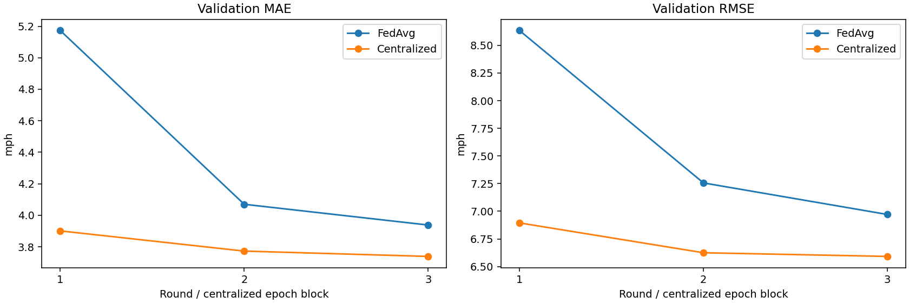
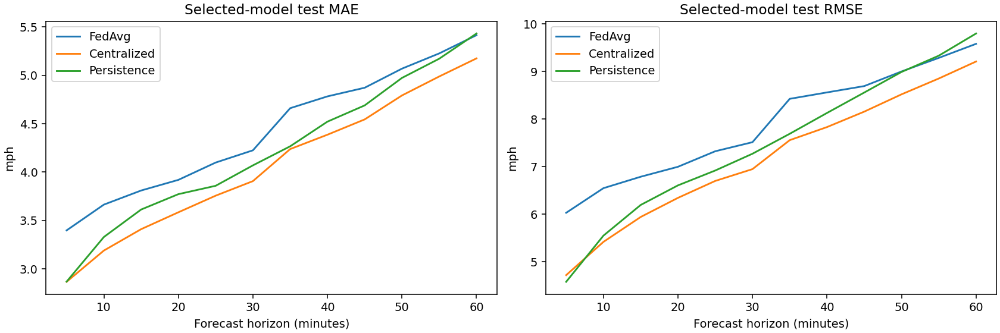

# Flower smoke run

A small end-to-end check of the federated setup: three simulated clients, a shared univariate GRU and three rounds. It ran on October 26, 2026 with Windows x64, Python 3.11.9, PyTorch 2.5.1+cpu, Flower 1.42.0 and Ray 2.55.1.

## Setup

The clients hold disjoint sensors from the first six in file order, so each sensor belongs to exactly one client.

| Client | Sensor IDs | Candidate train examples | Usable train examples | Validation examples | Test examples |
| --- | --- | ---: | ---: | ---: | ---: |
| 0 | 773869, 767541 | 2,776 | 2,764 | 356 | 762 |
| 1 | 767542, 717447 | 2,776 | 2,764 | 356 | 762 |
| 2 | 717446, 717445 | 2,776 | 2,764 | 356 | 762 |

An example is one sensor's 12-step history and its next 12 speeds. The model is the existing `GRU` class with `sensors=1`, hidden size 32, one recurrent layer and a 12-output head: 3,756 float32 parameters. A univariate model means a weight has the same meaning on every client. Averaging multivariate models whose clients have different sensors in the same channel slots would mix sensor identities. The cost is that each sensor is forecast independently.

Each client has its own partition file, fits its own scalers from its training rows and uses the same task code as the centralized reference. The driver holds the source data to prepare the partitions, and the reference pools them. Ownership is logical, all on one machine.

## Time boundaries

The run uses the first 2,016 timestamps (March 1 to 7, 2012), with the same row boundaries for every client:

| Split | First timestamp | Last timestamp | Rows per sensor |
| --- | --- | --- | ---: |
| Train | 2012-03-01 00:00 | 2012-03-05 21:30 | 1,411 |
| Validation | 2012-03-05 21:35 | 2012-03-06 14:15 | 201 |
| Test | 2012-03-06 14:20 | 2012-03-07 23:55 | 404 |

Scalers are per sensor and fitted on that client's observed training values only. Flower never averages statistics, and the centralized reference uses exactly the same ones, with the same leading-gap fallback and masks. Predictions are converted back to mph per example before scoring.

Training windows with no observed target are dropped, which leaves 2,764 usable examples per client instead of 2,776. Validation and test keep every window and mask the missing targets. The windows overlap (rolling origin), and targets at different horizons are counted separately.

## How the training compares

The simulation uses Flower's `ClientApp`, `ServerApp`, `Message` records and `FedAvg` strategy, started with `flwr run --stream` on three simulated SuperNodes and the Ray backend. My strategy subclass sorts replies by client ID and hands the averaging to `FedAvg.aggregate_train`. All three clients must reply successfully every round; a duplicate, a missing client or a failed reply stops the run. FedAvg weights each client by its number of usable training examples, not by observed targets. Validation scores pool sums and counts across clients instead of averaging local RMSEs.

Both methods use the same initial checkpoint, sensors, row ranges, window lengths, model, scalers, masks, batch size 64, normalized masked MAE, Adam at 0.001 and gradient clipping at 5. Federated training is three rounds of one local epoch; the centralized reference is three pooled epoch blocks. Adam restarts at the start of each client fit and each centralized block, and no optimizer state is sent.

Both methods process 24,876 training examples in total. FedAvg takes 396 local optimizer steps across the clients and centralized training takes 390, because each client has a partial last batch. So exposure is matched but step counts aren't.

Every round scores the validation data, and round 3 was selected for both models. Test scoring came after that, and no hyperparameter or seed choice used test scores.

## Convergence

Training loss is MAE in normalized units, validation errors are in mph, and the byte counts include training downloads and uploads plus validation downloads.

| Round | FedAvg local training loss | FedAvg val MAE | FedAvg val RMSE | Centralized val MAE | Cumulative parameter bytes |
| --- | ---: | ---: | ---: | ---: | ---: |
| 1 | 0.596119 | 5.173102 | 8.634060 | 3.900644 | 135,216 |
| 2 | 0.435196 | 4.069572 | 7.256250 | 3.772296 | 270,432 |
| 3 | 0.402378 | 3.937742 | 6.970981 | 3.738525 | 405,648 |



## Test results

Errors in mph over all valid sensor and forecast pairs and all twelve horizons.

| Model | MAE | RMSE |
| --- | ---: | ---: |
| FedAvg | 4.429506 | 7.974311 |
| Centralized GRU | 4.071094 | 7.308574 |
| Persistence | 4.215124 | 7.620558 |

FedAvg improved over the three rounds but finished behind both centralized training and persistence. The centralized GRU beat persistence. The per-horizon curves show that the ranking isn't the same at every horizon.



## Communication

The model is 15,024 bytes of float32 values. Each round sends the model to the three training clients, takes one back from each and sends the average to each for validation, which is 45,072 bytes per step and 135,216 bytes per round. Three rounds come to 405,648 bytes, and testing the selected model adds 45,072, for a total of **450,720 bytes** (about 0.430 MiB). The first model is created on the server, so there is no separate initial broadcast beyond round 1's training download.

This counts model values only, not network traffic: headers, messages, config, metrics, protocol overhead and framing are left out, and I didn't measure latency, bandwidth or energy. Centralized training has no communication estimate.

## Repeatability and tests

I ran the CLI twice (`runs/fl-smoke-a` and `runs/fl-smoke-b`) and the runs matched exactly: resolved config, client metadata, scalers and counts, partition-file hashes, initial model hash, every round record, the selected-model metrics, the centralized histories and results, the run ID and every tensor in every checkpoint. Framework run IDs, log timestamps and output paths differ and are left out of the comparison. [determinism.json](determinism.json) has the comparison.

The run ID is `59d276d12c1194d1d9387882bf5663d3cfa8ba0944dadc91e1cfea301aaad5e9`, and the recorded source commit is `c0fe4dca253fa7e2470c55fcfe15b175dd1704d4`. The manifest also records the working-tree state and content hashes of the source, tests, configs and lock file. Source files use LF line endings so clones reproduce the hashes. The [saved test output](tests.txt) shows 44 passing tests at the time, and [flower.log](flower.log) keeps the Ray start-up and shutdown messages.

## What it covers

Six sensors, seven days, one seed, and a shared univariate GRU with temporal inputs only. The [round-budget study](../federated-study/findings.md) extends it to twelve sensors, fourteen days and three seeds. The clients share one machine, and differential privacy and secure aggregation aren't part of this.

## Run it

After the [setup](../../docs/reproducibility.md):

```powershell
.\.venv\Scripts\python.exe -m pytest -q -W error
.\.venv\Scripts\python.exe -m tracast.federated --config configs/federated-smoke.json --out runs/fl-new-a
.\.venv\Scripts\python.exe -m tracast.federated --config configs/federated-smoke.json --out runs/fl-new-b
.\.venv\Scripts\python.exe -m tracast.compare_runs runs/fl-new-a runs/fl-new-b
```

Use a new output folder for each run.

## Flower references

Checked against the installed Flower 1.42.0 source and the docs on October 26, 2026:

- [PyTorch ClientApp/ServerApp example](https://flower.ai/docs/framework/tutorial-quickstart-pytorch.html)
- [Message API FedAvg](https://flower.ai/docs/framework/ref-api/flwr.serverapp.strategy.FedAvg.html)
- [Managed local SuperLink workflow](https://flower.ai/docs/framework/how-to-run-flower-locally.html)
- [Simulation runtime and Windows support](https://flower.ai/docs/framework/how-to-run-simulations.html)
