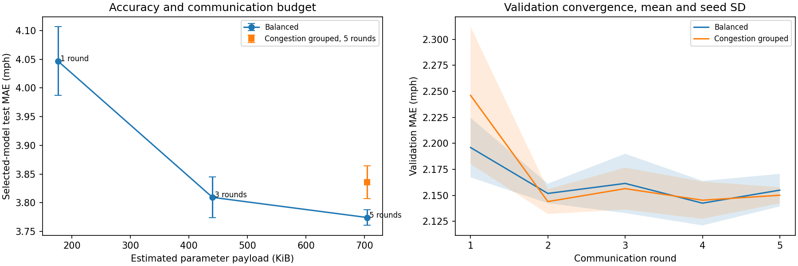

# Federated round budgets and client heterogeneity

This study runs twelve local Flower experiments using twelve sensors, fourteen days of readings, and seeds 7, 42, and 2026. Each of the three clients holds four sensors, and no sensor belongs to two clients. The model is a shared univariate GRU, with 3,756 float32 parameters. Every round contains one local epoch and all three clients participate. The official ClientApp, ServerApp, and FedAvg run through the Flower 1.42.0 CLI/SuperLink and Ray runtime.

## Results

The table reports mean errors in mph, with the sample standard deviation across the three seeds in parentheses. The pooled comparison trains on the combined client datasets. Checkpoints are selected by validation MAE within each round budget.

| Client partition | Rounds | FedAvg MAE | FedAvg RMSE | Pooled MAE | Pooled RMSE | Parameter bytes |
|---|---:|---:|---:|---:|---:|---:|
| balanced | 1 | 4.0470 (0.0599) | 7.7919 (0.1019) | 3.7924 (0.0101) | 7.5361 (0.0182) | 180,288 |
| balanced | 3 | 3.8093 (0.0357) | 7.5289 (0.0254) | 3.7653 (0.0344) | 7.5511 (0.0066) | 450,720 |
| balanced | 5 | 3.7742 (0.0138) | 7.5200 (0.0121) | 3.7497 (0.0467) | 7.5350 (0.0265) | 721,152 |
| congestion | 5 | 3.8358 (0.0288) | 7.5128 (0.0197) | 3.7497 (0.0467) | 7.5350 (0.0265) | 721,152 |

Balanced-partition mean MAE fell by 0.2729 mph from one to five rounds, while estimated parameter payload increased fourfold. The three-to-five-round gain was 0.0351 mph. Seed 42 retained the same selected test result at three and five rounds. Five-round FedAvg remained 0.0245 mph above the mean pooled-reference MAE.

Congestion-grouped clients had +0.0616 mph higher mean MAE than balanced clients at five rounds, but their mean RMSE difference was -0.0072 mph. The distribution change affects the two error measures differently in this experiment.



## Partition rule and data controls

Both rules use the same first twelve sensors in canonical traffic-file order and the first 4,032 timestamps. The same 70/10/20 chronological row boundaries apply to every client and case. Per-sensor normalization and zero/NaN target masks use the existing pipeline.

Sensors are ranked by their fraction of observed **training** speeds below 40 mph. The balanced rule interleaves rank positions across three clients; the congestion rule assigns consecutive rank blocks. Ranking uses training readings only. The groups describe simulated sensor ownership; their training distributions are measured below.

The observed training-speed histogram bins are 0/10/20/.../80/+inf mph, excluding missing readings. Mean client-to-pooled Jensen-Shannon divergence was 0.016882 bits for balanced ownership and 0.030693 bits for congestion grouping. This training-data statistic is constant across seeds.

| Rule | Client | Sensor IDs | Usable train windows | Observed training fraction below 40 mph |
|---|---:|---|---:|---:|
| balanced | 0 | 767541, 767471, 773869, 773062 | 10,779 | 0.0506 |
| balanced | 1 | 767620, 737529, 717447, 717816 | 10,730 | 0.0760 |
| balanced | 2 | 765604, 767542, 717445, 717446 | 10,788 | 0.1301 |
| congestion | 0 | 767541, 767620, 765604, 767471 | 10,781 | 0.0018 |
| congestion | 1 | 737529, 767542, 773869, 717447 | 10,780 | 0.0573 |
| congestion | 2 | 717445, 773062, 717816, 717446 | 10,736 | 0.1984 |

Each training example contains one sensor's input sequence and forecast targets. Client sample counts include only examples with at least one observed target. A window with no observed target contributes to neither local training nor its FedAvg example weight. Validation/test retain every candidate window and pool errors only over valid targets.

The pooled reference uses the same shared univariate architecture, initial model, scalers, masks, and total example exposure. Its dataset follows canonical sensor order regardless of client assignment. Adam resets at each local fit and each pooled epoch block; no optimizer state is federated. Partial batches create different total optimizer-step counts, which are stored in the case records.

## Reproducibility checks

The pooled reference's complete numerical output and state hash match exactly across balanced and congestion ownership for every seed. Global model-state hashes from the one- and three-round cases match the corresponding prefixes of the five-round cases. [summary.json](summary.json) records all checks.

All twelve cases completed. Their total measured wall time was 687.0 seconds (11.45 minutes), including launch overhead, simulation, selected test scoring, the pooled reference, and plots. Cases ran sequentially with one client actor active, two reserved Ray CPUs, one PyTorch thread, and a 128 MiB Ray object-store cap. Whole-study peak RAM was not measured.

## Per-seed records

| Case | Selected round | FedAvg MAE | FedAvg RMSE | Pooled MAE | Case wall seconds |
|---|---:|---:|---:|---:|---:|
| b1-s7 | 1 | 4.111763 | 7.906256 | 3.792999 | 56.0 |
| b3-s7 | 2 | 3.850131 | 7.556947 | 3.759755 | 49.9 |
| b5-s7 | 5 | 3.758373 | 7.521437 | 3.712816 | 61.8 |
| c5-s7 | 4 | 3.810094 | 7.494595 | 3.712816 | 65.5 |
| b1-s42 | 1 | 3.993612 | 7.710778 | 3.782038 | 38.7 |
| b3-s42 | 3 | 3.783720 | 7.507262 | 3.734071 | 52.1 |
| b5-s42 | 3 | 3.783720 | 7.507262 | 3.734071 | 68.3 |
| c5-s42 | 2 | 3.866865 | 7.533776 | 3.734071 | 66.1 |
| b1-s2026 | 1 | 4.035705 | 7.758775 | 3.802187 | 43.7 |
| b3-s2026 | 3 | 3.794028 | 7.522578 | 3.802187 | 55.3 |
| b5-s2026 | 4 | 3.780410 | 7.531418 | 3.802187 | 67.6 |
| c5-s2026 | 3 | 3.830434 | 7.510014 | 3.802187 | 62.0 |

Each [case directory](cases) contains config, source/data/dependency hashes, client metadata, all round metrics, selected test scores, pooled histories, status, and the runtime transcript. Raw partitions, model checkpoints, and local Flower service state stay outside Git.

## Communication definition

A model contains 15,024 bytes of float32 tensor values. Each round has three training downloads, three uploads, and three validation downloads: 135,216 bytes. Selected-model test evaluation adds 45,072 bytes. Total payload is therefore (3 x rounds + 1) x 3 x 15,024: 180,288 / 450,720 / 721,152 bytes for 1 / 3 / 5 rounds.

These estimates exclude array headers, metrics, config, message framing, app packaging, transport overhead, latency, and energy. Forecasting scores pool absolute errors, squared errors, and valid target counts across clients.

## Interpretation

Three seeds describe initialization and local-shuffle variation on one test block. The fourteen-day slice, twelve sensors, predefined congestion threshold, and short round budgets limit the conclusion to this setup. The selected model is univariate, so it is separate from the full-date-range multivariate graph benchmark. Client ownership is simulated on a shared host, using standard FedAvg.

```powershell
.\.venv\Scripts\python.exe -m tracast.federated_study --config configs/federated-study.json --out runs/federated-study-new
```

[Configuration](config.json) - [All measured cases](cases.json) - [Summary and controls](summary.json) - [Full research report](../research-report.md)
