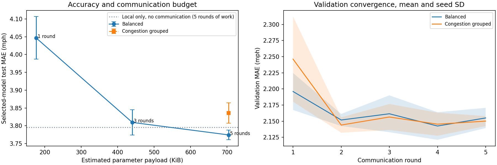

# Federated study

Twelve Flower runs on twelve sensors, fourteen days of readings and seeds 7, 42 and 2026. Three clients hold four sensors each and no sensor is on two clients. The model is a shared univariate GRU with 3,756 parameters, each round is one local epoch, and all three clients take part every round. Flower 1.42.0's `ClientApp`, `ServerApp` and `FedAvg` run through `flwr run` on Ray, all on one machine.

## Results

Mean MAE and RMSE in mph over the three seeds, with the seed SD in parentheses. Pooled is one model trained on all clients' data together; local-only trains each client by itself with the same amount of local work and no communication. The checkpoint with the best validation MAE is the one scored.

| Client partition | Rounds | FedAvg MAE | FedAvg RMSE | Pooled MAE | Local-only MAE | Parameter bytes |
|---|---:|---:|---:|---:|---:|---:|
| balanced | 1 | 4.0470 (0.0599) | 7.7919 (0.1019) | 3.7924 (0.0101) | 4.0031 (0.0413) | 180,288 |
| balanced | 3 | 3.8093 (0.0357) | 7.5289 (0.0254) | 3.7653 (0.0344) | 3.8256 (0.0324) | 450,720 |
| balanced | 5 | 3.7742 (0.0138) | 7.5200 (0.0121) | 3.7497 (0.0467) | 3.7958 (0.0484) | 721,152 |
| congestion | 5 | 3.8358 (0.0288) | 7.5128 (0.0197) | 3.7497 (0.0467) | 3.7686 (0.0534) | 721,152 |

Going from one to five rounds cuts balanced MAE by 0.2729 mph and multiplies the bytes sent by 4. The last two rounds are worth 0.0351 mph. At five rounds FedAvg is 0.0245 mph above the pooled model.

Congestion-grouped clients have +0.0616 mph MAE and -0.0072 mph RMSE compared with balanced ones at five rounds, so the change in the training distribution moves the two measures in different directions.

## FedAvg vs training alone

Local-only starts every client from the shared initial weights and repeats the work it would do in federated training (one epoch per round, same seeds, fresh optimizer each round). Each client keeps the round with its own best validation MAE, and the test errors are pooled across clients so the numbers compare with the others.

With balanced clients, federated averaging is 0.0163 mph below local-only at three rounds, 0.0216 below at five, and 0.0439 above at one. With congestion-grouped clients at five rounds it is 0.0672 above.

The gaps are about the size of the seed spread, so this doesn't show that communication beats training alone for this small model and 14-day slice. Pooled is lowest in every row.



## How sensors were grouped

Both rules use the first twelve sensors in file order and the first 4,032 timestamps, with the same 70/10/20 split for every client and case. Sensors are ranked by the fraction of their observed training speeds below 40 mph (training rows only). Balanced groups interleave the ranks across the three clients; congestion groups take consecutive blocks of ranks.

Training speeds are counted in 10 mph bins (0, 10, ... 80, 80+), ignoring missing readings. The mean Jensen-Shannon divergence between each client's histogram and the pooled one is 0.016882 bits for balanced ownership and 0.030693 for congestion grouping. It only depends on training data, so it is the same for every seed.

| Rule | Client | Sensor IDs | Usable train windows | Share of training speeds below 40 mph |
|---|---:|---|---:|---:|
| balanced | 0 | 767541, 767471, 773869, 773062 | 10,779 | 0.0506 |
| balanced | 1 | 767620, 737529, 717447, 717816 | 10,730 | 0.0760 |
| balanced | 2 | 765604, 767542, 717445, 717446 | 10,788 | 0.1301 |
| congestion | 0 | 767541, 767620, 765604, 767471 | 10,781 | 0.0018 |
| congestion | 1 | 737529, 767542, 773869, 717447 | 10,780 | 0.0573 |
| congestion | 2 | 717445, 773062, 717816, 717446 | 10,736 | 0.1984 |

An example is one sensor's input window plus its forecast targets. Only windows with at least one observed target count as training examples (for local training and for the FedAvg weights); validation and test keep every window and mask the missing targets.

## Checks

The pooled model is bit-for-bit the same for balanced and congestion ownership with every seed, and the global model after one or three rounds matches the first rounds of the five-round run. [summary.json](summary.json) has all the checks.

All twelve cases finished in 814.5 seconds (13.6 minutes) on the Ryzen 7 5825U, including launch, simulation, test scoring, the pooled and local-only models and plots. Cases ran one after another with one client actor, two reserved Ray CPUs, one PyTorch thread and a 128 MiB object store.

## Communication

The model is 15,024 bytes of float32 values. A round sends three training downloads, three uploads and three validation downloads, which is 135,216 bytes. Testing the chosen model adds 45,072. So the total is (3 x rounds + 1) x 3 x 15,024: 180,288, 450,720 and 721,152 bytes for 1, 3 and 5 rounds. This leaves out array headers, messages, config, framing, latency and energy.

## Per-seed results

| Case | Selected round | FedAvg MAE | FedAvg RMSE | Pooled MAE | Local-only MAE | Wall seconds |
|---|---:|---:|---:|---:|---:|---:|
| b1-s7 | 1 | 4.111763 | 7.906256 | 3.792999 | 4.045005 | 63.8 |
| b3-s7 | 2 | 3.850131 | 7.556947 | 3.759755 | 3.820297 | 67.0 |
| b5-s7 | 5 | 3.758373 | 7.521437 | 3.712816 | 3.759612 | 78.8 |
| c5-s7 | 4 | 3.810094 | 7.494595 | 3.712816 | 3.815089 | 72.9 |
| b1-s42 | 1 | 3.993612 | 7.710778 | 3.782038 | 3.962378 | 47.9 |
| b3-s42 | 3 | 3.783720 | 7.507262 | 3.734071 | 3.860319 | 64.8 |
| b5-s42 | 3 | 3.783720 | 7.507262 | 3.734071 | 3.850845 | 75.5 |
| c5-s42 | 2 | 3.866865 | 7.533776 | 3.734071 | 3.780473 | 77.4 |
| b1-s2026 | 1 | 4.035705 | 7.758775 | 3.802187 | 4.002003 | 49.6 |
| b3-s2026 | 3 | 3.794028 | 7.522578 | 3.802187 | 3.796261 | 64.0 |
| b5-s2026 | 4 | 3.780410 | 7.531418 | 3.802187 | 3.776971 | 77.5 |
| c5-s2026 | 3 | 3.830434 | 7.510014 | 3.802187 | 3.710226 | 75.3 |

`b3-s42` is balanced groups, three rounds, seed 42; `c5-s7` is congestion groups, five rounds, seed 7. Each [case folder](cases) has the config, hashes, client info, every round's metrics, the test scores, the pooled history and the Flower log. Raw partitions, checkpoints and Flower state stay out of git.

```powershell
.\.venv\Scripts\python.exe -m tracast.federated_study --config configs/federated-study.json --out runs/federated-study-new
```

[Config](config.json) · [All cases](cases.json) · [Summary](summary.json) · [Technical report](../research-report.md)
