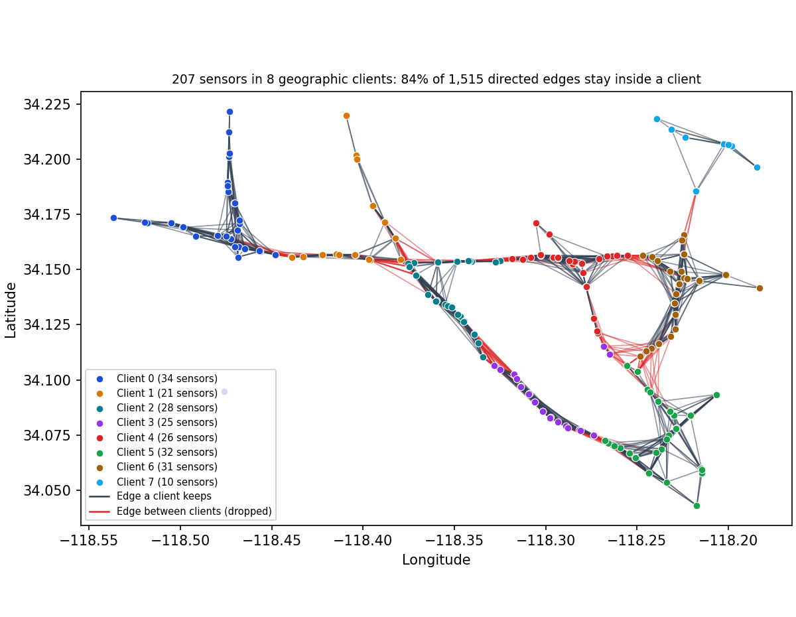
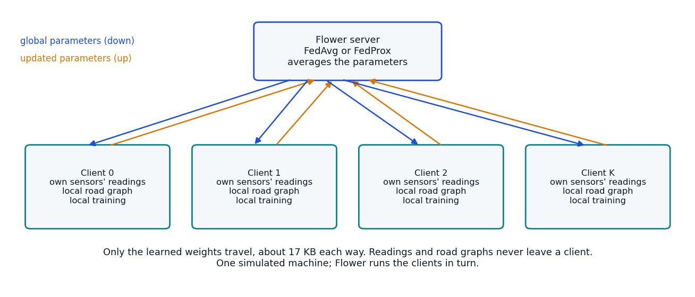
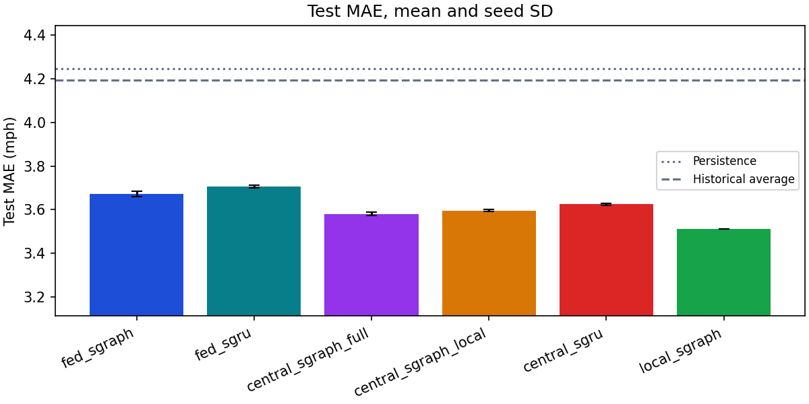
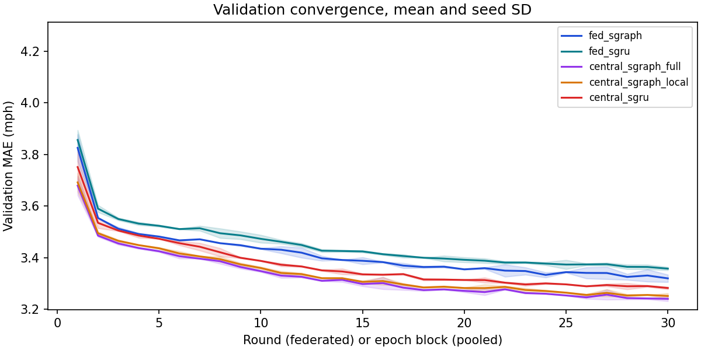
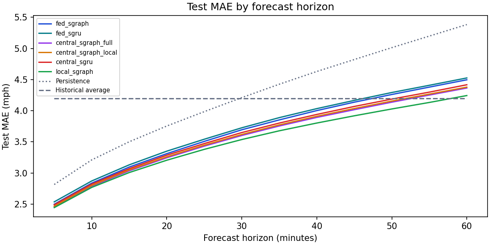
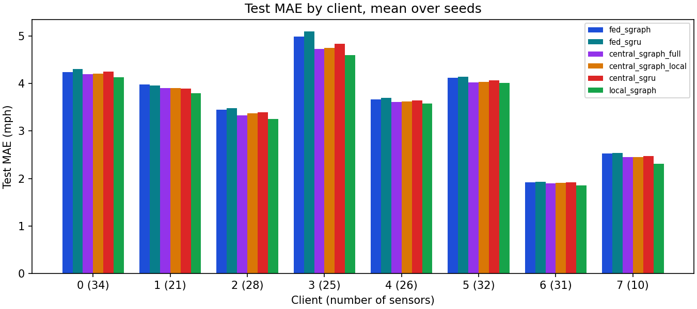

# Federated shared Graph-GRU on all 207 sensors

The earlier federated experiment used a tiny setup: 12 sensors, three clients, and a GRU that looked at one sensor at a time, so it couldn't use the road graph at all. This one federates the shared Graph-GRU from the [scaling study](../scaling/report.md) across **every** METR-LA sensor, with clients that own different areas of the city and different numbers of sensors. The question is how much accuracy federation costs, and whether the graph still helps when a client can only see its own part of it.

It is a single-machine simulation: Flower's simulation runtime runs the clients in turn on one computer. There is no real network, no stragglers and no dropped clients.

## Setup



- **Clients.** The 207 sensors are cut into 8 groups by k-means on their coordinates, so each client owns an area. The groups have 34, 21, 28, 25, 26, 32, 31 and 10 sensors. Nothing about speeds goes into this choice.
- **What a client can see.** Its own sensors' readings, and the road graph among its own sensors only. The edges that cross into other clients are dropped (the red lines): 1,274 of 1,515 directed edges (87% of the edge weight) stay inside a client, and 1 sensor ends up with no neighbor at all. A client never reads another client's speeds, not even a neighbor's, so its local graph is the only graph it has.
- **Model.** The shared Graph-GRU with calendar inputs: one small GRU run on every sensor, fed its own speed plus the average speed of its upstream and downstream neighbors. It has 4,236 parameters whatever the number of sensors, which is what lets clients with 10 and with 34 sensors average the same weights. The graph matrices stay on the client and are never exchanged.
- **One round.** The server sends the global parameters (16.5 KiB), each client trains on its own windows and sends back its updated parameters, and Flower's FedAvg averages them weighted by the number of training examples (windows times sensors).
- **Training budget.** 30 rounds, each a pass over a random third of the client's training windows with a fresh Adam (learning rate 0.001, batch 64, gradient clipping at 5). That is the same number of examples as the 30 epochs of a random third that the scaling study used, so the pooled arms below get exactly the same amount of data. The kept model is the round with the best pooled validation MAE.
- **Data.** The same chronological 70/10/20 split, training-only per-sensor normalization (each client fits it on its own training rows, which gives the same numbers as fitting it globally because it is per sensor), and the same missing-value masking as everywhere else. Seeds: 7 and 42.



## The arms

Each arm changes one thing, so the gaps between them say what that thing costs or buys:

| Arm | What it is |
|---|---|
| Federated shared Graph-GRU | The main arm, through Flower. |
| Federated shared GRU | The same, without graph inputs (tests the graph under federation). |
| Pooled shared Graph-GRU, local graphs only | One model on all the data, but with only the edges that stay inside a client. Same graph as the federated clients; differs from the federated arm only in optimization. |
| Pooled shared Graph-GRU, full graph | One model on all the data with every edge. Differs from the one above only in the cut edges. |
| Pooled shared GRU | One model, no graph. |
| Local-only shared Graph-GRU | Every client trains alone with the same rounds, seeds and local graph and no communication; each keeps its best round on its own validation data. |

All arms start from the same initial weights, process the same number of training examples, and are scored on the same observed test targets.

## Results

Test MAE in mph over 24 test days, mean (SD over seeds); the last columns are the model size, the average best round, training minutes (summed over clients for the federated arm), peak memory of the biggest process in MiB, and communicated parameters in MiB.

| Arm | MAE (SD) | RMSE | Parameters | Best round | Train min | Peak MiB | Comm MiB |
|---|---:|---:|---:|---:|---:|---:|---:|
| Federated shared Graph-GRU | 3.672 (0.014) | 7.202 | 4,236 | 30 | 23.3 | 499 | 11.8 |
| Federated shared GRU (no graph) | 3.705 (0.006) | 7.257 | 4,044 | 30 | 27.9 | 497 | 11.2 |
| Pooled shared Graph-GRU, local graphs only | 3.596 (0.005) | 7.134 | 4,236 | 30 | 46.4 | 980 | 0.0 |
| Pooled shared Graph-GRU, full graph | 3.580 (0.007) | 7.092 | 4,236 | 30 | 49.8 | 980 | 0.0 |
| Pooled shared GRU | 3.624 (0.005) | 7.221 | 4,044 | 30 | 56.5 | 973 | 0.0 |
| Local-only shared Graph-GRU | 3.511 (0.000) | 6.979 | 4,236 | each client's own | 45.9 | 487 | 0.0 |
| Persistence | 4.245 | 8.196 | 0 | | | | 0 |
| Historical average | 4.193 | 7.862 | | | | | 0 |

- **Federated against training alone:** federated training was 0.161 mph worse than every client training by itself (interval +0.137 to +0.184), and it came out ahead on 0 of 8 clients.
- **The federated model on every sensor.** The federated shared Graph-GRU reaches a test MAE of 3.672 (0.014) mph on all 207 sensors, against 4.245 for persistence and 4.193 for the historical average. Its best round was 30 of 30, so it was still improving when the budget ran out.
- **What federated optimization costs:** federated training cost 0.076 mph (interval +0.061 to +0.090) compared with one model trained on all the data with the same cut graph.
- **What cutting the graph at client borders costs:** a pooled model that keeps only the edges inside a client was 0.015 mph worse than one with every edge (interval +0.012 to +0.019).
- **The graph under federation:** with only its local graph, the federated Graph-GRU was 0.034 mph better than the federated GRU without a graph (interval -0.046 to -0.022); with everything pooled the gap was -0.044 (-0.055 to -0.033).
- **Against the historical average:** the federated model was 0.521 mph better than the historical average (interval -0.631 to -0.423).

Cost, measured in a separate short run with nothing else on the machine (3 rounds, one seed, 8 threads). Training seconds are summed over clients for the federated and local-only arms; wall seconds also include validation scoring and, for the federated arm, Flower's messaging; peak memory is the largest single process (a Flower client, or the whole pooled or local-only process).

| Arm | Training seconds per round | Wall seconds per round | Peak memory (MiB) |
|---|---:|---:|---:|
| Federated shared Graph-GRU (Flower) | 24.2 | 36.0 | 500 |
| Pooled shared Graph-GRU, full graph | 23.2 | 30.6 | 985 |
| Local-only shared Graph-GRU | 21.8 | 27.1 | 492 |

The study runs above shared the machine with other jobs, so their own timings are only a rough guide and aren't used.

Gaps between arms on identical test targets (first minus second, negative favors the first; 95% interval from resampling test days, seeds averaged first):

| Comparison | Gap in MAE (mph) |
|---|---:|
| Pooled shared Graph-GRU, full graph - Pooled shared GRU | -0.044 (-0.055 to -0.033) |
| Pooled shared Graph-GRU, local graphs only - Pooled shared Graph-GRU, full graph | +0.015 (+0.012 to +0.019) |
| Federated shared Graph-GRU - Pooled shared Graph-GRU, full graph | +0.091 (+0.075 to +0.107) |
| Federated shared Graph-GRU - Pooled shared Graph-GRU, local graphs only | +0.076 (+0.061 to +0.090) |
| Federated shared Graph-GRU - Federated shared GRU (no graph) | -0.034 (-0.046 to -0.022) |
| Federated shared Graph-GRU - Historical average | -0.521 (-0.631 to -0.423) |
| Federated shared Graph-GRU - Local-only shared Graph-GRU | +0.161 (+0.137 to +0.184) |
| Federated shared Graph-GRU - Persistence | -0.573 (-0.615 to -0.526) |
| Local-only shared Graph-GRU - Pooled shared Graph-GRU, full graph | -0.069 (-0.083 to -0.056) |
| Local-only shared Graph-GRU - Pooled shared Graph-GRU, local graphs only | -0.085 (-0.099 to -0.070) |





## Why training alone wins here

Training alone was better than federated training on every client, by 0.074 to 0.395 mph (federated minus local-only MAE per client). It also beat one pooled model with the same graph, by 0.085 mph (interval -0.099 to -0.070), on 8 of 8 clients. So the limit isn't federation alone: a single set of 4,236 weights has to serve all 207 sensors, while local training gives every area its own copy (8 copies in total), and the areas differ a lot (the table by client shows MAEs from 1.9 to 5.0 mph). Federated training then costs a further 0.076 mph compared with the pooled model, which is what averaging the clients' updates loses in a short budget. Every arm's best round was the last or nearly the last one, and the federated validation MAE was still falling at round 30 (3.344 at round 25 to 3.319), so the comparison is at an equal, modest budget.

I haven't isolated the cause, so this is the explanation that fits the numbers rather than a tested one. A larger shared model (more hidden units would give it room to specialize), longer training or a different learning rate could each change the picture, and I didn't try them here. The [local fine-tuning experiment](../fedopt/report.md#local-fine-tuning-of-the-federated-model) tries the middle ground: start from the federated model and let each client keep training it on its own data.

## By forecast horizon



The federated Graph-GRU's MAE grows from 2.50 mph at 5 minutes to 4.50 at 60. Persistence goes from 2.81 to 5.38. The historical average doesn't use recent readings, so it stays flat (4.19 to 4.19) and wins at the long horizons. The federated model stays ahead of it up to 45 minutes and falls behind from 50 minutes; the pooled model stays ahead of it up to 50 minutes and falls behind from 55 minutes; local-only training stays ahead of it up to 55 minutes and falls behind from 60 minutes. So at the longest horizons a one-hour forecast from these small shared models is worse than just knowing the time of week, which is a limit of the model and the budget, not of federation (the pooled and local arms do the same).

## By client

Test MAE for each client (mean over seeds). Clients differ a lot in how hard their sensors are, which is why persistence is in the table.

| Client | Sensors | Persistence | Federated shared Graph-GRU | Federated shared GRU (no graph) | Pooled shared Graph-GRU, local graphs only | Pooled shared Graph-GRU, full graph | Pooled shared GRU | Local-only shared Graph-GRU |
|---|---:|---:|---:|---:|---:|---:|---:|---:|
| 0 | 34 | 4.912 | 4.245 | 4.312 | 4.208 | 4.193 | 4.253 | 4.130 |
| 1 | 21 | 4.559 | 3.976 | 3.963 | 3.908 | 3.909 | 3.898 | 3.799 |
| 2 | 28 | 4.065 | 3.448 | 3.476 | 3.376 | 3.332 | 3.397 | 3.249 |
| 3 | 25 | 5.275 | 4.995 | 5.096 | 4.756 | 4.731 | 4.837 | 4.600 |
| 4 | 26 | 4.429 | 3.668 | 3.695 | 3.623 | 3.608 | 3.645 | 3.582 |
| 5 | 32 | 4.626 | 4.119 | 4.139 | 4.036 | 4.029 | 4.066 | 4.011 |
| 6 | 31 | 2.464 | 1.924 | 1.930 | 1.906 | 1.901 | 1.917 | 1.850 |
| 7 | 10 | 3.192 | 2.524 | 2.532 | 2.452 | 2.447 | 2.468 | 2.310 |



Federated MAE ranges from 1.92 mph (client 6) to 4.99 (client 3). Federated minus local-only MAE (negative means federating helped) ranges from +0.074 mph for client 6 (31 sensors) to +0.395 for client 3 (25 sensors).

## Communication

Each round moves 16.5 KiB of parameters down and 16.5 KiB back up for every client, plus the same amount again to evaluate the aggregated model on validation data. So 8 clients over 30 rounds exchange 11.8 MiB. That counts uncompressed parameter tensors only, not Flower's message envelopes or any metrics, and nothing was compressed. A pooled model would instead have to move the raw readings of every sensor (about 27 MiB at 4 bytes per reading), so for this task the weights are much smaller than the data, which is not true of every federated setting.

## Limits

- **Simulation only.** Clients run in turn on one machine, so there is no real network, no dropped or slow clients, and no timing result for communication.
- **Not converged.** The best round is the last or nearly the last one, so every arm was still improving. The comparison is at an equal, modest budget and doesn't show the best each approach could reach.
- **2 seeds.** The SD over seeds comes from 2 runs, so it is a rough number. The intervals over test days only reflect which days were held out, not the randomness of training.
- **One partition.** The geographic cut is one k-means solution (fixed partition seed), and a different cut changes which edges survive. The [optimization study](../fedopt/report.md) varies the partition rule.
- **One city, one period.** Same as the earlier studies, including a test period with more missing readings than training.
- **Shared validation.** The best round is picked from every client's validation error sums and counts (no readings), as simulations usually do it. A deployment would need clients to report them.

## Reproduce

```powershell
.\.venv\Scripts\python.exe -m tracast.cli fedgraph --config configs/fedgraph.json --out runs/fedgraph
```

Each arm and seed is its own folder, so the run can be stopped and resumed, or split with `--arms` and `--seeds`. `--summarize-only` rebuilds the table from the finished folders. Files: [summary.json](summary.json), [settings.json](settings.json), [partition.json](partition.json) and one folder per case under `cases/` with its result, manifest and setup. The runs started from a frozen copy of the working tree ([launch.json](launch.json) lists the files that weren't committed at the time, and each manifest has the source hashes). A third seed (2026) was planned and dropped for time: three of its arms (the federated Graph-GRU, the federated GRU and the pooled GRU) had finished before it was stopped, and they are not used anywhere in this report.
