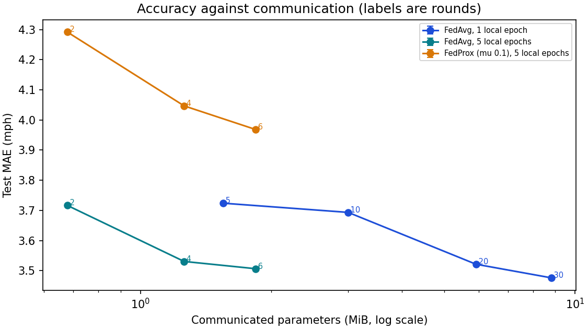

# FedAvg and FedProx under different client distributions

This is the optimization side of the [federated graph study](../fedgraph/report.md). It asks how much federated averaging is affected by how different the clients are, how much local work a round does, how many rounds there are, and how much of the road graph a client can see. It uses the shared Graph-GRU on 64 sensors with 6 clients (seed 7). The runs use the same code the Flower clients run, and a test checks that the in-process loop matches Flower bit for bit; the larger [headline study](../fedgraph/report.md) ran through Flower itself.

## How the clients differ

Three ways to cut the same sensors into 6 clients:

| Partition | Sensors per client | Speed-distribution distance (bits) | Edges kept | Edge weight kept |
|---|---|---:|---:|---:|
| Geographic areas | 17, 13, 12, 10, 9 and 3 | 0.0110 | 69% | 78% |
| Balanced (each client a similar mix) | 11, 11, 11, 11, 10 and 10 | 0.0093 | 15% | 15% |
| Congestion-grouped (each client one regime) | 11, 11, 11, 11, 10 and 10 | 0.0149 | 21% | 25% |

The speed-distribution distance is the average Jensen-Shannon divergence in bits between a client's histogram of training speeds and the pooled histogram (0 means identical). Geographic clients are the realistic case: each owns an area, so they differ in how congested their roads are and have unequal numbers of sensors. Balanced clients each get a similar mix of congested and free-flowing sensors, which makes them as alike as a split can, but it scatters neighbors across clients and cuts most of the graph. Congestion-grouped clients each hold sensors of about the same congestion level, so their speed distributions differ the most, and that is the heterogeneity FedProx was designed for.

## FedAvg against FedProx

FedProx adds a term (mu / 2) times the squared distance to the global weights to every client's loss, which pulls local updates back toward the global model. Test MAE in mph, mean (SD over seeds), the same 30 rounds and the same training examples in every cell:

| Partition | FedAvg | FedProx, mu 0.001 | FedProx, mu 0.01 | FedProx, mu 0.1 |
|---|---:|---:|---:|---:|
| Geographic areas | 3.476 | 3.498 | 3.559 | 3.794 |
| Balanced (each client a similar mix) | 3.452 | - | - | 3.802 |
| Congestion-grouped (each client one regime) | 3.526 | - | 3.591 | 3.812 |

Gaps on identical windows (first minus second, negative favors the first; 95% interval from resampling test days, seeds averaged first):

| Comparison | Gap in MAE (mph) |
|---|---:|
| FedProx (mu 0.001) - FedAvg, geographic clients | +0.022 (+0.018 to +0.025) |
| FedProx (mu 0.01) - FedAvg, geographic clients | +0.082 (+0.066 to +0.098) |
| FedProx (mu 0.1) - FedAvg, geographic clients | +0.318 (+0.265 to +0.365) |
| FedProx (mu 0.01) - FedAvg, congestion-grouped clients | +0.065 (+0.048 to +0.082) |
| FedProx (mu 0.1) - FedAvg, congestion-grouped clients | +0.286 (+0.238 to +0.330) |
| FedProx (mu 0.1) - FedAvg, balanced clients | +0.350 (+0.292 to +0.404) |
| FedAvg, geographic - congestion-grouped clients | -0.050 (-0.061 to -0.039) |
| FedAvg, geographic - balanced clients | +0.024 (+0.013 to +0.036) |
| FedAvg, 5 local epochs over 6 rounds - 1 local epoch over 30 | +0.030 (+0.019 to +0.041) |
| FedProx (mu 0.1) - FedAvg, 5 local epochs | +0.462 (+0.378 to +0.540) |

FedProx was worse than FedAvg in every setting I ran, and the penalty grows with mu (geographic clients: +0.022 at mu 0.001, +0.082 at mu 0.01, +0.318 at mu 0.1). The proximal term pulls every client back toward the global model, which helps when clients drift far apart during long local training. Here a round is only about a hundred optimizer steps and the model is still improving at the end, so the clients probably don't drift much, and the pull mostly slows learning down. Five local epochs per round leave more room to drift, and FedProx (mu 0.1) was still 0.462 mph worse there (interval +0.378 to +0.540), which suggests drift isn't what limits accuracy here.

## What federating costs, by partition

| Partition | Federated | Pooled, same cut graph | Local-only | Federated - pooled | Federated - local-only |
|---|---:|---:|---:|---:|---:|
| Geographic areas | 3.476 | 3.404 | 3.312 | +0.072 (+0.053 to +0.089) | +0.164 (+0.127 to +0.199) |
| Congestion-grouped (each client one regime) | 3.526 | 3.411 | - | +0.115 (+0.089 to +0.140) | - |
| Balanced (each client a similar mix) | 3.452 | 3.425 | - | +0.026 (+0.016 to +0.037) | - |

FedAvg's test MAE from lowest to highest is balanced (3.452), geographic areas (3.476), congestion-grouped (3.526). That is the order of how different the clients' speed distributions are, not of how much of the road graph each cut keeps, so for this model the differences between clients cost more than the lost edges. With one seed that is a hint rather than a result.

The pooled arm gets the same graph as the federated clients (only the edges inside a client), so "federated - pooled" isolates what federated optimization costs, while the partition table above says how much graph each cut removes. Local-only is every client training alone with no communication.

## Local work and rounds

A round is one local epoch over a random third of the client's windows; with more local epochs per round, fewer rounds use the same number of examples. The table gives the test score the server would have had after each number of rounds, from the same run (training in a round never depends on later rounds, and a test checks that a shorter run gives exactly the prefix of a longer one).

| Setting | Rounds | Local epochs in total | MAE (SD) | Communicated MiB |
|---|---:|---:|---:|---:|
| FedAvg, 1 local epoch | 5 | 5 | 3.724 | 1.6 |
| FedAvg, 1 local epoch | 10 | 10 | 3.693 | 3.0 |
| FedAvg, 1 local epoch | 20 | 20 | 3.522 | 5.9 |
| FedAvg, 1 local epoch | 30 | 30 | 3.476 | 8.8 |
| FedAvg, 5 local epochs | 2 | 10 | 3.717 | 0.7 |
| FedAvg, 5 local epochs | 4 | 20 | 3.531 | 1.3 |
| FedAvg, 5 local epochs | 6 | 30 | 3.507 | 1.8 |
| FedProx (mu 0.1), 5 local epochs | 2 | 10 | 4.292 | 0.7 |
| FedProx (mu 0.1), 5 local epochs | 4 | 20 | 4.047 | 1.3 |
| FedProx (mu 0.1), 5 local epochs | 6 | 30 | 3.968 | 1.8 |



With one local epoch per round, MAE goes from 3.724 after 5 rounds (1.6 MiB communicated) to 3.476 after 30 rounds (8.8 MiB), and it was still improving at the end. Five local epochs per round do the same total local work in 6 rounds: 3.507 mph for 1.8 MiB, which is 4.8 times less communication than the 30-round run, and 0.030 mph worse (interval +0.019 to +0.041).

## Local fine-tuning of the federated model

In the [headline study](../fedgraph/report.md) every client training alone beat federated training. This is the middle ground: run federated training as before, then let every client keep training the final federated model on its own data for up to 10 more local rounds (the same local update, fresh seeds, no communication), keeping the round with the best validation MAE on its own data. Round 0 is the federated model itself, so a client only moves away from it when its own validation data says that is better. Seeds 7 and 42, 64 sensors, 6 clients.

| Partition | Federated | Federated + fine-tuning | Local-only | Pooled, same cut graph | Fine-tuned - federated | Fine-tuned - local-only | Fine-tuned - pooled |
|---|---:|---:|---:|---:|---:|---:|---:|
| Geographic areas | 3.473 (0.005) | 3.312 (0.010) | 3.306 (0.008) | 3.401 (0.005) | -0.161 (-0.197 to -0.123) | +0.006 (-0.003 to +0.013) | -0.089 (-0.111 to -0.067) |
| Congestion-grouped | 3.508 (0.026) | 3.324 (0.018) | 3.307 (0.013) | 3.405 (0.008) | -0.184 (-0.222 to -0.144) | +0.017 (+0.011 to +0.023) | -0.082 (-0.099 to -0.063) |

On geographic clients the fine-tuned model was not clearly different from every client training alone (0.006 mph). It was 0.089 mph better than one pooled model with the same graph. On congestion-grouped clients the fine-tuned model was 0.017 mph worse than every client training alone. It was 0.082 mph better than one pooled model with the same graph.

The clients' chosen fine-tuning rounds average between 7.5 and 9.5 of 10, so they were still improving at the limit I allowed. It costs 10 extra local rounds per client (about a third of the federated training compute at 30 rounds), and the result is a personalized model per client rather than one shared model, so it answers a different question than FedAvg does: the federated model is a good starting point for each area, but at this training budget the fine-tuned model doesn't clearly beat each area training alone.

## Limits

- 1 seed. The intervals over test days reflect which days were held out, not the randomness of training.
- 64 sensors, not all 207, so that this many arms were affordable. Larger networks have more room for heterogeneity to matter.
- Three values of mu (0.001, 0.01 and 0.1) and one learning rate. A different local learning rate or more local work could change how FedProx behaves.
- A single-machine simulation, so it says nothing about real network conditions, stragglers or partial participation.
- The partitions are three fixed cuts (partition seed 0), and a different geographic cut changes which edges survive.
- Communication is counted as uncompressed parameter tensors (training down, training up and validation down for every client in every round), not Flower's message overhead.

## Reproduce

```powershell
.\.venv\Scripts\python.exe -m tracast.cli fedgraph --config configs/fedgraph-optimization.json --out runs/fedgraph-optimization
```

Files: [summary.json](summary.json), [settings.json](settings.json) and one folder per case under `cases/`.
