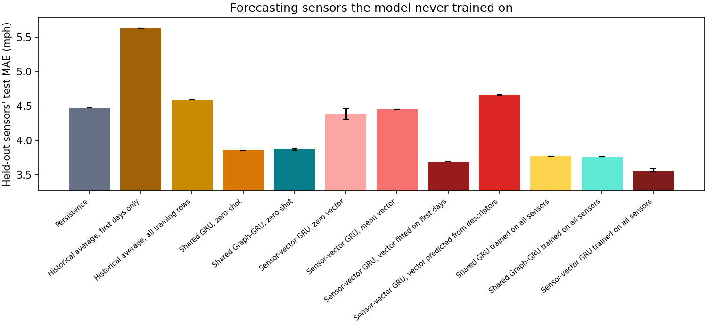
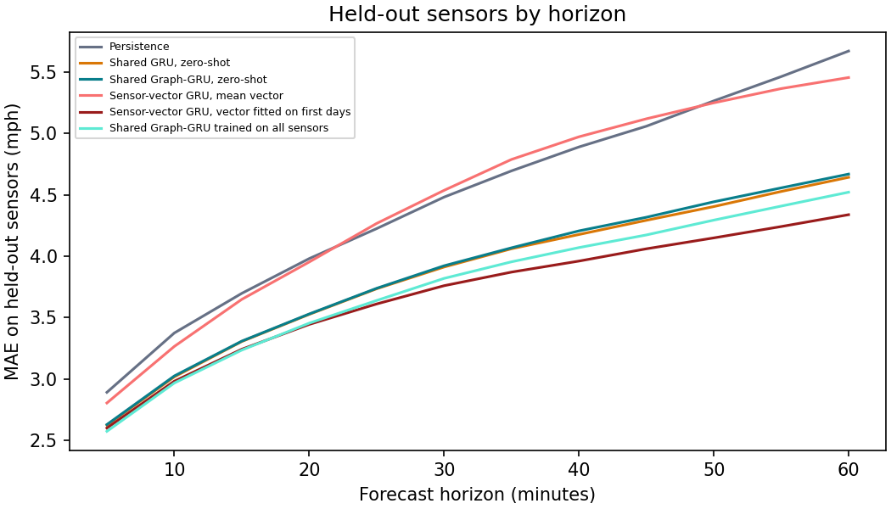

# Sensors the model never trained on

The [variants study](../variants/report.md) found that giving each sensor a small learned vector improves the shared GRU a lot. The catch is that the vector is a row in a table with one row per training sensor, so a sensor that isn't in the table has nothing to look up. The plain shared models have no per-sensor parameters, so a new sensor can simply be fed through. Here I test all of them on sensors they never trained on, and try to fix the vector models.

## Setup

- **Sensors.** The first 64 sensors of the graph ordering. One whole geographic area of 14 sensors (region holdout, chosen from coordinates only) is held out; the other 50 sensors train the models. For the held-out sensors the training period is untouched except for the first 7 days, which stand in for what a newly installed sensor has before it goes live.
- **What a new sensor is allowed to use.** Its first 7 days of readings, its location, and (for the graph model) its neighbors' current readings at forecast time. The first days set its input scaling and, for the fitted and predicted vectors, its vector. The fitted vector also picks its stopping epoch on the sensor's own validation rows; its test rows are only ever scored. A test checks that rewriting the sensor's later training rows changes none of this.
- **Models,** all with calendar inputs and the same training recipe as the earlier studies (30 epochs that each use a random third of the training windows, best epoch on validation kept; seeds 7 and 42):
  - the shared GRU and the shared Graph-GRU, run zero-shot;
  - the sensor-vector GRU (4 numbers per sensor) with a **zero vector**, the **average trained vector**, a vector **fitted** on the new sensors' first days with the network frozen (Adam, 30 epochs), and a vector **predicted** by ridge regression from the sensor's speeds in those days (mean, SD, share below 40 mph) and its latitude and longitude.
- **References.** The same three models trained on every sensor (so they did see the held-out sensors' training rows), persistence, and the historical average, once from the first 7 days only (what a new sensor would have) and once from all its training rows.
- **Scoring.** Test MAE in mph on the held-out sensors only, over the same test windows for every method. 14 sensors, 24 test days.

## Results

| Method | MAE (SD) | RMSE |
|---|---:|---:|
| Persistence | 4.474 (0.000) | 8.899 |
| Historical average, first days only | 5.631 (0.000) | 10.881 |
| Historical average, all training rows | 4.585 (0.000) | 8.432 |
| Shared GRU, zero-shot | 3.851 (0.002) | 7.860 |
| Shared Graph-GRU, zero-shot | 3.867 (0.014) | 7.807 |
| Sensor-vector GRU, zero vector | 4.385 (0.081) | 8.805 |
| Sensor-vector GRU, mean vector | 4.451 (0.002) | 8.967 |
| Sensor-vector GRU, vector predicted from descriptors | 4.663 (0.009) | 9.156 |
| Sensor-vector GRU, vector fitted on first days | 3.688 (0.006) | 7.388 |
| Shared GRU trained on all sensors | 3.766 (0.002) | 7.725 |
| Shared Graph-GRU trained on all sensors | 3.759 (0.003) | 7.648 |
| Sensor-vector GRU trained on all sensors | 3.563 (0.024) | 7.339 |

On a sensor it never saw, the shared Graph-GRU was 0.108 mph worse than the same model trained on that sensor. The shared GRU was 0.086 mph worse than the same model trained on that sensor. For a sensor the model never saw, the Graph-GRU was not clearly different from the GRU without a graph (0.016 mph).

A vector fitted on the first week was 0.697 mph better than a zero vector. It was 0.764 mph better than the average vector. A vector predicted from descriptors was 0.212 mph worse than the average vector. The fitted-vector GRU was 0.179 mph better than the zero-shot shared Graph-GRU. It was 0.125 mph worse than the same model with a vector learned from all the training data.

The zero-shot shared Graph-GRU was 1.764 mph better than a historical average from the first week. It was 0.607 mph better than persistence.

Gaps on identical windows (first minus second, negative favors the first; 95% interval from resampling test days, seeds averaged first):

| Comparison | Gap in MAE (mph) |
|---|---:|
| Shared Graph-GRU, zero-shot - Shared GRU, zero-shot | +0.016 (-0.008 to +0.038) |
| Shared Graph-GRU, zero-shot - Shared Graph-GRU trained on all sensors | +0.108 (+0.087 to +0.131) |
| Shared GRU, zero-shot - Shared GRU trained on all sensors | +0.086 (+0.065 to +0.109) |
| Sensor-vector GRU, vector fitted on first days - Sensor-vector GRU, zero vector | -0.697 (-0.838 to -0.543) |
| Sensor-vector GRU, vector fitted on first days - Sensor-vector GRU, mean vector | -0.764 (-0.914 to -0.599) |
| Sensor-vector GRU, vector predicted from descriptors - Sensor-vector GRU, mean vector | +0.212 (+0.088 to +0.342) |
| Sensor-vector GRU, vector fitted on first days - Sensor-vector GRU, vector predicted from descriptors | -0.976 (-1.147 to -0.783) |
| Sensor-vector GRU, vector fitted on first days - Sensor-vector GRU trained on all sensors | +0.125 (+0.098 to +0.151) |
| Sensor-vector GRU, vector fitted on first days - Shared Graph-GRU, zero-shot | -0.179 (-0.249 to -0.103) |
| Sensor-vector GRU, vector fitted on first days - Shared GRU trained on all sensors | -0.078 (-0.137 to -0.017) |
| Sensor-vector GRU, vector fitted on first days - Shared Graph-GRU trained on all sensors | -0.071 (-0.137 to -0.001) |
| Shared Graph-GRU, zero-shot - Historical average, first days only | -1.764 (-2.018 to -1.508) |
| Sensor-vector GRU, vector fitted on first days - Historical average, first days only | -1.944 (-2.178 to -1.711) |
| Shared Graph-GRU, zero-shot - Persistence | -0.607 (-0.663 to -0.543) |





For comparison, the shared GRU, the shared Graph-GRU and the sensor-vector GRU score 3.320, 3.276 and 3.137 mph on the 50 sensors they trained on.

## Limits

- 2 seeds, one held-out area (14 sensors) and one city. A different area or a random set of sensors (the code supports `holdout: random`) would give different numbers, but I only ran the area.
- The fitted vector uses the new sensor's validation rows to pick its stopping epoch. A real deployment would have to carve those out of the first 7 days; the effect is small, but it does use data after the first 7 days.
- Only the GRU has a vector version here. The Graph-GRU with a vector exists in the benchmark, but I didn't run it on held-out sensors.
- The fitted vector is only as good as the first week: a sensor that is mostly missing then would get a poor one.
- Every model trained to an equal budget, not to convergence.

## Reproduce

```powershell
.\.venv\Scripts\python.exe -m tracast.cli holdout --config configs/holdout.json --out runs/holdout
```

Files: [summary.json](summary.json), [config.json](config.json) and one result file per seed.
