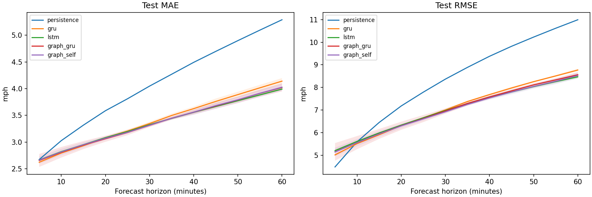
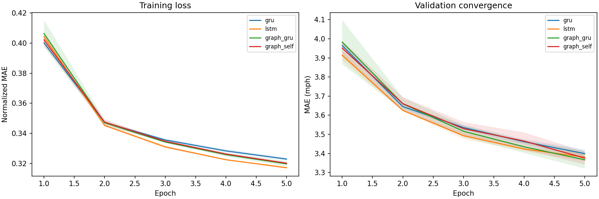

# TraCast: recurrent encoders, road-distance graph features, and federated traffic forecasting

Technical report - October 2026

## Abstract

TraCast evaluates traffic-speed forecasting on the real METR-LA dataset with chronological evaluation, training-only normalization, and masked targets. A fixed 16-sensor subset is selected from the published DCRNN road-distance graph. GRU, LSTM, and Graph-GRU models receive the same training windows and five-epoch budgets across seeds 7, 42, and 2026. Mean test MAE is 3.409 mph for GRU, 3.363 for LSTM, and 3.364 for Graph-GRU, compared with 4.100 for persistence. Removing graph neighbors changes mean MAE by 0.0043 mph, with mixed seed-level effects. A separate Flower study evaluates shared univariate forecasting across disjoint sensor partitions and records accuracy, convergence, sample counts, and parameter communication.

## 1. Introduction

Traffic forecasts depend on both temporal patterns and relationships between sensors. This project asks two questions: how recurrent encoder choice and explicit road-distance context affect forecasting under a fixed training budget, and how local training plus model averaging changes accuracy and communication relative to pooled training. The centralized graph benchmark and federated experiment are separate tasks with their own matched references.

## 2. Related work

[Li et al. (2018)](https://arxiv.org/abs/1707.01926) combine directed diffusion with recurrent forecasting and distribute METR-LA sensor data and distance relationships. TraCast uses those relationships for a simpler one-hop spatial aggregation layer; it does not implement the DCRNN diffusion recurrent cell or scheduled-sampling decoder. [Cho et al. (2014)](https://arxiv.org/abs/1406.1078) introduce the gated recurrent encoder used as the GRU reference. [Hochreiter and Schmidhuber (1997)](https://doi.org/10.1162/neco.1997.9.8.1735) introduce LSTM. [McMahan et al. (2017)](https://arxiv.org/abs/1602.05629) describe federated averaging. [Flower](https://arxiv.org/abs/2007.14390) supplies the client/server runtime used here.

## 3. Data and preprocessing

The checksum-verified HDF5 contains 34,272 five-minute timestamps and 207 sensors, from March 1 through June 27, 2012: 7,094,304 speed entries. The benchmark selects 16 sensors, giving 548,352 speed entries before missing-value masking. Raw timestamps are retained without assigning an undocumented timezone. Numeric columns, unique sensor IDs, increasing timestamps, five-minute spacing, finite nonnegative observations, and file hashes are checked before selection.

Rows split 70/10/20 before sequence construction. Training spans March 1 00:00 to May 23 07:05, validation May 23 07:10 to June 4 04:40, and test June 4 04:45 to June 27 23:55. These contain 23,967, 3,404, and 6,832 windows respectively. Every window stays within its split. Twelve observed time steps predict the next twelve steps, covering 5-60 minute forecast horizons.

Zero and NaN readings are missing. Inputs forward-fill within their split and use the sensor's training mean for leading gaps. A mean and population standard deviation are fitted to each sensor's observed training readings; constant sensors use a scale of one. Missing targets contribute to neither loss nor scores. The same windows, statistics, masks, and batch ordering are used across model architectures for a given seed. The zero-as-missing convention can exclude genuine stopped traffic.

## 4. Distance graph and architecture

The author-distributed distance table is pinned to revision `602afd9d767d3aa1c9b3eac51710d6aeee12c227` and checked by SHA-256. Endpoints outside the canonical 207 METR-LA sensors are excluded. Their aligned finite distance costs set a population standard deviation s. For a supplied directed cost D[i,j], W[i,j] = exp(-(D[i,j]/s)^2), retaining values at least 0.1 and removing self pairs. No speed correlation, validation score, or test target enters graph construction.

A breadth-first traversal from the first canonical sensor selects a connected 16-sensor subset using the union of edge directions, with stronger weights first and ID tie-breaking. Its induced graph contains 85 directed relationships. Full IDs, coordinates, weights, source hashes, and the kernel scale are in [protocol.json](benchmark/protocol.json). Edges express the published distance relationships; straight lines in the figure are not road polylines.

Graph-GRU computes separate row-normalized incoming and outgoing means. At each sensor and time step, a shared Linear(3,4) plus ReLU transforms its own normalized speed and two neighbor means into four features. The 16 node embeddings flatten to 64 features, enter a one-layer GRU with hidden width 32, and feed a linear head producing 12 x 16 forecasts. The self-only ablation sets both neighbor operators to zero while retaining the same learned projection, recurrent encoder, head, initialization rule, and parameter count.

The GRU reference has 16 input channels, 32 hidden units, and the same direct horizon head. LSTM replaces the recurrent encoder with a 32-unit LSTM. These models have different parameter counts; equal epochs and example exposure do not imply equal parameter counts or FLOPs.

## 5. Experimental setup

All learned models train for five epochs using batch size 64, Adam at 0.001, masked MAE in normalized units, and gradient clipping at 5. Every model processes the same training-window budget. The checkpoint with lowest validation MAE is selected separately per model and seed. Test scoring occurs after selection.

Trials run sequentially in fresh Python processes on an AMD Ryzen 7 5825U (8 cores, 16 logical processors), with four PyTorch threads. Windows reports 14,861,852,672 bytes of physical memory. Python 3.11.9, CPU PyTorch 2.5.1, NumPy 1.26.4, pandas 2.2.3, and the remaining runtime packages are pinned. MKLDNN is disabled and deterministic PyTorch algorithms are enabled.

Training time sums update loops, including batch retrieval and excluding validation. Inference timing uses five warmups followed by thirty forward passes on the same first test batch and reports the median per window. It excludes inverse scaling, loading, and metric computation. Full test-evaluation time is logged separately. Windows PeakWorkingSetSize measures the whole fresh process, including HDF5/CSV loading and training; it is not model-only memory. Reported timings describe this workstation run, during which documentation work also occurred.

## 6. Centralized results

Values are mean (sample SD) across three training seeds. Persistence is deterministic and evaluated once. Seed variation uses one shared test block and does not quantify uncertainty across future dates or networks.

| Model | MAE, mph | RMSE, mph | Parameters | Train updates, s | Forward ms/window |
|---|---:|---:|---:|---:|---:|
| Persistence | 4.100 | 8.549 | 0 | 0.00 | 0.0001 |
| GRU | 3.409 (0.032) | 7.179 (0.033) | 11,136 | 11.12 (1.79) | 0.0104 (0.0009) |
| LSTM | 3.363 (0.007) | 7.091 (0.031) | 12,736 | 10.89 (0.97) | 0.0143 (0.0021) |
| Graph-GRU | 3.364 (0.036) | 7.107 (0.106) | 15,760 | 12.73 (1.54) | 0.0211 (0.0088) |
| Graph-GRU, self only | 3.368 (0.023) | 7.073 (0.047) | 15,760 | 12.63 (1.43) | 0.0166 (0.0004) |

### Graph ablation

Graph-GRU minus self-only MAE differences by seed are -0.013652, +0.015787, -0.015134 mph. Their mean is -0.004333 mph. Graph-GRU improves over the raw-input GRU in all three runs, but the edge contribution is small and changes sign. The self-only projection retains most of the mean MAE improvement over the smaller GRU reference. LSTM has nearly the same mean MAE as Graph-GRU, with fewer parameters and lower seed dispersion in this configuration.

Whole-process peak memory was approximately 320 MiB for all architectures. Runtime and preprocessing dominate this measurement, so those small differences should not be interpreted as architecture-specific memory savings.

## 7. Federated learning

The executed Flower baseline used six sensors, seven days, three clients, three rounds, one local epoch per client, and seed 42. Its shared univariate GRU had 3,756 parameters. FedAvg test MAE/RMSE were 4.429506/7.974311 mph, versus 4.071094/7.308574 for its matched centralized reference. Persistence scored 4.215124/7.620558 mph. The parameter payload estimate was 450,720 bytes, including validation and selected-model test downloads. Two complete CLI runs matched in all checkpoint tensors and numerical records.

[Baseline protocol and runtime transcript](federated-smoke/report.md).

Clients are logical sensor partitions on one machine. The shared GRU has one sensor per example so input/output weights retain the same meaning on every client. Sensor normalization uses local observed training readings only. The reference pools those same normalized examples, matches the initial model and exposure, and uses canonical sensor ordering. Model averaging is weighted by usable training-window counts. Evaluation pools absolute errors, squared errors, and valid target counts before calculating MAE/RMSE. Shared files on the simulation host provide logical ownership, not a privacy boundary. No differential privacy or secure aggregation is evaluated.

## 8. Discussion and limits

The learned centralized encoders improve over persistence on this sensor subset and test period. The experiments give little evidence that these one-hop distance features outperform the self-only projection under a five-epoch budget. Only three initialization seeds are used, with no hyperparameter search, temporal resampling, or alternative graph-selection study. The topology-only BFS subset is connected but not representative of every road in METR-LA. Excluding neighbors outside the subset removes spatial context.

The fixed train/validation/test period, short local federated budgets, simulated ownership, and differing model capacities limit broader conclusions. The federated model is univariate; the centralized graph benchmark is multivariate. Their absolute errors should be compared within each experiment, not across the two tables. Peak memory is a process high-water mark. Communication estimates include tensor values only, excluding serialization, metrics, configuration, transport framing, latency, and energy. Raw data provenance and the distribution's license declarations are recorded in [DATA.md](../DATA.md).

## 9. Reproducibility

[README commands](../README.md) fetch hash-checked inputs, run tests, execute the model benchmark, and launch Flower. Experiment records retain resolved configuration, seeds, source/data/dependency hashes, sensor IDs, adjacency, split ranges, scaler values, per-horizon counts, histories, timing definitions, and checkpoint hashes. Historical results remain under `phase1-verified` and `flower-verified` Git tags. The benchmark source commit is `10066eb159ed60cb82ee16c132efa3a5a2b79365`; source content hashes identify its executed working tree. Timings and process IDs are not treated as deterministic numerical outputs.

The benchmark and Flower runs use separate output directories and never overwrite completed experiments. Raw HDF5 files, topology CSVs, checkpoints, generated client partitions, and local Flower state are excluded from Git. Unit tests cover schema validation, chronological boundaries, train-only scaling, masking, horizon pooling, graph direction/alignment, changed-edge predictions, LSTM gradients, actual Flower aggregation and message dispatch, and failed launch states. The experiment CLIs provide the real-data integration runs.

## References

1. Li, Y., Yu, R., Shahabi, C., Liu, Y. (2018). Diffusion Convolutional Recurrent Neural Network: Data-Driven Traffic Forecasting. ICLR. https://arxiv.org/abs/1707.01926
2. Cho, K. et al. (2014). Learning Phrase Representations using RNN Encoder-Decoder for Statistical Machine Translation. EMNLP. https://arxiv.org/abs/1406.1078
3. Hochreiter, S., Schmidhuber, J. (1997). Long Short-Term Memory. Neural Computation 9(8), 1735-1780. https://doi.org/10.1162/neco.1997.9.8.1735
4. McMahan, H. B. et al. (2017). Communication-Efficient Learning of Deep Networks from Decentralized Data. AISTATS. https://arxiv.org/abs/1602.05629
5. Beutel, D. J. et al. (2020). Flower: A Friendly Federated Learning Research Framework. https://arxiv.org/abs/2007.14390
6. Flower 1.42.0 ClientApp, ServerApp and FedAvg documentation. https://flower.ai/docs/framework/tutorial-quickstart-pytorch.html
