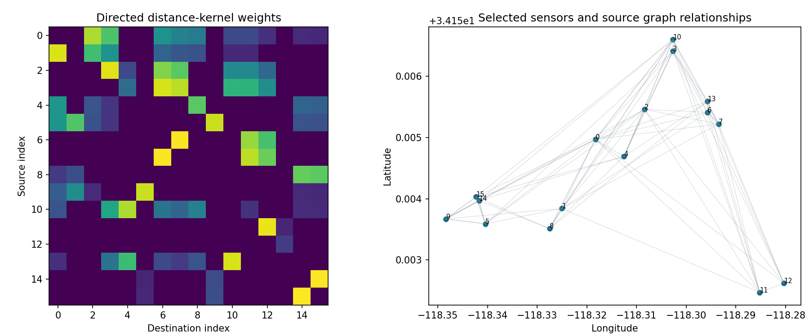
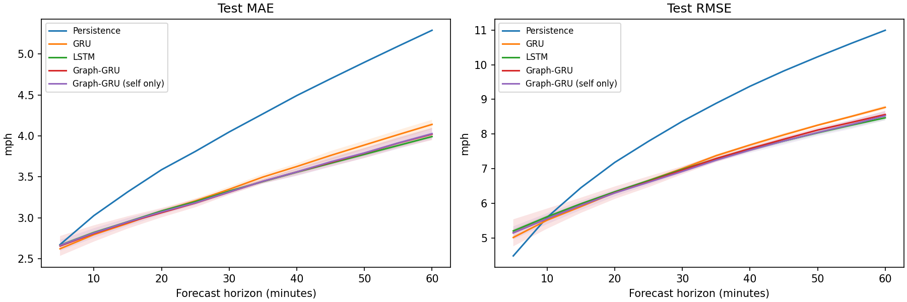
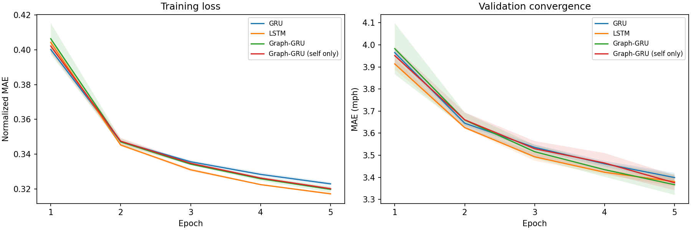
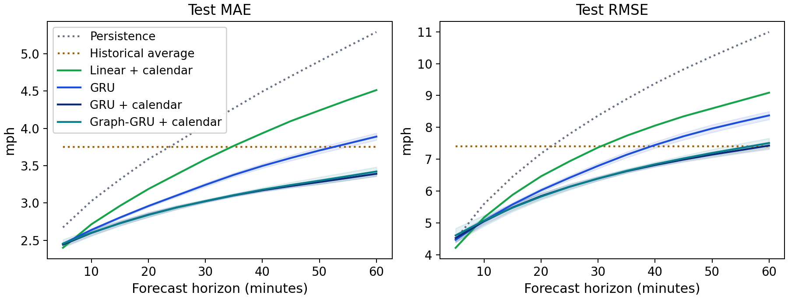
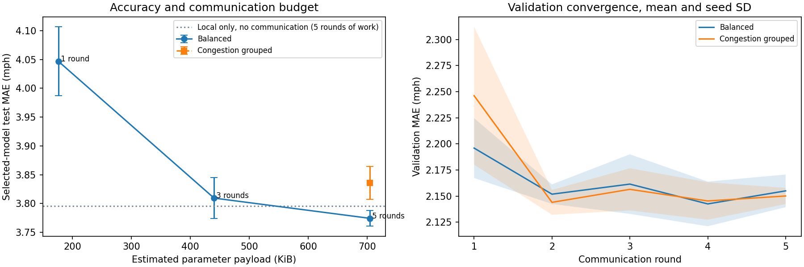
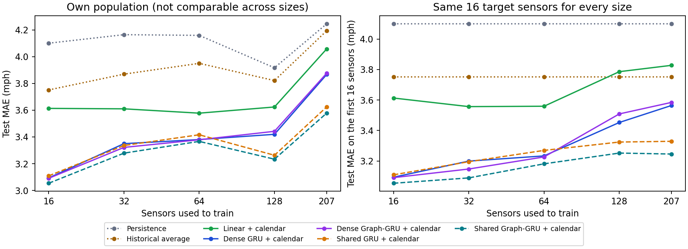
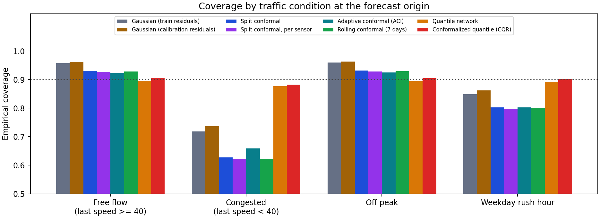
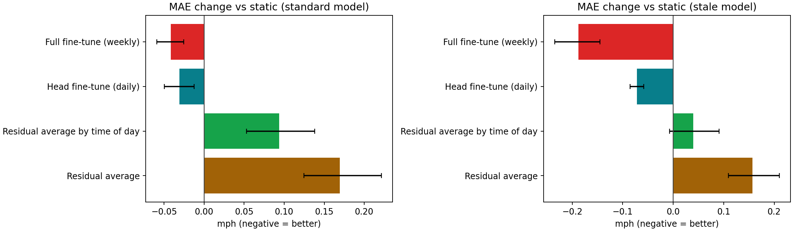
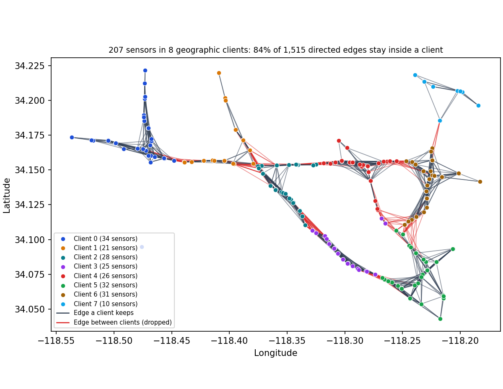
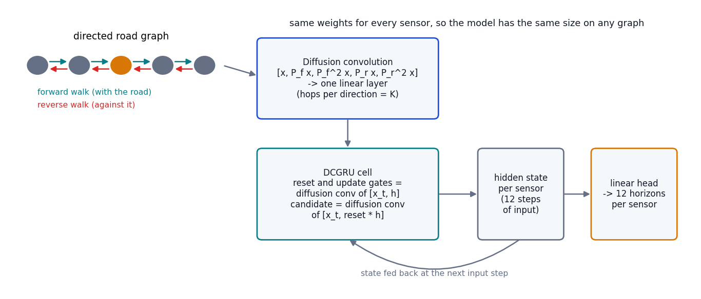

# TraCast: traffic speed forecasting on METR-LA

Technical report, November 2026

## Summary

I compared simple baselines, GRU and LSTM models and a graph-aware GRU for forecasting traffic speed 5 to 60 minutes ahead on METR-LA, using 16 sensors and a chronological split. Every model beats persistence (4.100 mph MAE); the best reaches 2.985. The biggest single improvement came from giving the model the time of day (the GRU goes from 3.255 to 3.007), not from changing the architecture or adding the road graph, which changes MAE by -0.038 mph without the clock and +0.031 with it. A federated simulation (three clients, twelve sensors) ends up close to training each client alone.

Later experiments extend this. **In the shared models the graph helps, at 5 of 5 sizes.** Adding the neighbor averages changes MAE by -0.057 to -0.029 mph. Without them a shared model sees nothing about its neighbors, so this is a clean test of the graph, which the dense models can't give. **Sharing the weights wins once the network is big.** At 128 and 207 sensors the shared GRU beats the dense GRU by 0.157 to 0.242 mph (the interval excludes zero), and at 16, 32 and 64 they are level. It does that with 4,044 parameters instead of 105,396. **In a shared model, telling the sensors apart matters more than the graph.** A learned 4-number vector per sensor changes test MAE by -0.208 to -0.107 mph at 16 and 64 sensors, the graph's neighbor averages by -0.055 to -0.050 and an LSTM instead of a GRU by -0.030 to -0.020 (negative is better). **Prediction intervals that are right on average can fail when it matters.** At a nominal 90%, split conformal covers 90.5% of the test speeds, but only 63% when the last speed was below 40 mph (against 93% in free flow). A quantile network with a conformal correction holds 88% there at the same average width. **Adapting a deployed model helps a little, and cheap adaptation can hurt.** Fine-tuning the output layer daily improves MAE by 0.031 mph and fine-tuning the whole network weekly by 0.042 (for a model trained on only the first 40% of the timeline: 0.072 and 0.188), at 3 s and 27 s for the 24 test days. Averaging past errors into the forecast was worse than doing nothing (+0.094 mph at best). **Federated graph forecasting works at full scale, but training alone was better.** A federated shared Graph-GRU on all 207 sensors (8 geographic clients with 10 to 34 sensors, each seeing only its own part of the road graph) scores 3.672 (0.014) mph, about 0.52 mph better than the historical average. Every client training by itself did 0.161 mph better (interval +0.137 to +0.184), and also beat one pooled model with the same graph, which points to a single set of weights for every area as the limit. **A DCRNN-style diffusion GRU is the best centralized model I tried.** At 16 sensors it beats the shared Graph-GRU by 0.119 mph (interval -0.153 to -0.083) and by 0.174 mph at 64 sensors (one seed there). A randomly relabelled graph is 0.090 mph worse, so the real road structure is what it uses. Federated, with six clients on 64 sensors, that advantage reverses: federated DCRNN is 0.026 mph worse than the federated Graph-GRU (interval +0.005 to +0.051), although pooled it is 0.164 mph better. **A model can forecast sensors it never trained on, and the sensor-vector models can be rescued.** On 14 held-out sensors (a whole area, with only their first week of data available) the shared Graph-GRU scores 3.867 (0.014) mph zero-shot against 3.759 (0.003) when it trained on them. The vector model breaks without a vector (4.385 (0.081) with a zero vector), but fitting just that vector on the first week gives 3.688 (0.006) mph, 0.179 mph better than the plain zero-shot model. Predicting the vector from sensor descriptors did not work (4.663 (0.009) against 4.451 (0.002) for the average vector). **FedProx did not help on 64 sensors with six clients.** FedProx was worse than FedAvg in all 6 settings I ran, and the penalty grows with mu (geographic clients: +0.022 at mu 0.001, +0.082 at mu 0.01, +0.318 at mu 0.1); with five local epochs a round, where there is more drift to correct, it was still 0.462 mph worse. A round here is short and the model is still improving at the end, so the proximal pull mostly slows learning. **Fine-tuning the federated model on each client.** On geographic clients, letting every client keep training the final federated model on its own data improves it by 0.161 mph (interval -0.197 to -0.123) and ends level with every client training alone (no clear difference).

## 1. What I wanted to find out

This started as a way to learn how traffic forecasting works from end to end. I ended up with four questions:

1. Do GRU and LSTM models beat simple baselines like persistence, a historical average and a linear model?
2. Does the road graph help?
3. Does knowing the time of day help?
4. Does federated training lose anything compared with training on all the data in one place, or with each client training alone?

To keep the comparisons fair I wrote one pipeline (data checks, split, normalization, masks, metrics) and ran every model through it.

## 2. Data

METR-LA has speed readings from 207 loop detectors in Los Angeles every five minutes from March 1 to June 27, 2012: 34,272 timestamps and 7,094,304 readings. The file comes from a Hugging Face copy pinned to one revision and checked against a SHA-256 hash ([DATA.md](../DATA.md) has the sources and licenses). On load I check the timestamps, the five-minute spacing, the sensor IDs and that the values are numeric, finite and non-negative. Timestamps are kept as given because the data doesn't say which timezone they use.

Most experiments use 16 sensors (548,352 readings), picked from the road graph (section 3). Rows are split in time: the first 70% is train (March 1 to May 23), the next 10% validation (to June 4) and the last 20% test (June 4 to June 27). Windows are built after the split, so none crosses a boundary. That leaves 23,967 train, 3,404 validation and 6,832 test windows. A model sees 12 steps (one hour) and predicts the next 12.

Zeros and NaNs count as missing. Inputs are forward-filled within their split (leading gaps get the sensor's training mean), each sensor is normalized with the mean and standard deviation of its observed training readings, and missing targets count toward neither the loss nor the scores. Treating zero as missing can throw away real stopped traffic. For a given seed, every model gets the same windows, statistics, masks and batch order.

## 3. Models

**Baselines.** Persistence repeats the last reading. The historical average predicts the training mean for the same sensor, weekday and five-minute slot, and uses no recent readings. The linear model is one linear layer from the flattened input window to all 12 x 16 forecasts.

**GRU and LSTM.** One recurrent layer with 32 hidden units reads all 16 sensors at each step. A linear head turns the last hidden state into all 12 forecast steps for all 16 sensors at once.

**Graph-GRU.** The graph comes from the DCRNN authors' distance table (revision `602afd9d767d3aa1c9b3eac51710d6aeee12c227`). Only pairs between the 207 METR-LA sensors are used. Their finite costs set the standard deviation s of a Gaussian kernel, W[i,j] = exp(-(D[i,j] / s)^2), which I keep when it is at least 0.1 and drop for self pairs. That gives 1,515 directed edges among the 207 sensors. I picked the 16 sensors by walking the graph breadth-first from the first sensor, following edges in either direction and taking stronger ones first, which gives a connected subset with 85 directed edges. Neither the choice of sensors nor the weights use any speed data.

For each sensor and time step, Graph-GRU takes its own normalized speed plus two averages: one over the sensors that feed into it and one over the sensors it feeds, both weighted by the edge weights. A small shared layer (Linear 3 to 4, then ReLU) turns those three numbers into four features per sensor. The 16 x 4 features go into the GRU and the same kind of linear head. "Self only" zeroes the two averages and changes nothing else, so it has the same 15,760 parameters. Every model here reads all 16 sensors, so this ablation tests the graph-weighted averages, not whether neighboring sensors matter.

**Calendar inputs.** Models marked "+ calendar" get three extra inputs at every step: the sine and cosine of the time of day, and a weekend flag.

**Training.** All learned models use batch size 64, Adam with learning rate 0.001, masked MAE in normalized units and gradient clipping at 5. The checkpoint with the lowest validation MAE is the one scored on the test set.

Everything ran on a Ryzen 7 5825U laptop (8 cores, about 14 GB of RAM) with 4 PyTorch threads, Python 3.11.9, CPU PyTorch 2.5.1, NumPy 1.26.4 and pandas 2.2.3. MKLDNN is off and deterministic algorithms are on, so a repeat with the same seed gives the same numbers.

## 4. First pass: five epochs

I started with five epochs per learned model and three seeds (7, 42, 2026). Training time sums the update loops, including batch loading and excluding validation. Forward time is the median of 30 passes over the first test batch, per window, after 5 warmups. Peak memory (Windows PeakWorkingSetSize for the whole process) was about 320 MiB for every model.

| Model | MAE (SD) | RMSE (SD) | Parameters | Train time, s | Forward, ms/window |
|---|---:|---:|---:|---:|---:|
| Persistence | 4.100 | 8.549 | 0 | 0.00 | 0.0001 |
| GRU | 3.409 (0.032) | 7.179 (0.033) | 11,136 | 11.12 (1.79) | 0.0104 (0.0009) |
| LSTM | 3.363 (0.007) | 7.091 (0.031) | 12,736 | 10.89 (0.97) | 0.0143 (0.0021) |
| Graph-GRU | 3.364 (0.036) | 7.107 (0.106) | 15,760 | 12.73 (1.54) | 0.0211 (0.0088) |
| Graph-GRU, self only | 3.368 (0.023) | 7.073 (0.047) | 15,760 | 12.63 (1.43) | 0.0166 (0.0004) |

LSTM and Graph-GRU end up at about the same MAE, and the LSTM has fewer parameters. Graph-GRU minus self-only is -0.0137, +0.0158, -0.0151 mph by seed (mean -0.0043), so the neighbor averages barely matter and the sign changes between seeds. Most of Graph-GRU's lead over the GRU stays when the averages are zeroed.

Five epochs turned out to be too short. In 12 of 12 runs the best validation epoch was the last one, so the models were still improving when training stopped.

## 5. Training longer, and adding calendar inputs

Each model trains for up to 60 epochs, stops after 8 epochs with no validation gain, and halves the learning rate after 2. Models marked "+ calendar" also get the time of day (sine and cosine) and a weekend flag as inputs. I added two simple baselines: a historical average (the training mean for each sensor, weekday and 5-minute slot) and a linear model over the whole input window. 5 seeds: 7, 42, 2026, 123, 999.

| Model | MAE (SD) | MAE range over test days | 15 min | 30 min | 60 min | RMSE (SD) | Parameters | Epochs run |
|---|---:|---:|---:|---:|---:|---:|---:|---:|
| Persistence | 4.100 | 3.681-4.469 | 3.316 | 4.048 | 5.290 | 8.549 | 0 | - |
| Historical average | 3.751 | 3.300-4.185 | 3.751 | 3.751 | 3.752 | 7.405 | 0 | - |
| Linear | 3.622 (0.001) | 3.218-3.988 | 2.967 | 3.602 | 4.572 | 7.386 (0.005) | 37,056 | 43 |
| Linear + calendar | 3.597 (0.003) | 3.196-3.962 | 2.961 | 3.584 | 4.512 | 7.373 (0.007) | 43,968 | 39 |
| GRU | 3.255 (0.026) | 2.892-3.602 | 2.805 | 3.243 | 3.889 | 6.873 (0.085) | 11,136 | 37 |
| GRU + calendar | 3.007 (0.025) | 2.687-3.313 | 2.730 | 3.023 | 3.391 | 6.373 (0.078) | 11,424 | 42 |
| LSTM | 3.271 (0.013) | 2.906-3.617 | 2.845 | 3.259 | 3.885 | 6.913 (0.046) | 12,736 | 32 |
| Graph-GRU | 3.193 (0.038) | 2.844-3.527 | 2.779 | 3.195 | 3.765 | 6.743 (0.134) | 15,760 | 37 |
| Graph-GRU + calendar | 3.016 (0.031) | 2.695-3.324 | 2.727 | 3.026 | 3.422 | 6.403 (0.095) | 16,048 | 35 |
| Graph-GRU (self only) | 3.231 (0.037) | 2.872-3.574 | 2.829 | 3.229 | 3.793 | 6.854 (0.109) | 15,760 | 33 |
| Graph-GRU (self only) + calendar | 2.985 (0.039) | 2.666-3.292 | 2.732 | 3.002 | 3.327 | 6.363 (0.162) | 16,048 | 45 |

MAE and RMSE are test means in mph; 15/30/60 min are MAE at those horizons. The range column resamples the 24 test days to show how much a score depends on which days ended up in the test set. Persistence and the historical average aren't trained, so they run once.

Graph-GRU (self only) + calendar is lowest at 2.985 mph (persistence 4.100, historical average 3.751), but GRU + calendar and Graph-GRU + calendar are within 0.031 mph of it, so I can't rank them. Training longer helped: the GRU went from 3.409 at five epochs to 3.255. Calendar inputs gave the biggest jump: the GRU changes by -0.249 mph (95% CI -0.324 to -0.181). Graph-GRU minus its self-only version (the same model with the neighbor averages zeroed) is -0.038 mph (95% CI -0.062 to -0.018) without calendar inputs and +0.031 mph (95% CI +0.008 to +0.055) with calendar inputs. The sign flips, so the graph doesn't give a reliable gain.

| Difference in MAE (first - second) | Estimate (mph) | 95% CI over test days |
|---|---:|---:|
| GRU + calendar - GRU | -0.249 | -0.324 to -0.181 |
| Linear + calendar - linear | -0.025 | -0.035 to -0.015 |
| Graph-GRU + calendar - Graph-GRU | -0.177 | -0.229 to -0.130 |
| LSTM - GRU | +0.016 | -0.021 to +0.057 |
| Graph-GRU - self only | -0.038 | -0.062 to -0.018 |
| Graph-GRU - self only, both with calendar | +0.031 | +0.008 to +0.055 |
| Graph-GRU - GRU, both with calendar | +0.010 | -0.007 to +0.025 |
| GRU - historical average | -0.496 | -0.672 to -0.320 |
| GRU + calendar - historical average | -0.744 | -0.926 to -0.573 |
| Historical average - persistence | -0.349 | -0.551 to -0.135 |

Negative means the first model is better. Both models in a row are scored on the same windows and the same resampled days. The intervals are about which days were held out; the seed SDs in the table above cover random initialization.

## 6. Federated learning

The centralized models above read all 16 sensors together. For federated learning I wanted a model that means the same thing on every client, so the federated task uses a univariate GRU shared across sensors: one sensor per example, 3,756 parameters (15,024 bytes).

The setup is twelve sensors, the first 4,032 timestamps (fourteen days), three clients with four sensors each (no sensor on two clients), three seeds (7, 42, 2026) and one local epoch per round. The runtime is Flower 1.42.0 (`ClientApp`, `ServerApp`, `FedAvg`) through `flwr run` on Ray, with all clients on one machine. Each sensor is normalized with its own training statistics. The server averages weights, weighted by each client's number of usable training examples (examples with at least one observed target). Errors are pooled as sums and counts before computing MAE and RMSE.

There are two references. Centralized trains one model on all clients' examples with the same starting weights, scalers, masks and total number of examples. Local-only trains each client by itself with the same local work and no communication, and each client keeps the round with its own best validation MAE. Optimizers restart at every local fit, and no optimizer state is shared.

Sensors are ranked by the fraction of their training readings below 40 mph. Balanced groups interleave those ranks across clients and congestion-grouped clients get consecutive blocks. The mean Jensen-Shannon divergence between each client's training speed histogram and the pooled one is 0.0169 bits for balanced groups and 0.0307 for congestion groups.

| Sensor grouping | Rounds | Federated MAE | Centralized MAE | Local-only MAE | Model weights sent |
|---|---:|---:|---:|---:|---:|
| Balanced | 1 | 4.047 | 3.792 | 4.003 | 180,288 B |
| Balanced | 3 | 3.809 | 3.765 | 3.826 | 450,720 B |
| Balanced | 5 | 3.774 | 3.750 | 3.796 | 721,152 B |
| Congestion-grouped | 5 | 3.836 | 3.750 | 3.769 | 721,152 B |

At 5 rounds with balanced groups, federated averaging gets 3.774 mph, local-only 3.796 and centralized 3.750. With congestion-grouped clients it is 3.836 against 3.769. The gaps are about the size of the seed spread, so in this setup training alone is about as good as federating.

Going from 1 to 5 rounds cuts balanced MAE by 0.273 mph and sends 4 times as many model-weight bytes. The byte counts cover weights sent for training, validation and the final test; message overhead isn't counted. Congestion grouping raises MAE by 0.0616 mph at five rounds while lowering RMSE by 0.0072, so the change in the speed distribution doesn't hit both measures the same way.

As a check, the centralized reference is identical for both ownership rules, and for each seed the global model after r rounds matches the one from the longer runs. [Client assignments, per-seed numbers and the communication count](federated-study/findings.md).

## 7. Scaling to all 207 sensors

Everything above uses 16 sensors from one highway. I ran the same comparison on nested sets of 16, 32, 64, 128 and 207 sensors (each set contains the one before it), plus two new models that share one small GRU across every sensor, so their size doesn't depend on how many sensors there are. Test MAE in mph on the same first 16 sensors, whatever size the model was trained on:

| Trained on this many sensors | 16 | 32 | 64 | 128 | 207 |
|---|---:|---:|---:|---:|---:|
| Historical average | 3.751 | 3.751 | 3.751 | 3.751 | 3.751 |
| Dense GRU | 3.094 (0.012) | 3.199 (0.035) | 3.233 (0.013) | 3.453 (0.036) | 3.564 (0.017) |
| Dense Graph-GRU | 3.091 (0.036) | 3.147 (0.016) | 3.227 (0.019) | 3.509 (0.076) | 3.585 (0.038) |
| Shared GRU | 3.109 (0.010) | 3.195 (0.008) | 3.270 (0.011) | 3.324 (0.014) | 3.329 (0.005) |
| Shared Graph-GRU | 3.054 (0.013) | 3.089 (0.007) | 3.181 (0.019) | 3.252 (0.017) | 3.246 (0.006) |

The graph helps the shared models at every size (-0.057 to -0.029 mph), which the dense models can't show because they already read every sensor. Sharing the weights also wins once the network is big: at 128 and 207 sensors the shared GRU beats the dense one by 0.157 to 0.242 mph with 4,044 parameters instead of 105,396. What it costs is compute: at 207 sensors the shared Graph-GRU needs 23.9 s per epoch against 2.1 s for the dense one. And more sensors did not make the first 16 better: trained on all 207, the dense models are +0.471 to +0.494 mph worse on those 16 targets, the shared ones +0.192 to +0.220.

Two variants of the shared models are in the [variants report](variants/report.md), tested at 16 and 64 sensors. A learned vector of 4 numbers per sensor, which lets the shared network tell sensors apart, changes the test MAE on the sensors the models train on by -0.208 to -0.107 mph (negative is better), a bigger effect than the graph has, and with it the shared GRU scores 3.045 on the first 16 sensors when trained on 64, against 3.233 for the dense GRU. The catch is that a model with those vectors can't forecast a sensor it wasn't trained on. Swapping the GRU for an LSTM changes it by -0.030 to -0.020.

The sizes' own-population scores, the cost in time and memory, and the limits are in the [scaling report](scaling/report.md).

## 8. Prediction intervals

A point forecast doesn't say how sure the model is, so I built 90% prediction intervals on the 16-sensor GRU and checked them on the held-out test days. There is a separate calibration part between validation and test that never touches training or the choice of checkpoint. Methods: a Gaussian baseline, split conformal, adaptive conformal (ACI), and a quantile network with a conformal correction (CQR). Averages over 3 seeds:

| Method | Coverage | Width (mph) | Coverage when last speed < 40 mph | Interval score |
|---|---:|---:|---:|---:|
| Gaussian, training residuals | 0.938 | 18.7 | 0.718 | 32.5 |
| Split conformal | 0.905 | 13.9 | 0.627 | 32.0 |
| Adaptive conformal (ACI) | 0.900 | 13.9 | 0.659 | 32.1 |
| Conformalized quantile (CQR) | 0.904 | 13.8 | 0.882 | 19.7 |

At a nominal 90%, split conformal covers 90.5% of the test speeds, calibrated across all twelve horizons, while the Gaussian baselines overshoot it (93.8%) and drift away from the diagonal at other levels. But when the last speed was below 40 mph (8% of the targets), split conformal covers 63% and ACI 66%, against 93% in free flow: one quantile for everything is too small exactly when traffic is bad. The quantile network with a conformal correction learns widths that depend on the traffic state and holds 88% there, at the same average width (13.8 against 13.9 mph) and with an interval score of 19.7 against 32.0. Letting ACI adapt faster does lift congestion coverage to 88%, but only by widening every interval (the average goes from 13.9 to 19.6 mph).

The other methods, the reliability plot, coverage by horizon and day, and the limits are in the [intervals report](uncertainty/report.md).

## 9. Drift and adaptation

A model is trained once and used for months, so I replayed the test period one day at a time and let it adapt using only data that had already arrived (the tests check that nothing from the future gets in). Test MAE in mph, with the change against the static model in brackets, for the usual model and for a stale one trained on only the first 40% of the timeline:

| Strategy | Standard model | Stale model | Adaptation seconds (standard) |
|---|---:|---:|---:|
| Static model | 3.006 | 3.250 | 0 |
| Residual average | 3.176 (+0.169) | 3.407 (+0.157) | 1 |
| Residual average by time of day | 3.100 (+0.094) | 3.290 (+0.040) | 0 |
| Output layer fine-tuned daily | 2.976 (-0.031) | 3.179 (-0.072) | 3 |
| Whole network fine-tuned weekly | 2.965 (-0.042) | 3.062 (-0.188) | 27 |

Fine-tuning the output layer daily improves the usual model's MAE by 0.031 mph and fine-tuning the whole network weekly by 0.042, and both intervals over test days exclude zero. For a stale model the gains are 0.072 and 0.188, so weekly fine-tuning wins back 77% of the 0.244 mph the stale model lost. The output-layer update costs 3 s over the 24 test days against 27 s for the weekly one. Averaging past errors into the forecast made things worse. The drift in these four months is mild, and the static model's error didn't grow with time since training, so the gains are small.

The data drift statistics, the regime breakdown and the limits are in the [drift report](shift/report.md).

## 10. Federated graph learning

The first federated experiment was small: 12 sensors and a GRU that looked at one sensor at a time. The shared Graph-GRU can be federated properly, because its 4,236 weights don't depend on how many sensors a client has. I cut all 207 sensors into 8 geographic clients (10, 21, 25, 26, 28, 31, 32 and 34 sensors) with k-means on their coordinates. A client sees only its own sensors' readings and the road graph among them, so 16% of the road edges (the ones crossing into another client) are gone for everyone. Flower's FedAvg averages only the learned weights. Test MAE in mph, 2 seeds, with a pooled model (same data and training examples, one place) and local-only training (no communication) as references:

| Arm | MAE (SD) | RMSE |
|---|---:|---:|
| Federated shared Graph-GRU | 3.672 (0.014) | 7.202 |
| Federated shared GRU (no graph) | 3.705 (0.006) | 7.257 |
| Pooled shared Graph-GRU, full graph | 3.580 (0.007) | 7.092 |
| Pooled shared Graph-GRU, local graphs only | 3.596 (0.005) | 7.134 |
| Local-only shared Graph-GRU (no communication) | 3.511 (0.000) | 6.979 |
| Persistence | 4.245 | 8.196 |
| Historical average | 4.193 | 7.862 |

Federated training cost +0.076 (+0.061 to +0.090) mph against a pooled model with the same cut graph, and the local graph still helped (-0.034 (-0.046 to -0.022) mph against the federated model with no graph). Training alone won on every client; the [headline report](fedgraph/report.md) has the numbers by client and by forecast horizon. The weights are tiny next to the data (11.8 MiB exchanged over the whole run), though this is a single-machine simulation, not a deployment.

## 11. A DCRNN-style diffusion GRU

The shared Graph-GRU only averages direct neighbors. DCRNN (Li et al., ICLR 2018) puts diffusion convolution inside the GRU gates: random walks along the road and against it, several hops, so information can travel along the network and the direction of the road matters. I wrote it from the paper's equations as a direct multi-horizon model, with the number of hops, the directions and the isolated-sensor handling configurable, and it works with the pooled and the federated code. Test MAE in mph at 16 sensors, same data, splits and update budget for every model:

| Model | MAE (SD) | Parameters |
|---|---:|---:|
| Dense GRU | 3.082 (0.021) | 11,424 |
| Shared GRU (no graph) | 3.117 (0.016) | 4,044 |
| Shared Graph-GRU (one-hop neighbor averages) | 3.061 (0.015) | 4,236 |
| DCRNN with no diffusion (0 hops) | 3.116 (0.012) | 3,948 |
| DCRNN, shuffled graph | 3.032 (0.016) | 17,772 |
| DCRNN (2 hops, forward and reverse) | 2.942 (0.019) | 17,772 |

Three hops are not clearly better than two. Diffusion itself is worth 0.174 mph over the same model with no hops. Treating the road as undirected is 0.102 mph worse than using both directions. Federated, with six clients on 64 sensors, that advantage reverses: federated DCRNN is 0.026 mph worse than the federated Graph-GRU (interval +0.005 to +0.051), although pooled it is 0.164 mph better. Federating costs DCRNN 0.259 mph and the Graph-GRU 0.072 against pooled models with the same cut graph. The [report](diffusion/report.md) has the ablations, the 64-sensor results and the federated runs.

## 12. Sensors the model never saw

A sensor-vector model has a row per training sensor, so a new sensor has no vector, while the plain shared models can take any sensor. I held out one geographic area and gave each new sensor only its first week of readings. Test MAE in mph on the held-out sensors, 2 seeds:

| Method | MAE (SD) |
|---|---:|
| Persistence | 4.474 (0.000) |
| Historical average, first days only | 5.631 (0.000) |
| Shared GRU, zero-shot | 3.851 (0.002) |
| Shared Graph-GRU, zero-shot | 3.867 (0.014) |
| Sensor-vector GRU, zero vector | 4.385 (0.081) |
| Sensor-vector GRU, mean vector | 4.451 (0.002) |
| Sensor-vector GRU, vector predicted from descriptors | 4.663 (0.009) |
| Sensor-vector GRU, vector fitted on first days | 3.688 (0.006) |
| Shared Graph-GRU trained on all sensors | 3.759 (0.003) |
| Sensor-vector GRU trained on all sensors | 3.563 (0.024) |

The [report](holdout/report.md) has the comparisons with intervals and the limits.

## 13. FedAvg, FedProx and different kinds of clients

The [FedProx study](fedopt/report.md) uses 64 sensors and six clients, cut three ways (by area, balanced across congestion levels, or grouped by congestion level), and compares FedAvg and FedProx at several strengths, five local epochs against one, pooled and local-only references, and local fine-tuning of the federated model. In that one seed FedAvg's error followed how different the clients' speed distributions were rather than how much of the road graph each cut kept, and five local epochs a round cut the communication by about a factor of five at a small cost in accuracy. The FedProx grid used seed 7 and the fine-tuning runs seeds 7 and 42.

## 14. What I take from this

- **Give the model the clock.** Time of day and a weekend flag beat every architecture change I tried. By 30 minutes ahead, a plain historical average already beats persistence.
- **The graph wasn't worth it here.** The neighbor averages helped a little without the clock and hurt a little with it, and Graph-GRU with the clock is not clearly different from a GRU with the clock.
- **Check training length before comparing models.** After five epochs the LSTM and Graph-GRU both looked better than the GRU by about 0.046 mph. With proper training the LSTM is level with the GRU (+0.016) and Graph-GRU is 0.062 ahead, a lead that disappears once the clock is added.
- **Federated averaging didn't beat training alone** for this small model and short slice, and pooling the data was best.
- **In the shared models the graph helps, at 5 of 5 sizes.** Adding the neighbor averages changes MAE by -0.057 to -0.029 mph. Without them a shared model sees nothing about its neighbors, so this is a clean test of the graph, which the dense models can't give.
- **Sharing the weights wins once the network is big.** At 128 and 207 sensors the shared GRU beats the dense GRU by 0.157 to 0.242 mph (the interval excludes zero), and at 16, 32 and 64 they are level. It does that with 4,044 parameters instead of 105,396.
- **In a shared model, telling the sensors apart matters more than the graph.** A learned 4-number vector per sensor changes test MAE by -0.208 to -0.107 mph at 16 and 64 sensors, the graph's neighbor averages by -0.055 to -0.050 and an LSTM instead of a GRU by -0.030 to -0.020 (negative is better).
- **Prediction intervals that are right on average can fail when it matters.** At a nominal 90%, split conformal covers 90.5% of the test speeds, but only 63% when the last speed was below 40 mph (against 93% in free flow). A quantile network with a conformal correction holds 88% there at the same average width.
- **Adapting a deployed model helps a little, and cheap adaptation can hurt.** Fine-tuning the output layer daily improves MAE by 0.031 mph and fine-tuning the whole network weekly by 0.042 (for a model trained on only the first 40% of the timeline: 0.072 and 0.188), at 3 s and 27 s for the 24 test days. Averaging past errors into the forecast was worse than doing nothing (+0.094 mph at best).
- **Federated graph forecasting works at full scale, but training alone was better.** A federated shared Graph-GRU on all 207 sensors (8 geographic clients with 10 to 34 sensors, each seeing only its own part of the road graph) scores 3.672 (0.014) mph, about 0.52 mph better than the historical average. Every client training by itself did 0.161 mph better (interval +0.137 to +0.184), and also beat one pooled model with the same graph, which points to a single set of weights for every area as the limit.
- **A DCRNN-style diffusion GRU is the best centralized model I tried.** At 16 sensors it beats the shared Graph-GRU by 0.119 mph (interval -0.153 to -0.083) and by 0.174 mph at 64 sensors (one seed there). A randomly relabelled graph is 0.090 mph worse, so the real road structure is what it uses. Federated, with six clients on 64 sensors, that advantage reverses: federated DCRNN is 0.026 mph worse than the federated Graph-GRU (interval +0.005 to +0.051), although pooled it is 0.164 mph better.
- **A model can forecast sensors it never trained on, and the sensor-vector models can be rescued.** On 14 held-out sensors (a whole area, with only their first week of data available) the shared Graph-GRU scores 3.867 (0.014) mph zero-shot against 3.759 (0.003) when it trained on them. The vector model breaks without a vector (4.385 (0.081) with a zero vector), but fitting just that vector on the first week gives 3.688 (0.006) mph, 0.179 mph better than the plain zero-shot model. Predicting the vector from sensor descriptors did not work (4.663 (0.009) against 4.451 (0.002) for the average vector).
- **FedProx did not help on 64 sensors with six clients.** FedProx was worse than FedAvg in all 6 settings I ran, and the penalty grows with mu (geographic clients: +0.022 at mu 0.001, +0.082 at mu 0.01, +0.318 at mu 0.1); with five local epochs a round, where there is more drift to correct, it was still 0.462 mph worse. A round here is short and the model is still improving at the end, so the proximal pull mostly slows learning.
- **Fine-tuning the federated model on each client.** On geographic clients, letting every client keep training the final federated model on its own data improves it by 0.161 mph (interval -0.197 to -0.123) and ends level with every client training alone (no clear difference).

What this doesn't cover: one 16-sensor subset picked by a graph walk (not representative of every road, and neighbors outside the subset are missing), one 24-day test window (scores move by about 0.3 mph with the choice of days, though the gaps between models are much tighter), no hyperparameter search, and a federated task that is univariate and simulated on one machine, so its errors shouldn't be compared with the centralized tables. Timings are rough, and the byte counts only cover model weights.

## 15. Reproducing it

The [README](../README.md) and the [run guide](../docs/reproducibility.md) have the commands. They fetch checksum-verified data and use pinned dependencies. Each experiment's folder in `reports/` has its config, source and data hashes, sensor IDs, split ranges, scaler values, histories and per-horizon counts. Unit tests run on small constructed arrays, and the experiment commands are the real-data runs.

## 16. Where this could go next

- Bigger shared models and longer training. The scores on the first 16 sensors got worse as the training population grew, every federated arm's best round was its last, and training alone beat one set of shared weights for every area. A bigger shared model, or a few specialized ones, is the first thing to try, with the fine-tuning result (which already closes the gap) as the one to compare against.
- A closer DCRNN: the paper's encoder-decoder with scheduled sampling, a second layer, and training for accuracy on all 207 sensors (mine predicts every horizon at once from the last hidden state, and is trained up to 64 sensors and only timed at 207).
- Real deployment effects (partial participation, stragglers, dropped clients, a network) that a single-machine simulation can't show, and more rounds and learning-rate schedules for FedAvg and FedProx.
- More than one geographic cut, and more seeds. The partitions are fixed k-means solutions and the federated studies use one or two seeds, so a different cut or another seed could change the smaller gaps.
- Held-out sensors beyond one area: a random set of sensors, the graph model with a vector, and a better way to start a new sensor than the average vector (predicting it from descriptors didn't work).
- Intervals that are joint across horizons and sensors, and conformal methods with guarantees conditional on the traffic state instead of only on average.
- More data: another year or another city, and drift with real change points (roadworks, a sensor replaced) and a change detector that decides when to adapt.

## References

1. Li, Y., Yu, R., Shahabi, C., Liu, Y. (2018). Diffusion Convolutional Recurrent Neural Network: Data-Driven Traffic Forecasting. ICLR. https://arxiv.org/abs/1707.01926
2. Cho, K. et al. (2014). Learning Phrase Representations using RNN Encoder-Decoder for Statistical Machine Translation. EMNLP. https://arxiv.org/abs/1406.1078
3. Hochreiter, S., Schmidhuber, J. (1997). Long Short-Term Memory. Neural Computation 9(8), 1735-1780. https://doi.org/10.1162/neco.1997.9.8.1735
4. McMahan, H. B. et al. (2017). Communication-Efficient Learning of Deep Networks from Decentralized Data. AISTATS. https://arxiv.org/abs/1602.05629
5. Beutel, D. J. et al. (2020). Flower: A Friendly Federated Learning Research Framework. https://arxiv.org/abs/2007.14390
6. Li, T., Sahu, A. K., Zaheer, M., Sanjabi, M., Talwalkar, A., Smith, V. (2020). Federated Optimization in Heterogeneous Networks (FedProx). MLSys. https://arxiv.org/abs/1812.06127
