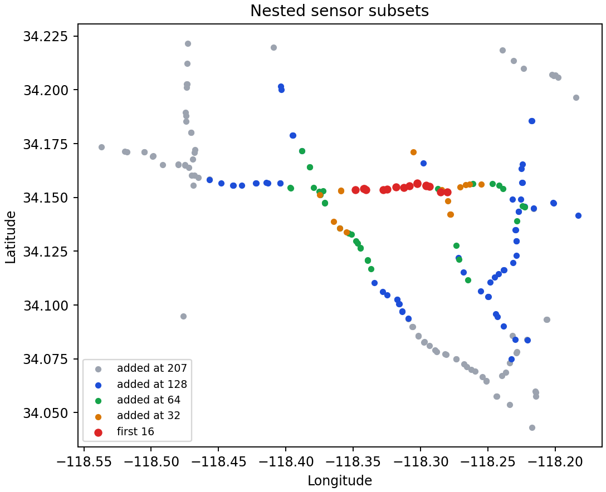
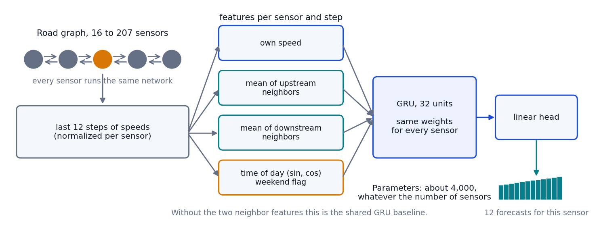
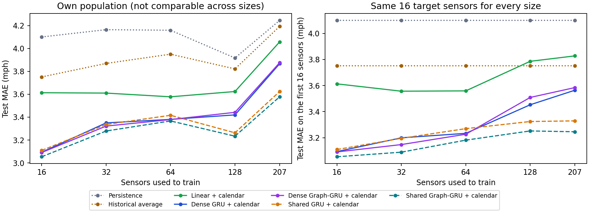
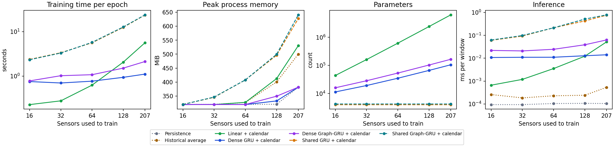

# Scaling to the whole network

Everything so far used 16 sensors that happen to sit on one highway. METR-LA has 207, so the obvious question is what changes when the model sees all of them, and whether the road graph helps more when there is more of it.



## Setup

The sensors are prefixes of one ordering of the whole graph (a breadth-first walk from the first sensor, then the one sensor the walk can't reach). So the first 16 are exactly the sensors from the earlier experiments and every bigger set contains the smaller ones. The sizes are 16, 32, 64, 128, 207. Splits, windows, masking and training-only normalization are the same as before, and a test checks that the 16-sensor results didn't move.

Models, all with 32 hidden units and the calendar inputs:

- **Dense GRU and dense Graph-GRU**: the earlier models. They read all sensors at once, so their input and output layers grow with the sensor count.
- **Shared GRU and shared Graph-GRU**: one small GRU run on every sensor separately with the same weights, so the size doesn't depend on the sensor count. The shared Graph-GRU also gets the average speed of each sensor's upstream and downstream neighbors; the shared GRU gets nothing but the sensor's own history.
- A linear model, the historical average and persistence as baselines.



Every model gets the same number of updates at every size: 30 epochs that each use a random third of the training windows (so 10 full passes), with the learning rate halved when validation stalls, and the best epoch on validation is kept. Seeds: 7, 42. That is a budget, not early stopping, so a model that needs longer is at a disadvantage; the earlier experiments showed this matters, and it is one of the limits below.

## Two kinds of comparison

The sets of sensors differ between sizes, so a score on "all the sensors" isn't comparable across sizes: the added sensors are simply harder (persistence goes from 4.10 to 4.25 mph and the historical average from 3.75 to 4.19). I report two things:

- **Own population**: each model scored on all the sensors it was trained on. Fine for comparing models at one size.
- **Same 16 sensors**: every model scored on the first 16 sensors only, so the targets are identical at every size. This is the fair way to ask whether more sensors help.

## Results

Test MAE in mph on the same first 16 sensors, mean (SD over seeds):

| Model | 16 | 32 | 64 | 128 | 207 |
|---|---:|---:|---:|---:|---:|
| Persistence | 4.100 | 4.100 | 4.100 | 4.100 | 4.100 |
| Historical average | 3.751 | 3.751 | 3.751 | 3.751 | 3.751 |
| Linear + calendar (dense) | 3.613 (0.006) | 3.557 (0.016) | 3.559 (0.039) | 3.786 (0.015) | 3.828 (0.124) |
| GRU + calendar (dense) | 3.094 (0.012) | 3.199 (0.035) | 3.233 (0.013) | 3.453 (0.036) | 3.564 (0.017) |
| Graph-GRU + calendar (dense) | 3.091 (0.036) | 3.147 (0.016) | 3.227 (0.019) | 3.509 (0.076) | 3.585 (0.038) |
| Shared GRU + calendar | 3.109 (0.010) | 3.195 (0.008) | 3.270 (0.011) | 3.324 (0.014) | 3.329 (0.005) |
| Shared Graph-GRU + calendar | 3.054 (0.013) | 3.089 (0.007) | 3.181 (0.019) | 3.252 (0.017) | 3.246 (0.006) |

Test MAE in mph on all the sensors each model was trained on (not comparable across columns):

| Model | 16 | 32 | 64 | 128 | 207 |
|---|---:|---:|---:|---:|---:|
| Persistence | 4.100 | 4.164 | 4.159 | 3.917 | 4.245 |
| Historical average | 3.751 | 3.869 | 3.950 | 3.821 | 4.193 |
| Linear + calendar (dense) | 3.613 (0.006) | 3.610 (0.013) | 3.578 (0.038) | 3.624 (0.001) | 4.057 (0.113) |
| GRU + calendar (dense) | 3.094 (0.012) | 3.350 (0.025) | 3.380 (0.008) | 3.420 (0.014) | 3.866 (0.003) |
| Graph-GRU + calendar (dense) | 3.091 (0.036) | 3.322 (0.006) | 3.379 (0.020) | 3.442 (0.032) | 3.876 (0.003) |
| Shared GRU + calendar | 3.109 (0.010) | 3.336 (0.007) | 3.416 (0.001) | 3.263 (0.000) | 3.624 (0.005) |
| Shared Graph-GRU + calendar | 3.054 (0.013) | 3.279 (0.012) | 3.367 (0.004) | 3.234 (0.008) | 3.578 (0.005) |

- **In the shared models the graph helps, at 5 of 5 sizes.** Adding the neighbor averages changes MAE by -0.057 to -0.029 mph. Without them a shared model sees nothing about its neighbors, so this is a clean test of the graph, which the dense models can't give.
- **In the dense models it barely shows.** The same graph features move the dense GRU by -0.028 to +0.022 mph, because a dense GRU already reads every sensor.
- **Sharing the weights wins once the network is big.** At 128 and 207 sensors the shared GRU beats the dense GRU by 0.157 to 0.242 mph (the interval excludes zero), and at 16, 32 and 64 they are level. It does that with 4,044 parameters instead of 105,396.
- **More sensors did not make the first 16 better, and the dense models suffer most.** Trained on all 207 sensors, the dense models are +0.471 to +0.494 mph worse on the same 16 targets than when trained on 16, the shared models +0.192 to +0.220. With the same capacity and the same number of updates, a bigger and more varied network is harder to fit, and a dense network has to squeeze every sensor through the same 32 hidden units.
- **The shared model's size doesn't grow, its compute does.** It stays at 4,236 parameters while the dense Graph-GRU needs 165,028 at 207 sensors. But the time per epoch grows x10.2 from 16 to 207 sensors for the shared Graph-GRU (there are x13 more sensors) against x2.7 for the dense one. At 207 sensors that is 23.9 s per epoch against 2.1 s.
- **On all 207 sensors the best model is Shared Graph-GRU + calendar** at 3.578 mph, 15% lower than the historical average (4.193).

Gaps between models at each size, on identical windows (first minus second, negative favors the first; 95% interval from resampling test days, seeds averaged first):

| Size | Shared graph - shared plain | Shared plain - dense plain | Shared graph - dense graph | Dense graph - dense plain |
|---|---:|---:|---:|---:|
| 16 | -0.055 (-0.082 to -0.030) | +0.016 (-0.061 to +0.086) | -0.037 (-0.119 to +0.036) | -0.003 (-0.017 to +0.013) |
| 32 | -0.057 (-0.074 to -0.042) | -0.014 (-0.102 to +0.068) | -0.043 (-0.133 to +0.043) | -0.028 (-0.049 to -0.006) |
| 64 | -0.050 (-0.064 to -0.036) | +0.036 (-0.053 to +0.116) | -0.012 (-0.116 to +0.077) | -0.002 (-0.024 to +0.022) |
| 128 | -0.029 (-0.046 to -0.015) | -0.157 (-0.258 to -0.058) | -0.208 (-0.297 to -0.116) | +0.022 (-0.018 to +0.061) |
| 207 | -0.046 (-0.058 to -0.035) | -0.242 (-0.343 to -0.146) | -0.298 (-0.418 to -0.189) | +0.009 (-0.038 to +0.064) |



## Cost

Measured in a separate short run with nothing else running on the machine (8 threads, 3 epochs of a random third of the windows, one seed).

| Model | Parameters at 207 | Seconds per epoch, 16/32/64/128/207 | Peak memory (MiB), 16/32/64/128/207 | Inference ms per window, 16/32/64/128/207 |
|---|---:|---:|---:|---:|
| Linear + calendar (dense) | 6,262,164 | 0.2 / 0.3 / 0.6 / 2.1 / 5.6 | 320 / 320 / 327 / 413 / 530 | 0.001 / 0.001 / 0.004 / 0.012 / 0.052 |
| GRU + calendar (dense) | 105,396 | 0.8 / 0.7 / 0.8 / 0.9 / 1.1 | 319 / 320 / 320 / 333 / 382 | 0.011 / 0.011 / 0.011 / 0.013 / 0.014 |
| Graph-GRU + calendar (dense) | 165,028 | 0.8 / 1.0 / 1.1 / 1.5 / 2.1 | 320 / 320 / 320 / 350 / 382 | 0.022 / 0.021 / 0.024 / 0.039 / 0.063 |
| Shared GRU + calendar | 4,044 | 2.4 / 3.4 / 5.6 / 12.5 / 23.7 | 320 / 346 / 408 / 496 / 627 | 0.060 / 0.093 / 0.213 / 0.426 / 0.757 |
| Shared Graph-GRU + calendar | 4,236 | 2.3 / 3.3 / 5.7 / 12.8 / 23.9 | 320 / 346 / 408 / 499 / 640 | 0.062 / 0.098 / 0.213 / 0.512 / 0.781 |



## Limits

- Equal update budgets, not equal convergence. A model that is still improving at the end is undersold, and the shared models are slower to train per update.
- Two seeds per cell. The paired test-day intervals say how much a gap depends on which days were held out, but the seed SDs here come from only two runs.
- The sensor ordering is one breadth-first walk. A different walk (or a random subset) would give different nested sets, and the first 16 are a single highway segment, so "the first 16" is not a typical set of sensors.
- All 207 sensors share one network, one time period and one city. Nothing here says how it behaves in another network.
- The models have 32 hidden units at every size. Giving the bigger sets more capacity is the first thing to try next, since the same-16 scores got worse as the population grew.

## Reproduce

```powershell
.\.venv\Scripts\python.exe -m tracast.cli scaling --config configs/scaling.json --out runs/scaling
.\.venv\Scripts\python.exe -m tracast.cli scaling --config configs/scaling-cost.json --out runs/scaling-cost
```

The first is the accuracy run (30 epochs, 2 seeds). The second repeats the setup for 3 epochs with one seed and nothing else running on the machine, and the cost numbers come from it. The accuracy run's own timings were taken while other jobs shared the machine, so they are in `scaling-summary.json` but not used. Files: [scaling-summary.json](scaling-summary.json), [cost-summary.json](cost-summary.json), [scaling-config.json](scaling-config.json).
