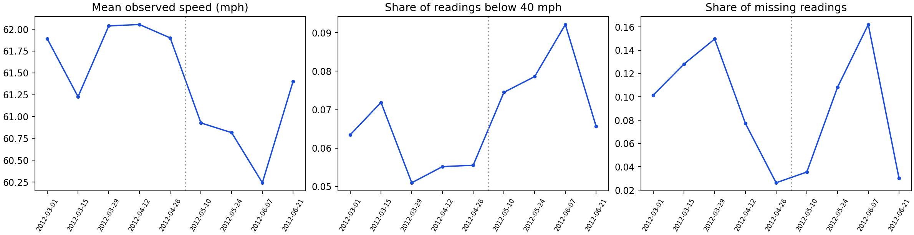
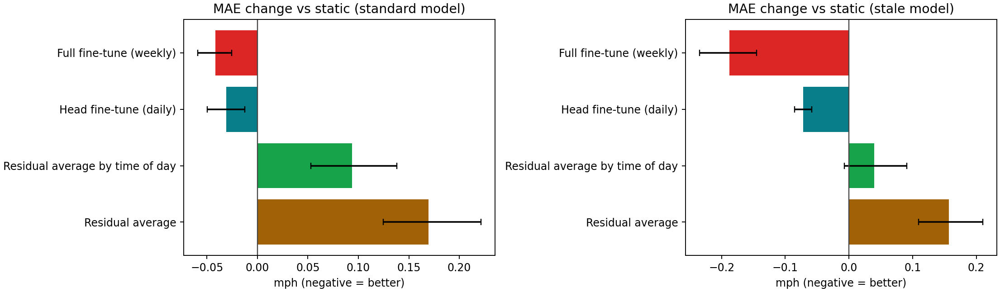
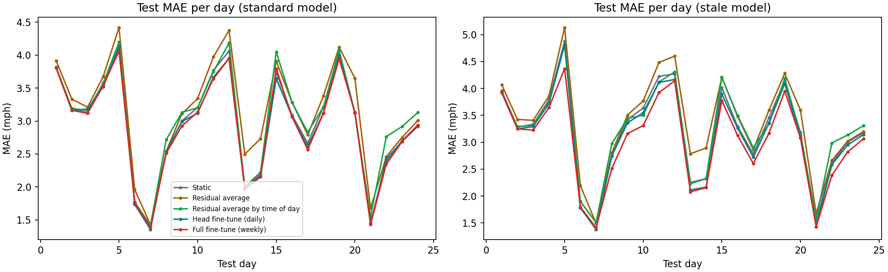

# Drift and adaptation

A forecaster is trained once on the past and then used for a long time. Traffic changes, so I wanted to know three things: does the model get worse as time moves away from its training data, does adapting it help, and is it worth the compute.

## What changes in the data

Statistics of the 16 sensors in blocks of 14 days. The last column is how far the block's speed distribution is from the training period's (Jensen-Shannon divergence in bits, 0 means identical).

| Block starting | Mean speed (mph) | Readings below 40 mph | Missing readings | Distance from training |
|---|---:|---:|---:|---:|
| 2012-03-01 (train) | 61.9 | 6.3% | 10.2% | 0.0009 |
| 2012-03-15 (train) | 61.2 | 7.2% | 12.8% | 0.0005 |
| 2012-03-29 (train) | 62.0 | 5.1% | 15.0% | 0.0012 |
| 2012-04-12 (train) | 62.1 | 5.5% | 7.7% | 0.0002 |
| 2012-04-26 (train) | 61.9 | 5.6% | 2.6% | 0.0003 |
| 2012-05-10 | 60.9 | 7.4% | 3.6% | 0.0011 |
| 2012-05-24 | 60.8 | 7.9% | 10.8% | 0.0017 |
| 2012-06-07 | 60.2 | 9.2% | 16.2% | 0.0031 |
| 2012-06-21 | 61.4 | 6.6% | 3.0% | 0.0002 |

In the training blocks 9.7% of the readings are missing, after them 9.2%. The share of readings below 40 mph goes from 5.9% to 7.9%, and the mean speed from 61.8 to 60.8 mph. These are small shifts, so any adaptation gain here will be small too.



## Setup

The test period is replayed one day at a time, the way a deployed model would run. At the start of each day a strategy may use only data that has already been observed: a window counts as known once its last target is in the past, and a test corrupts the not-yet-arrived targets to check that nothing leaks. The strategies:

- **Static model**: trained once, never touched.
- **Residual average**: add a running average of the model's recent errors (per horizon and sensor) to its forecast. No training, almost free.
- **Residual average by time of day**: the same, but one average for every time of day (weekday and weekend separately), because errors depend on the hour.
- **Output layer fine-tuned daily**: every morning, fine-tune only the last layer on the most recent 14 days of known windows.
- **Whole network fine-tuned weekly**: every 7 days, fine-tune all the weights on everything known so far.

The model is the dense GRU with calendar inputs on 16 sensors, 3 seeds. I used two settings: the standard one (trained on the first 70%, like everywhere else) and a stale one (trained on only the first 40%, so there are 42 days it has never seen before the test period starts, which the adaptive strategies can use once they are known). The learning rate for the output layer and the averaging rate of the cheap strategies are chosen by replaying the validation part, never the test part. Costs are wall-clock seconds on the laptop.

## Results

Test MAE in mph (SD over seeds), the change against the static model with a 95% interval from resampling test days (negative is better), the 60-minute MAE, and the adaptation cost over the whole test period.

**Standard setting: the model is trained on the first 70% of the timeline, as everywhere else.**

| Strategy | MAE | Change vs static | MAE at 60 min | Adaptation seconds | Updates |
|---|---:|---:|---:|---:|---:|
| Static model | 3.006 (0.032) |  | 3.387 | 0 |  |
| Residual average | 3.176 (0.041) | +0.169 (+0.125 to +0.221) | 3.664 | 0.7 | 6832 |
| Residual average by time of day | 3.100 (0.030) | +0.094 (+0.053 to +0.138) | 3.512 | 0.5 | 6832 |
| Output layer fine-tuned daily | 2.976 (0.034) | -0.031 (-0.049 to -0.012) | 3.357 | 3.3 | 24 |
| Whole network fine-tuned weekly | 2.965 (0.039) | -0.042 (-0.059 to -0.026) | 3.332 | 26.7 | 4 |

**Stale setting: the model is trained on only the first 40%, so a long stretch it has never seen sits between its training and the test period.**

| Strategy | MAE | Change vs static | MAE at 60 min | Adaptation seconds | Updates |
|---|---:|---:|---:|---:|---:|
| Static model | 3.250 (0.045) |  | 3.773 | 0 |  |
| Residual average | 3.407 (0.054) | +0.157 (+0.109 to +0.210) | 4.020 | 0.7 | 6832 |
| Residual average by time of day | 3.290 (0.034) | +0.040 (-0.007 to +0.091) | 3.768 | 0.5 | 6832 |
| Output layer fine-tuned daily | 3.179 (0.042) | -0.072 (-0.085 to -0.059) | 3.693 | 3.1 | 24 |
| Whole network fine-tuned weekly | 3.062 (0.012) | -0.188 (-0.235 to -0.145) | 3.453 | 25.8 | 4 |

- **Standard model:** the best strategy is whole network fine-tuned weekly, -0.042 mph against the static model (3.006), and the test-day interval excludes zero (-0.059 to -0.026).
- **Stale model:** the best strategy is whole network fine-tuned weekly, -0.188 mph against the static model (3.250), and the test-day interval excludes zero (-0.235 to -0.145).
- **A stale model is 0.244 mph worse than a fresh one**, and adapting wins back 29% (output layer fine-tuned daily), 77% (whole network fine-tuned weekly) of that gap.
- **Cost:** over the 24 test days, fine-tuning the output layer daily takes 3 s and fine-tuning the whole network weekly takes 27 s, about x8 more. The cheaper one keeps 74% of the weekly fine-tune's gain in the standard setting and 38% in the stale one.
- **Standard model over time:** the static model's MAE is 3.005 in the first week of the test period and 2.828 in the last (-0.177; both weeks hold each weekday once). So there is no sign of the error growing with time since training. Fine-tuning the output layer gains 0.049 mph on the third of days furthest from the training distribution and 0.009 on the third closest to it.
- **Stale model over time:** the static model's MAE is 3.232 in the first week of the test period and 3.015 in the last (-0.218; both weeks hold each weekday once). So there is no sign of the error growing with time since training. Fine-tuning the output layer gains 0.103 mph on the third of days furthest from the training distribution and 0.043 on the third closest to it.



The validation replay is the only thing that picked the settings, so I checked that it points the right way: for the three cheap strategies, in 17 of 18 seed and setting combinations the validation replay and the test period agreed on whether adapting beats the static model.



## Where does adapting help

Test MAE by kind of day, standard setting. "Shifted" ranks the test days by how far their speed distribution is from the training period's.

| Days | Static model | Residual average | Residual average by time of day | Output layer fine-tuned daily | Whole network fine-tuned weekly |
|---|---:|---:|---:|---:|---:|
| Least shifted third of days | 2.805 | 2.903 | 2.991 | 2.796 | 2.770 |
| Most shifted third of days | 2.676 | 2.891 | 2.696 | 2.627 | 2.625 |
| Weekdays | 3.267 | 3.405 | 3.378 | 3.236 | 3.219 |
| Weekends | 1.963 | 2.258 | 1.989 | 1.933 | 1.947 |

Same for the stale setting:

| Days | Static model | Residual average | Residual average by time of day | Output layer fine-tuned daily | Whole network fine-tuned weekly |
|---|---:|---:|---:|---:|---:|
| Least shifted third of days | 3.038 | 3.112 | 3.187 | 2.995 | 2.858 |
| Most shifted third of days | 2.962 | 3.179 | 2.933 | 2.859 | 2.750 |
| Weekdays | 3.544 | 3.672 | 3.594 | 3.483 | 3.338 |
| Weekends | 2.075 | 2.345 | 2.074 | 1.961 | 1.960 |

## Limits

- One network, one model and 24 test days. A difference of a few hundredths of a mph is about the size of the day-to-day variation, which is why the intervals matter more than the averages.
- The drift in these four months is mild (see the table at the top), so the standard setting has little to adapt to. The stale setting is a way to get a bigger gap, but it is a constructed one, not natural drift.
- The strategies and their settings are small choices from a short list. Other adaptation methods (replay buffers, learning-rate schedules, change detection) could do better, and the retraining baseline is fine-tuning from the current weights, not training from scratch.
- Adaptation costs are for this CPU. Retraining scales with the amount of data it uses, the cheap strategies don't.
- No change-point detection: every strategy updates on a fixed schedule whether or not anything changed.

## Reproduce

```powershell
.\.venv\Scripts\python.exe -m tracast.cli shift --config configs/shift.json --out runs/shift
```

Files: [summary.json](summary.json), [config.json](config.json), per-seed results in `standard-seed-*.json` and `stale-seed-*.json`.
