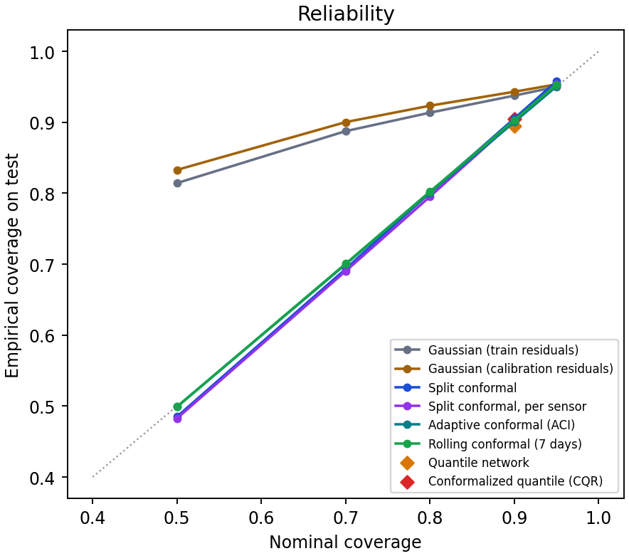
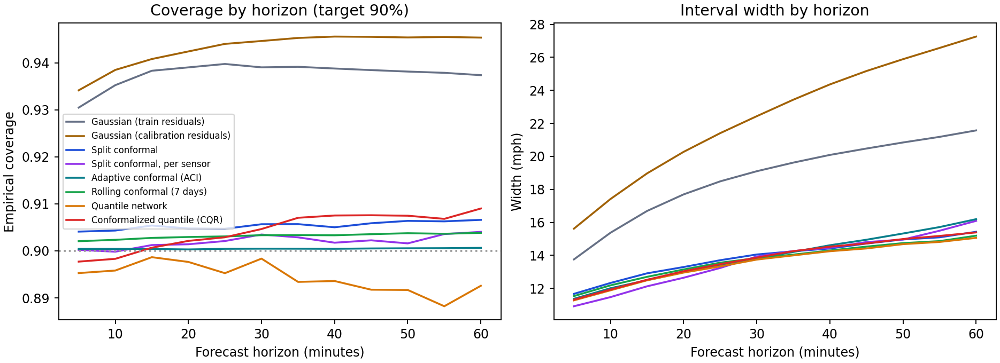
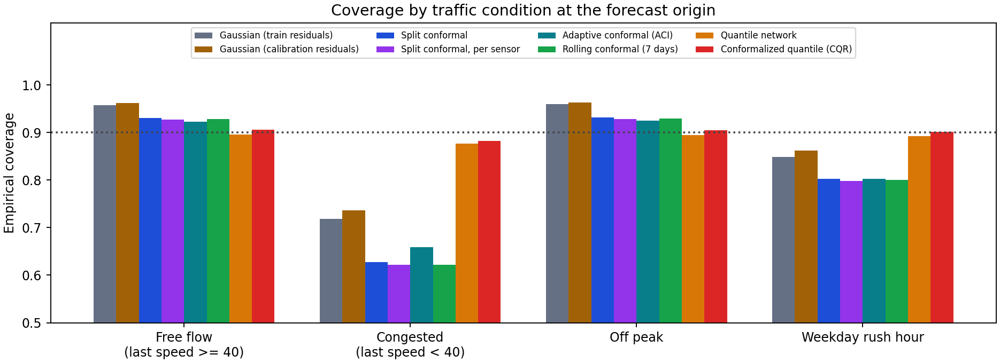
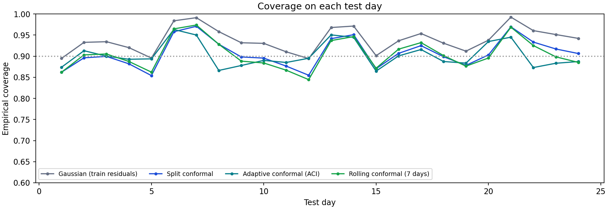

# Prediction intervals

A forecast of "47 mph" doesn't say how sure the model is. I wanted intervals that hold up: if I ask for 90% coverage, about 90% of the true speeds should land inside, and that should be true when traffic is bad too, not just on average.

## Setup

The rows are split in time. Training is the first 70% (2012-03-01 to 2012-05-23), validation is the next 5% (2012-05-23 to 2012-05-29) and picks the checkpoint, calibration is the 5% after that (2012-05-29 to 2012-06-04), and the last 20% (2012-06-04 to 2012-06-27, 24 days) is the test set. The calibration part is never used for training or for choosing a checkpoint, and a test checks that rewriting it doesn't change the trained model.

The point forecaster is the dense GRU with calendar inputs on the 16-sensor subset, trained with the same recipe as the other experiments (3 seeds). Its test MAE is 3.017 mph (SD 0.027). Every interval method is built from it:

- **Gaussian, training residuals**: the forecast plus or minus 1.645 standard deviations of the training residuals, per horizon and sensor. Training residuals are optimistic, so this is the naive baseline.
- **Gaussian, calibration residuals**: the same, with the standard deviation measured on the calibration part.
- **Split conformal**: the (1 - alpha) quantile of the absolute calibration residuals, one per horizon (pooled over sensors) or one per horizon and sensor.
- **Adaptive conformal (ACI)**: the same quantile, but the level is nudged after every window depending on whether the interval just missed (Gibbs and Candes, 2021). A forecast k steps ahead only learns its outcome k + 1 steps later, so the feedback is delayed accordingly.
- **Rolling conformal**: recalibrated every day from the most recent 7 days of residuals that have already arrived.
- **Quantile network**: a second network trained with the pinball loss to output the 5% and 95% quantiles, used as is, and **CQR**, the same band widened or narrowed by a conformal correction measured on the calibration part (Romano et al., 2019).

Coverage is the share of observed targets inside the interval, width is in mph, and the interval score (Gneiting and Raftery, 2007) is the width plus 20 times how far a target missed, so a narrow interval only scores well if it holds. I split the results by what is known when the forecast is made: the last observed speed below or above 40 mph, and weekday rush hours (7 to 10 and 16 to 19).

## Results

Nominal coverage 90%, averaged over the 3 seeds (the SD of the overall coverage is under 0.004 for every method). "Congested" and "free flow" use the last observed speed at the forecast origin.

| Method | Coverage | Width (mph) | Interval score | Free flow | Congested | Rush hour | Weakest sensor |
|---|---:|---:|---:|---:|---:|---:|---:|
| Gaussian, training residuals | 0.938 | 18.7 | 32.5 | 0.957 | 0.718 | 0.849 | 0.908 |
| Gaussian, calibration residuals | 0.943 | 22.4 | 34.7 | 0.962 | 0.737 | 0.862 | 0.898 |
| Split conformal | 0.905 | 13.9 | 32.0 | 0.930 | 0.627 | 0.803 | 0.705 |
| Split conformal, per sensor | 0.902 | 13.7 | 31.4 | 0.927 | 0.621 | 0.798 | 0.848 |
| Adaptive conformal (ACI) | 0.900 | 13.9 | 32.1 | 0.922 | 0.659 | 0.802 | 0.680 |
| Rolling conformal (7 days) | 0.903 | 13.7 | 32.0 | 0.929 | 0.622 | 0.800 | 0.699 |
| Quantile network | 0.894 | 13.6 | 19.7 | 0.896 | 0.877 | 0.892 | 0.859 |
| Conformalized quantile (CQR) | 0.904 | 13.8 | 19.7 | 0.906 | 0.882 | 0.901 | 0.873 |

- **Split conformal hits the coverage it was asked for, on average.** At a nominal 90% it covers 90.5% of the test speeds, while the Gaussian baselines overshoot it at 93.8% and 94.3% (see the reliability plot).
- **But on average hides congestion.** When the last speed was below 40 mph (8% of the targets) the same intervals cover only 63%, against 93% in free flow.
- **A quantile network plus a conformal correction fixes that** at the same average width (13.8 vs 13.9 mph): 88% in congestion, and an interval score of 19.7 against 32.0.



The Gaussian intervals look fine at 90% only because they are 35% wider than split conformal, and they stop being calibrated as soon as the level moves: at a nominal 50% they cover 81%. Residuals of traffic forecasts are far from Gaussian (most are small and a few are huge), so a standard deviation is the wrong summary. The conformal lines follow the diagonal at every level.



Split conformal is calibrated across horizons, with coverage between 0.904 and 0.907 for 5 to 60 minutes ahead, while the width grows from 11.7 to 15.4 mph.



## Why plain conformal fails in congestion

Split conformal guarantees coverage on average over windows that look alike. Here it uses one quantile for everything, but the errors are not alike: when traffic is already congested the next hour is much harder to predict, so the residuals are bigger. One quantile that is right on average is too small in congestion and too big in free flow, which is exactly what the table shows (63% against 93%). Doing it per sensor doesn't help in congestion (62%) because the problem is the traffic state, not the sensor, although it does lift the weakest sensor from 0.705 to 0.848. ACI and rolling recalibration react to drift in time, which isn't what is wrong here: at the preset step size they leave the congestion gap in place (66% and 62%); the step-size sweep further down shows what a bigger step does.

The quantile network learns the state-dependent width itself. In congestion its intervals are 43 mph wide on average against 11 in free flow, and the conformal correction then fixes the overall level. At the same average width, that moves congestion coverage from 63% to 88%.



Day by day, coverage for split conformal ranges from 0.854 to 0.971. The ACI and rolling versions have nearly the same range (0.865 to 0.963 and 0.844 to 0.974), so there is no strong drift in coverage over these 24 days for them to correct. CQR's range is 0.868 to 0.921.

## How much the ACI step size matters

ACI moves its level by gamma after every window. A step of 0 never moves it, which is plain split conformal, and the main table uses 0.005, a value I picked without tuning it. This sweep on the same test windows is a sensitivity check, not a way to choose the step. Averages over the seeds:

| gamma | Coverage | Width (mph) | Free flow | Congested | Interval score |
|---|---:|---:|---:|---:|---:|
| 0 | 0.905 | 13.9 | 0.930 | 0.627 | 32.0 |
| 0.001 | 0.903 | 13.6 | 0.928 | 0.626 | 32.0 |
| 0.005 | 0.900 | 13.9 | 0.922 | 0.659 | 32.1 |
| 0.02 | 0.900 | 16.2 | 0.908 | 0.813 | 31.5 |
| 0.05 | 0.900 | 19.6 | 0.903 | 0.876 | 32.7 |

Overall coverage stays between 0.900 and 0.905 and coverage in congestion between 0.626 and 0.876. A bigger step does raise congestion coverage, from 63% with no adaptation to 88% at gamma 0.05. But it does that by widening every interval, not only the ones in congestion: the average width goes from 13.9 to 19.6 mph, free-flow coverage drops from 93% to 90%, and the interval score only moves between 31.5 and 32.7. ACI follows runs of misses over time, but it keeps one level for all sensors at a horizon, so when a jam makes some sensors miss it widens the intervals of the free-flowing ones too. The quantile network with the conformal correction reaches 88% in congestion at 13.8 mph with a score of 19.7. The lowest interval score is at gamma 0.02 (31.5).

## Limits

- Conformal coverage is guaranteed when calibration and test windows are exchangeable. Here neighbouring windows overlap, the daily pattern repeats and the test period may drift, so coverage is measured, not guaranteed. The calibration part is only 6 days.
- One point model, 16 sensors that all sit on one highway corridor, one test period of 24 days.
- Intervals are per target. They don't say anything about errors being correlated across horizons or neighbouring sensors, so they are not joint prediction regions.
- "Congested" is defined from the last observed speed with a 40 mph threshold, which is a choice. Defining it from the realized speed gives the diagnostic number below, and every method undercovers there because selecting on the outcome always does: split conformal covers 53%, CQR 81%.
- The quantile network is trained for one level (90%). Other levels need another network, which is why CQR is missing from the reliability plot except at 90%.
- Missing readings are skipped everywhere, so coverage only describes observed targets.

## Reproduce

```powershell
.\.venv\Scripts\python.exe -m tracast.cli uncertainty --config configs/uncertainty.json --out runs/uncertainty
```

Files: [summary.json](summary.json), [config.json](config.json), per-seed results in `seed-7.json`, `seed-42.json` and `seed-2026.json`. Method code is in `src/tracast/conformal.py` and `src/tracast/uncertainty.py`; the tests build noise with a known answer and check that the online methods never read an outcome that hasn't arrived.
