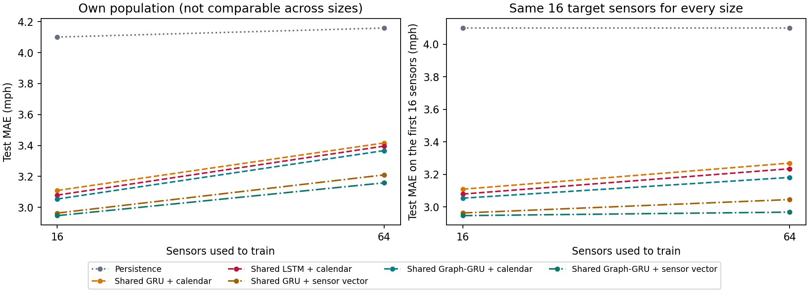

# Shared model variants

The shared models in the [scaling study](../scaling/report.md) use a GRU and give every sensor the same weights, so a sensor is only told apart from the others by its own speeds. This page tests two things I left out there, one at a time: swapping the GRU for an LSTM, and giving each sensor a learned vector of 4 numbers so the network can tell sensors apart. The vectors add 4 parameters per sensor, so those two models do grow with the network, just slowly.

The setup is the scaling study's: the same nested sensor sets (here 16 and 64), the same splits and masking, 30 epochs that each use a random third of the training windows, the best epoch on validation kept, seeds 7 and 42. The shared GRU and shared Graph-GRU are trained again as references, so every gap below is measured inside this run on identical windows.

## Results

Test MAE in mph on the same first 16 sensors, mean (SD over seeds):

| Model | 16 | 64 |
|---|---:|---:|
| Shared GRU (reference) | 3.109 (0.010) | 3.270 (0.011) |
| Shared LSTM | 3.079 (0.011) | 3.235 (0.002) |
| Shared GRU + sensor vector | 2.963 (0.024) | 3.045 (0.011) |
| Shared Graph-GRU (reference) | 3.054 (0.013) | 3.181 (0.019) |
| Shared Graph-GRU + sensor vector | 2.947 (0.012) | 2.968 (0.016) |

Parameters at 64 sensors: Shared GRU 4,044, Shared LSTM 5,260, Shared GRU + sensor vector 4,684, Shared Graph-GRU 4,236, Shared Graph-GRU + sensor vector 4,876.

Gaps in test MAE on all the sensors each model was trained on, on identical windows (first minus second, negative favors the first; 95% interval from resampling test days, seeds averaged first). These are the same paired gaps as in the scaling study, so they aren't the same numbers as the differences between the same-16 scores above:

| Size | LSTM - GRU | GRU + vector - GRU | Graph-GRU + vector - Graph-GRU | Graph-GRU + vector - GRU + vector |
|---|---:|---:|---:|---:|
| 16 | -0.030 (-0.038 to -0.021) | -0.146 (-0.196 to -0.098) | -0.107 (-0.153 to -0.065) | -0.016 (-0.050 to +0.015) |
| 64 | -0.020 (-0.025 to -0.016) | -0.206 (-0.250 to -0.161) | -0.208 (-0.253 to -0.160) | -0.051 (-0.066 to -0.037) |

- **LSTM - GRU:** at 16 sensors better by 0.030 mph (interval -0.038 to -0.021); at 64 sensors better by 0.020 mph (interval -0.025 to -0.016).
- **GRU + vector - GRU:** at 16 sensors better by 0.146 mph (interval -0.196 to -0.098); at 64 sensors better by 0.206 mph (interval -0.250 to -0.161).
- **Graph-GRU + vector - Graph-GRU:** at 16 sensors better by 0.107 mph (interval -0.153 to -0.065); at 64 sensors better by 0.208 mph (interval -0.253 to -0.160).
- **Graph-GRU + vector - GRU + vector:** at 16 sensors not clearly different (-0.016 mph, interval -0.050 to +0.015); at 64 sensors better by 0.051 mph (interval -0.066 to -0.037).
- **Against the dense GRU from the scaling study** (same windows and seeds, same-16 MAE in mph): the shared GRU with a sensor vector scores 2.963 against 3.094 at 16 sensors, 3.045 against 3.233 at 64 sensors, with 4,684 parameters instead of 35,040 at 64 sensors.
- **Check against the scaling study:** the two reference models were trained again here, and their same-16 scores match the scaling study's to the last digit (training is deterministic for a given seed).



The left panel scores each model on all the sensors it was trained on, the right one on the same first 16 sensors for every size. Persistence is the dotted grey line.

## Limits

- A sensor vector ties the model to the sensors it was trained on, so it can't forecast a new sensor until a vector is learned for it. The plain shared models don't have that limit, which gives up part of the point of sharing weights in exchange for accuracy. The [held-out sensor study](../holdout/report.md) tests fitting a vector on a new sensor's first week.
- Only 16 and 64 sensors, because every extra model is another full training run at each size. Whether the vectors help more (or overfit) at 207 sensors isn't tested here.
- Two seeds, the same equal-update budget as before, and a fixed 4-number vector. A larger vector or a longer run might change the picture.
- I didn't time these models; the cost comparison in the scaling study covers the GRU versions only.

## Reproduce

```powershell
.\.venv\Scripts\python.exe -m tracast.cli scaling --config configs/variants.json --out runs/variants
```

Files: [variants-summary.json](variants-summary.json), [variants-config.json](variants-config.json).
